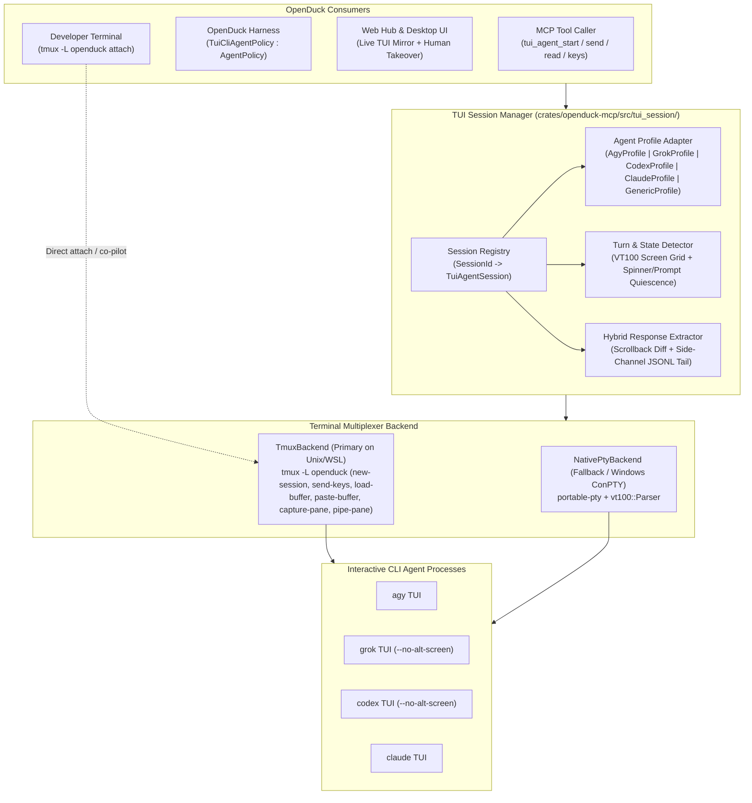
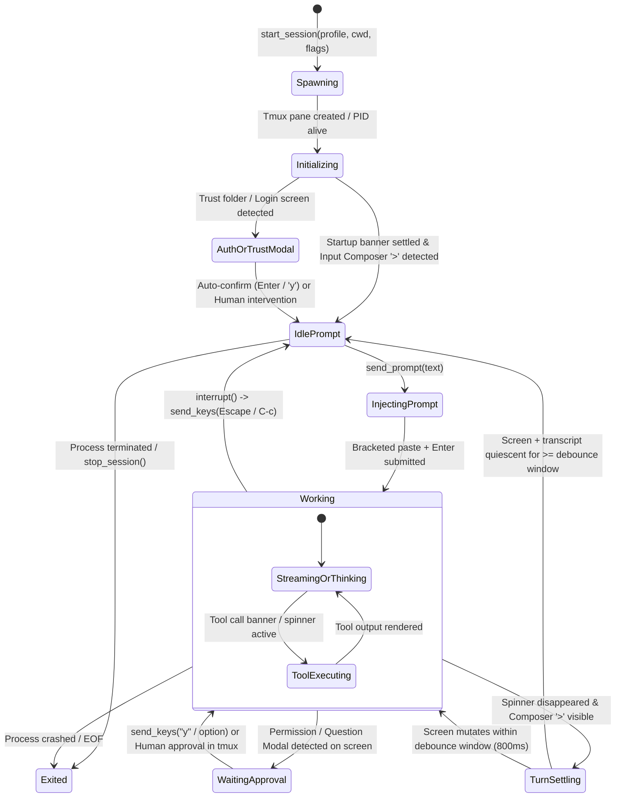
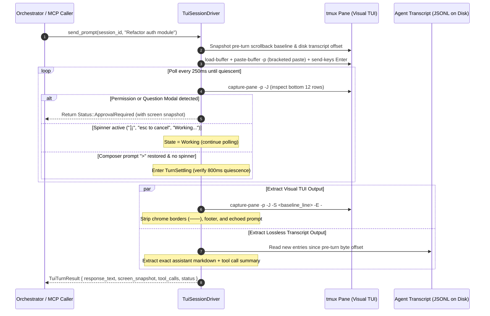

# Interactive Agent CLI TUI & Tmux Session Driver Architecture Plan

## 1. Executive Summary & Feasibility Verdict

### Is It Possible?
**Yes — it is 100% possible and practically achievable in OpenDuck.**

Today, OpenDuck integrates with external agent CLIs via two non-interactive mechanisms:
1. **One-Shot Headless Subprocesses**: `crates/openduck-mcp/src/agy/mod.rs` (`agy -p`), `crates/openduck-mcp/src/grok/mod.rs` (`grok -p`), and `crates/openduck/src/providers/codex.rs` (`codex exec -`). Each turn spawns a fresh OS process, waits for EOF, and parses JSON/JSONL stdout.
2. **Stdio ACP Adapters**: `crates/openduck/src/providers/grok_acp.rs` (`grok agent stdio`), `codex_acp.rs` (`codex-acp`), and `claude_acp.rs`.

While headless `-p` and ACP modes work well for stateless or protocol-driven turns, driving an agent CLI **inside a persistent `tmux` (or PTY) TUI session** unlocks four critical capabilities that headless modes cannot provide:
- **Live Human-in-the-Loop Attachability**: A developer can run `tmux attach -t openduck-agents` (or view the live TUI pane in the OpenDuck Web Hub) to watch `agy`, `grok`, or `codex` work in real time, manually approve interactive permission modals, or type follow-up hints directly into the same TUI.
- **Zero Cold-Start Overhead Across Turns**: The CLI process stays warm in memory across turns—preserving initialized MCP servers, LSP connections, auth tokens, and in-memory codebase indexes.
- **Interactive TUI-Only Features & Slash Commands**: Programmatic access to TUI-specific commands (`/plan`, `/compact`, `/model`, `/effort`, `/clear`, `/voice`, `/status`) and interactive multi-choice prompts (`ask_question` / confirmation dialogs).
- **Universal Agent Compatibility**: Any TUI-based coding agent (`agy`, `grok`, `codex`, `claude`, `kimi`, `cursor-agent`) can be orchestrated even if it lacks an ACP server or headless JSON mode.

### Why Pure TUI Screen-Scraping Alone Is Hard (And How We Solve It)
Modern agent TUIs (built with Ratatui, Ink, or BubbleTea) render into an **alternate screen buffer** (`smcup`/`rmcup`), animate Braille spinners (`⠋⠙⠹⠸⠼⠴⠦⠧⠇⠏` or `⣷`), wrap lines at terminal column width (`cols`), and clip long responses inside an internal viewport.

To make TUI driving **100% deterministic and lossless**, this plan introduces a **Dual-Channel Hybrid TUI Architecture**:
1. **Control & Visual Channel (`tmux` / PTY Driver + VT100 Parser)**: Spawns and manages the CLI inside an isolated `tmux` window/pane (`tmux -L openduck`), injects bracketed-paste text and keystrokes (`send-keys`), reads the live rendered screen (`capture-pane -p -e -J`), detects TUI state (`IdlePrompt`, `Working`, `WaitingApproval`, `ModalOpen`, `Exited`), and streams live terminal frames to the Web Hub.
2. **Side-Channel Transcript Correlator (Lossless Response Reader)**: While the TUI visually indicates turn completion (spinner stops and prompt `>` returns), the driver optionally correlates and tails the CLI's live local session transcript on disk (`~/.gemini/antigravity-cli/brain/<id>/.system_generated/logs/transcript.jsonl` for `agy`, `~/.grok/sessions/.../chat_history.jsonl` for `grok`, `~/.codex/sessions/...` for `codex`) alongside the scrollback buffer (`--no-alt-screen` / `capture-pane -S -`), guaranteeing **zero truncation** even on 5,000-line responses.

---

## 2. Empirical Analysis of Target Agent CLIs

An empirical inspection of the installed agent CLIs (`agy`, `grok`, `codex`, `claude`) on the target Linux environment (`tmux 3.4`) reveals the following TUI characteristics and capabilities:

| Agent CLI | Interactive TUI Launch Command | Scrollback / Alt-Screen Flags | Live TUI State Indicators (Observed via `tmux capture-pane`) | Side-Channel Disk Transcript (Lossless Output Source) |
| :--- | :--- | :--- | :--- | :--- |
| **`agy`** (Antigravity CLI) | `agy [--dangerously-skip-permissions] [--model <m>] [--effort <e>] [--conversation <id> \| -c]` | Uses inline + bottom composer bar; supports `--log-file <path>` | **Busy**: `⣷  Running ...` / `esc to cancel` in footer<br>**Idle**: Composer box `─── \n > \n ───` with no `esc to cancel` | `~/.gemini/antigravity-cli/cache/conversation_metadata.json` + `~/.gemini/antigravity-cli/brain/<id>/.system_generated/logs/transcript.jsonl` |
| **`grok`** (Grok Build CLI) | `grok [--always-approve] [-m <model>] [--reasoning-effort <e>] [-r <id> \| -c] [--no-alt-screen \| --minimal]` | **`--no-alt-screen`** and **`--minimal`** print finalized blocks directly into native terminal scrollback | **Busy**: Active spinner / streaming status bar<br>**Idle**: Composer prompt ready; `signals.json` / `updates.jsonl` turn complete | `~/.grok/active_sessions.json` (maps `pid` + `cwd` $\to$ `session_id`) + `~/.grok/sessions/<encoded_cwd>/<session_id>/chat_history.jsonl` & `events.jsonl` |
| **`codex`** (OpenAI Codex CLI) | `codex [--dangerously-bypass-approvals-and-sandbox \| --full-auto] [-m <model>] [-C <dir>] [--no-alt-screen]` | **`--no-alt-screen`** disables alternate screen mode and preserves native tmux scrollback | **Busy**: Working indicator / tool execution banner<br>**Approval**: Interactive `[y/n]` / approval modal<br>**Idle**: Input composer ready | `~/.codex/session_index.jsonl`, `~/.codex/history.jsonl`, and `~/.codex/sessions/**/*.jsonl` |
| **`claude`** (Claude Code CLI) | `claude [--dangerously-skip-permissions] [--ax-screen-reader] [--resume <id> \| -c]` | **`--ax-screen-reader`** renders flat screen-reader-friendly text without decorative borders or animations | **Busy**: Spinner + token counter + `esc to interrupt`<br>**Idle**: `>` prompt ready | `~/.claude/projects/<encoded_cwd>/<session_id>.jsonl` |

### Observed Live `agy` TUI Layout in `tmux`
Capturing a live `agy` pane (`tmux capture-pane -t 1:0.0 -p`) demonstrates the deterministic structural anchors at the bottom of the pane:
```text
⣷  Running command...
└ Tip: Use /voice (or press f5) to record your prompt with your microphone.
────────────────────────────────────────────────────────────────────────────────
>
────────────────────────────────────────────────────────────────────────────────
esc to cancel                                          Gemini 4 Argon · medium
```
When `agy` finishes a turn:
1. The `⣷  ...` status line and `esc to cancel` footer indicator disappear.
2. The cursor rests inside the `>` composer box between the horizontal rule lines (`─`).
3. Simultaneously, the completed `PLANNER_RESPONSE` step is flushed to `~/.gemini/antigravity-cli/brain/<conversation_id>/.system_generated/logs/transcript.jsonl`.

---

## 3. System Architecture



### 3.1 Two-Tier Multiplexer Backend (`TmuxBackend` + `NativePtyBackend`)

1. **`TmuxBackend` (Primary on Linux / macOS / WSL2)**:
   - Uses a dedicated tmux server socket (`tmux -L openduck` or configurable socket name) so OpenDuck's agent sessions never pollute or collide with the user's personal tmux configuration unless requested, while allowing instant attach via `tmux -L openduck attach -t <session_id>`.
   - Sets deterministic window dimensions (`-x 160 -y 48`) and UTF-8 / 256-color environment (`TERM=xterm-256color`), with a large history limit (`set-option -t <pane> history-limit 50000`).
   - Survives OpenDuck daemon restarts: if `openduck` restarts, `TmuxBackend` re-discovers running panes via `tmux -L openduck list-panes -a`.
2. **`NativePtyBackend` (Fallback when `tmux` is absent or on Windows ConPTY)**:
   - Spawns the process inside an in-memory pseudo-terminal (`portable-pty`) and feeds the raw byte stream into an in-memory `vt100::Parser` (160×48 grid with 50,000 lines of scrollback).

---

## 4. TUI Turn Lifecycle & State Machine

Driving an interactive TUI reliably requires knowing **when the TUI is ready for input**, **when it is actively generating or running tools**, **when it is blocked on a confirmation prompt**, and **when the turn has finished**.



### 4.1 Reliable Prompt Injection Protocol (Solving Multi-Line & Paste Issues)
Typing a multi-line prompt into a TUI using naive `send-keys "line 1\nline 2"` fails because every `\n` is interpreted by the TUI composer as `Enter` (submitting prematurely on line 1), and special characters (`"`, `$`, `;`, `[`) can be mangled.

Our injection protocol solves this cleanly in 3 steps:
1. **Pre-Flight Clear**: Verify pane state is `IdlePrompt` (or send `Escape` / `C-u` if stale input exists in the composer box).
2. **Bracketed Paste Buffer Injection**:
   - Write the prompt bytes to a temporary buffer via `tmux -L openduck load-buffer -b <buf_id> -` (piped over stdin, completely avoiding shell-escaping limits and OS `ARG_MAX` limits).
   - Paste atomically into the target pane using **bracketed paste mode** (`\x1b[200~...\x1b[201~`):
     ```bash
     tmux -L openduck paste-buffer -p -d -b <buf_id> -t <pane_target>
     ```
     The `-p` flag instructs `tmux` to wrap the pasted text in bracketed paste control sequences (`CSI 200 ~` ... `CSI 201 ~`). All modern TUI frameworks (Ink, Ratatui, BubbleTea, Textual) treat bracketed paste as a single multi-line text insertion inside the input textarea rather than submitting on newlines!
3. **Commit Submission**:
   - Wait 50–100ms for the TUI event loop to process the bracketed paste buffer.
   - Send `tmux -L openduck send-keys -t <pane_target> Enter`.
   - Verify transition from `IdlePrompt` $\to$ `Working` (or immediate completion for fast slash commands).

---

## 5. Dual-Channel Response Reading Pipeline

Reading the response back from an agent's TUI uses a two-layer pipeline that combines **Visual TUI Capture** with **Side-Channel Transcript Correlation**:



### 5.1 Layer 1: Pure TUI Screen & Scrollback Extraction (Works for Any CLI)
Even without disk transcript correlation, the TUI driver extracts clean responses directly from `tmux`:
1. **Launch with Scrollback Preservation**:
   - Pass `--no-alt-screen` to `grok` and `codex` (and `--ax-screen-reader` optionally to `claude`), so completed response blocks scroll naturally into `tmux`'s 50,000-line history buffer instead of vanishing inside an internal alternate-screen scroll viewport.
2. **Pre-Turn Baseline Marker**:
   - Before submitting a prompt, record the current pane `history_size` (`tmux display-message -p -t <pane> '#{history_size}'`) and snapshot the visible screen lines.
3. **Post-Turn Capture & Chrome Stripping**:
   - Run `tmux capture-pane -t <pane> -p -J -S -<delta>` (`-J` joins wrapped lines and trims trailing spaces).
   - Apply the agent profile's **Chrome Filter** (`AgentTuiProfile::strip_chrome`) to strip:
     - Top/bottom composer rule lines (`────────...`),
     - The echoed user prompt (`> <prompt>`),
     - Footer status bars (`esc to cancel`, model badge, tips `└ Tip: ...`),
     - Transient spinner frames (`⠋⠙⠹⠸⠼⠴⠦⠧⠇⠏⣷`).

### 5.2 Layer 2: Side-Channel Transcript Correlation (Zero-Loss Precision)
For first-class profiles (`agy`, `grok`, `codex`, `claude`), the TUI session driver pairs the `tmux` pane with the agent's local session store:
- **`AgyTuiProfile`**:
  - Matches the `cwd` or explicit `--conversation <id>` against `~/.gemini/antigravity-cli/cache/conversation_metadata.json`.
  - Tails `~/.gemini/antigravity-cli/brain/<conversation_id>/.system_generated/logs/transcript.jsonl` for new `PLANNER_RESPONSE` steps since the turn started.
- **`GrokTuiProfile`**:
  - Matches the child process PID / `cwd` in `~/.grok/active_sessions.json` to discover the live `session_id`.
  - Reads new entries from `~/.grok/sessions/<encoded_cwd>/<session_id>/chat_history.jsonl` and `summary.json`.
- **`CodexTuiProfile`**:
  - Reads the latest rollout JSONL file in `~/.codex/sessions/` matching the session start timestamp / `cwd`.
- **Result Merging**:
  - Returns `response_text` from the lossless transcript when available, falling back to the chrome-stripped `capture-pane` output (e.g., for TUI-only slash commands like `/status` or `/models` that only render to the screen and do not write to the conversation transcript), while **always** attaching the latest `screen_snapshot` so the caller can see exactly what is on the TUI screen.

---

## 6. Detailed Rust Module & API Design

### 6.1 Crate Placement
We will implement the core TUI session engine inside `crates/openduck-mcp/src/tui_session/` (and expose it both as a built-in MCP extension `tui_agent` and as a library module consumable by `crates/openduck` control plane and harness):

```text
crates/openduck-mcp/src/
├── tui_session/
│   ├── mod.rs              # TuiAgentServer (MCP ServerHandler + ToolRouter)
│   ├── backend.rs          # MultiplexerBackend trait, TmuxBackend, NativePtyBackend
│   ├── session.rs          # TuiSessionManager, TuiSessionHandle, TurnWaitLoop
│   ├── screen.rs           # ScreenSnapshot, ANSI/Chrome stripper, QuiescenceDetector
│   ├── profiles/
│   │   ├── mod.rs          # AgentTuiProfile trait & profile registry
│   │   ├── agy.rs          # AgyTuiProfile (TUI anchors + transcript.jsonl reader)
│   │   ├── grok.rs         # GrokTuiProfile (--no-alt-screen + chat_history.jsonl reader)
│   │   ├── codex.rs        # CodexTuiProfile (--no-alt-screen + session JSONL reader)
│   │   ├── claude.rs       # ClaudeTuiProfile (--ax-screen-reader + project JSONL reader)
│   │   └── generic.rs      # GenericTuiProfile (configurable regex/prompt anchors)
```

### 6.2 Core Rust Traits & Data Structures

```rust
use std::path::{Path, PathBuf};
use std::time::Duration;
use anyhow::Result;
use async_trait::async_trait;
use serde::{Deserialize, Serialize};

#[derive(Debug, Clone, Copy, PartialEq, Eq, Serialize, Deserialize)]
#[serde(rename_all = "snake_case")]
pub enum AgentCliKind {
    Agy,
    Grok,
    Codex,
    Claude,
    Custom,
}

#[derive(Debug, Clone, PartialEq, Eq, Serialize, Deserialize)]
#[serde(rename_all = "snake_case")]
pub enum TuiPaneState {
    Initializing,
    IdlePrompt,
    Working { status_line: Option<String> },
    WaitingApproval { prompt_snippet: String },
    Exited { exit_code: Option<i32> },
}

#[derive(Debug, Clone, Serialize, Deserialize)]
#[serde(rename_all = "camelCase")]
pub struct TuiSessionConfig {
    pub session_id: String,
    pub kind: AgentCliKind,
    pub cwd: PathBuf,
    pub model: Option<String>,
    pub effort: Option<String>,
    pub auto_approve: bool,
    pub resume_id: Option<String>,
    pub cols: u16,
    pub rows: u16,
    pub extra_args: Vec<String>,
    pub env: Vec<(String, String)>,
}

#[derive(Debug, Clone, Serialize, Deserialize)]
#[serde(rename_all = "camelCase")]
pub struct TuiTurnResult {
    pub session_id: String,
    pub state: TuiPaneState,
    /// Clean assistant response (from lossless side-channel transcript if available,
    /// otherwise chrome-stripped TUI scrollback diff).
    pub response: String,
    /// Raw visible TUI screen at the end of the turn (e.g. 160x48 snapshot).
    pub screen_snapshot: String,
    /// Source of `response`: "transcript+tui" or "tui_scrollback"
    pub extraction_source: String,
    pub duration_ms: u64,
    /// Command a human can run to attach live to this session
    pub attach_command: String,
}

#[async_trait]
pub trait MultiplexerBackend: Send + Sync {
    async fn spawn_pane(&self, id: &str, cmd: &[String], cwd: &Path, cols: u16, rows: u16) -> Result<u32>;
    async fn paste_text(&self, id: &str, text: &str, bracketed: bool) -> Result<()>;
    async fn send_keys(&self, id: &str, keys: &[String]) -> Result<()>;
    async fn capture_screen(&self, id: &str, include_ansi: bool, scrollback_lines: Option<i32>) -> Result<String>;
    async fn history_size(&self, id: &str) -> Result<usize>;
    async fn is_alive(&self, id: &str) -> Result<bool>;
    async fn resize(&self, id: &str, cols: u16, rows: u16) -> Result<()>;
    async fn kill_pane(&self, id: &str) -> Result<()>;
    fn attach_command(&self, id: &str) -> String;
}

pub trait AgentTuiProfile: Send + Sync {
    fn kind(&self) -> AgentCliKind;
    fn build_launch_command(&self, config: &TuiSessionConfig) -> Result<Vec<String>>;
    fn classify_screen(&self, screen_text: &str) -> TuiPaneState;
    fn strip_chrome(&self, captured_scrollback: &str, submitted_prompt: &str) -> String;
    fn read_transcript_delta(&self, cwd: &Path, pid: u32, since_offset: &mut u64) -> Option<String>;
}
```

### 6.3 MCP Tool Interface (`tui_agent` Built-in Extension)

Registering `TuiAgentServer` in `crates/openduck-mcp/src/lib.rs` (`BUILTIN_EXTENSIONS`) exposes 6 ergonomic MCP tools to any OpenDuck agent, orchestrator, or recipe:

| MCP Tool Name | Parameters | Description |
| :--- | :--- | :--- |
| **`tui_agent_start`** | `agent` (`agy`\|`grok`\|`codex`\|`claude`\|`custom`), `cwd`, `model`, `effort`, `auto_approve` (default `true`), `resume_id`, `initial_prompt` | Spawns the agent CLI inside a persistent `tmux` session (`tmux -L openduck`), waits until the TUI reaches `IdlePrompt` (or submits `initial_prompt`), and returns `session_id`, `attach_command`, and initial screen. |
| **`tui_agent_prompt`** | `session_id`, `prompt`, `wait` (default `true`), `timeout_secs` (default `600`) | Pastes `prompt` into the TUI composer via bracketed paste, presses `Enter`, and (if `wait=true`) polls until turn completion or modal prompt, returning the extracted response + TUI screen snapshot. |
| **`tui_agent_read`** | `session_id`, `scrollback_lines` (default `120`), `include_ansi` (default `false`) | Reads the current TUI screen, current `TuiPaneState` (`idle_prompt`, `working`, `waiting_approval`), and any new transcript output without sending input. |
| **`tui_agent_keys`** | `session_id`, `keys` (e.g. `["Escape"]`, `["Down", "Enter"]`, `["y", "Enter"]`, `["/compact", "Enter"]`) | Sends raw keystrokes, navigation keys, or slash commands directly to the TUI to answer interactive questions, approve modals, or interrupt a turn (`Escape` / `C-c`). |
| **`tui_agent_list`** | `include_screen_preview` (default `false`) | Lists all active `tmux` agent TUI sessions, their PIDs, working directories, agent type, current `TuiPaneState`, and `tmux attach` commands. |
| **`tui_agent_stop`** | `session_id` | Gracefully exits the TUI (`/exit` or `C-c` / `C-d`) and destroys the `tmux` pane. |

---

## 7. Control Plane, Harness & Web Hub Integration

### 7.1 Control Plane HTTP & SSE Endpoints (`crates/openduck/src/control/`)
Extend `crates/openduck/src/control/terminal.rs` and `http.rs` with persistent TUI session routes under each project:
- `POST /api/v1/projects/{slug}/tui-sessions` — Start an interactive `agy`, `grok`, `codex`, or `claude` TUI session rooted in the project workspace.
- `GET /api/v1/projects/{slug}/tui-sessions` — List active TUI sessions for the project.
- `POST /api/v1/projects/{slug}/tui-sessions/{id}/prompt` — Submit a prompt to the TUI session.
- `POST /api/v1/projects/{slug}/tui-sessions/{id}/keys` — Send raw keys (`Enter`, `Escape`, `Up`, `Down`, `C-c`, etc.).
- `GET /api/v1/projects/{slug}/tui-sessions/{id}/stream` — SSE stream emitting real-time screen diffs (`capture-pane -p -e`) and `TuiPaneState` transitions every 200ms when the screen changes.
- `DELETE /api/v1/projects/{slug}/tui-sessions/{id}` — Terminate session.

### 7.2 Web Hub Live TUI Console (`ui/hub/src/components/ProjectTerminal.tsx`)
Upgrade the existing `ProjectTerminal.tsx` tab in the Web Hub to support two modes:
1. **Command Runner Mode** (existing one-shot shell execution).
2. **Interactive Agent TUI Sessions Mode**:
   - One-click launch buttons for **Start `agy` TUI**, **Start `grok` TUI**, **Start `codex` TUI**, or **Start `claude` TUI**.
   - Live ANSI-rendered terminal viewport streaming the `tmux` pane, with a **Prompt Input Bar**, quick-key buttons (`Esc`, `Enter`, `↑`, `↓`, `Tab`, `Ctrl+C`, `/compact`, `/status`), and a copyable `tmux -L openduck attach -t ...` badge for local terminal attach.

### 7.3 Harness Policy Adapter (`TuiCliAgentPolicy`)
In `crates/openduck/src/control/harness.rs`, implement `TuiCliAgentPolicy` implementing `openduck_harness::policy::AgentPolicy`:
- Allows Project Harness tasks (and multi-subtask pipelines) to execute using a persistent `agy`, `grok`, or `codex` TUI session as the underlying execution engine, while recording every turn's prompt, TUI screen snapshot, and extracted response into the standard OpenDuck `TrajectoryRecord`.

---

## 8. Edge Cases, Risks & Mitigations

| Edge Case / Risk | Root Cause | Concrete Mitigation in Design |
| :--- | :--- | :--- |
| **Multi-line prompt submits early on first newline** | TUI input boxes treat raw `\n` as `Enter` (submit). | Always inject prompts via `tmux load-buffer` + `tmux paste-buffer -p` (bracketed paste mode `\x1b[200~...\x1b[201~`), then send `Enter` separately after 80ms. |
| **Long responses clipped by alternate screen** | Fullscreen TUIs keep their own internal scroll buffer and only render `rows` lines to the terminal grid. | 1) Pass `--no-alt-screen` (`grok`, `codex`) or `--ax-screen-reader` (`claude`).<br>2) Pair visual `capture-pane` with the **Side-Channel Transcript Correlator** (`transcript.jsonl` / `chat_history.jsonl`). |
| **False-positive "Turn Complete" while agent is between tool calls** | Spinner briefly disappears for 50–100ms while transitioning between tool execution and next LLM request. | Require a configurable **Quiescence Debounce Window** (default `800ms` of unchanged screen with `>` prompt visible and no active spinner/footer `esc to cancel`, corroborated by transcript step status). |
| **Interactive Trust / Permission Modal blocks automation** | First run in a new folder asks `"Do you trust the files in this folder?"` or tool confirmation. | 1) Default `auto_approve=true` passes `--dangerously-skip-permissions` (`agy`/`claude`), `--always-approve` (`grok`), `--dangerously-bypass-approvals-and-sandbox` (`codex`).<br>2) `classify_screen` detects trust/approval modals and surfaces `TuiPaneState::WaitingApproval` so the caller (or auto-responder) can send `y` / `Enter`. |
| **Orphaned `tmux` sessions on crash** | Parent process killed before stopping child TUI sessions. | Tag each tmux session with metadata environment variables (`OPENDUCK_OWNER_PID`, `OPENDUCK_SESSION_ID`, `OPENDUCK_CREATED_AT`) and run a configurable idle reaper + orphan cleanup on daemon startup. |
| **Unbounded Memory Bloat from Stale Sessions** | Persistent CLI sessions consume 150MB–800MB RAM each. Stale or exited processes accumulate in memory if not reclaimed. | Automated dual-tier reclamation policy in `TuiSessionManager::reclaim_stale_sessions`:<br>1) **Exited Retention Grace Period** (`exited_retention_mins`, default 10m): Retains exited sessions so callers can inspect the final screen and exit code before pruning.<br>2) **Idle Inactivity Timeout** (`idle_timeout_mins`, e.g. 30–60m): Terminates quiescent sessions in `IdlePrompt`.<br>Runs automatically on `list_sessions` and `start_session`. |

### 8.1 Session Lifecycle & Reclamation Timing Strategy

The optimal timing to reclaim TUI sessions depends on the lifecycle phase:

| Scenario / State | Best Reclamation Timing | Rationale & Mechanism |
| :--- | :--- | :--- |
| **Exited / Crashed (`pane_dead`)** | **Lazy sweep after 5–10 min grace period** (default `exited_retention_mins: 10`, or `0` for immediate) | Avoids premature eviction so Web Hub and caller agents can fetch the final screen snapshot and exit status before removal. |
| **Interactive Developer Sessions (`IdlePrompt`)** | **30 to 60 minutes of inactivity** (`idle_timeout_mins: 30..60`) | Preserves warm cache, branch state, and conversation context during thought/review pauses without leaking memory indefinitely. |
| **Automated Harness / Benchmark Runs** | **Immediately on task / test teardown** | Prevents resource exhaustion and port collisions during batch test and eval runs. |
| **Explicit Stop / Dismissal** | **Immediately upon `tui_agent_stop` or DELETE API call** | Gracefully sends `Escape` + `C-c`, pauses 150ms, then terminates the tmux pane and unregisters the handle. |

---

## 9. Phased Implementation Roadmap

### Phase 1: Core `TmuxBackend` & Screen State Engine (`crates/openduck-mcp/src/tui_session/`)
- [ ] Implement `MultiplexerBackend` and `TmuxBackend` wrapping `tmux -L openduck` (`new-session`, `load-buffer`, `paste-buffer -p`, `send-keys`, `capture-pane -p -J`, `kill-session`).
- [ ] Implement `ScreenSnapshot`, ANSI escape stripping, and the `QuiescenceDetector` debounce loop.
- [ ] Implement `AgentTuiProfile` for `agy`, `grok`, `codex`, `claude`, and `generic`.

### Phase 2: Hybrid Side-Channel Transcript Correlators
- [ ] Connect `AgyTuiProfile` to `~/.gemini/antigravity-cli/brain/<id>/.system_generated/logs/transcript.jsonl`.
- [ ] Connect `GrokTuiProfile` to `~/.grok/active_sessions.json` and `~/.grok/sessions/.../chat_history.jsonl`.
- [ ] Connect `CodexTuiProfile` to `~/.codex/sessions/`.

### Phase 3: Built-in MCP Extension (`tui_agent`)
- [ ] Implement `TuiAgentServer` with `tui_agent_start`, `tui_agent_prompt`, `tui_agent_read`, `tui_agent_keys`, `tui_agent_list`, and `tui_agent_stop`.
- [ ] Register `tui_agent` in `crates/openduck-mcp/src/lib.rs` (`BUILTIN_EXTENSIONS`) and `mcp_server_runner.rs`.

### Phase 4: Control Plane REST/SSE & Web Hub Live TUI View
- [ ] Add `/api/v1/projects/{slug}/tui-sessions` endpoints in `crates/openduck/src/control/terminal.rs` and `http.rs`.
- [ ] Add interactive TUI session viewer & control bar to `ui/hub/src/components/ProjectTerminal.tsx`.

---

## 10. Verification & Testing Plan

1. **Deterministic Mock-TUI Unit & Integration Tests (`crates/openduck-mcp/tests/tui_session_tests.rs`)**:
   - Create a synthetic shell/Rust fixture TUI script that simulates:
     - Startup banner $\to$ `>` prompt,
     - Multi-line bracketed paste input reception,
     - Animated spinner (`⣷ Running...` + `esc to cancel`) for 500ms,
     - Interactive `[y/n]` confirmation prompt handling via `tui_agent_keys`,
     - Final response output + return to `>` idle prompt.
   - Verify `TmuxBackend` spawns, injects multi-line prompts without premature newline submission, detects `Working` $\to$ `WaitingApproval` $\to$ `IdlePrompt`, and extracts the clean response.
2. **Profile Parser Snapshot Tests**:
   - Unit-test `AgyTuiProfile`, `GrokTuiProfile`, `CodexTuiProfile`, and `ClaudeTuiProfile` against real captured `tmux capture-pane` fixtures and sample JSONL transcripts.
3. **End-to-End Live CLI Smoke Verification**:
   - Start a real `agy` / `grok` / `codex` session via `tui_agent_start`, send a multi-turn task via `tui_agent_prompt`, verify `tmux -L openduck capture-pane` matches the returned `TuiTurnResult`, and cleanly shut down via `tui_agent_stop`.
