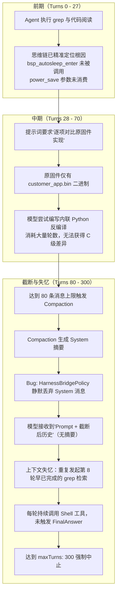
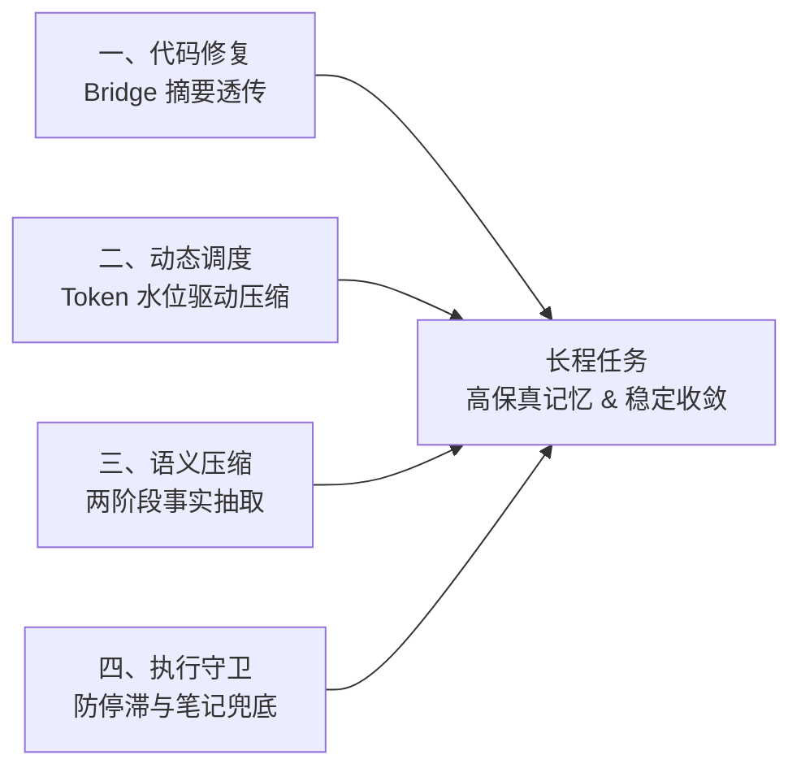

# OpenDuck Harness 上下文截断与长程任务死循环治理优化方案

## 1. 背景与问题诊断

在任务运行 `20261101_235006_task_task-power-save-mode-fix_01a19985`（以及历史上的多轮次验证，包括 DeepSeek 与 GLM 系列模型）中，系统执行满 300 轮上限后因未返回最终结论而被强制取消（`Cancelled`）。

深入分析运行轨迹（35MB JSONL / 300 Turns）后，确认了以下因果链条：



### 核心痛点归纳

1. **协议转换丢失核心摘要（代码级 Bug）**：
   [`crates/openduck-harness/src/runtime.rs`](file:///mnt/e/openduck-harness/crates/openduck-harness/src/runtime.rs#L2688) 生成的 `[COMPACTED CONTEXT SUMMARY]` 封装在 `HarnessMessage::system` 中，但在 [`crates/openduck/src/control/harness.rs:952`](file:///mnt/e/openduck-harness/crates/openduck/src/control/harness.rs#L952) 转换为 Provider 消息时被 `MessageRole::System => {}` 静默丢弃。
2. **容量阈值脱离模型实际能力（策略缺陷）**：
   硬编码 `max_context_messages = 80`。按一问一答 + 工具往返，约 38 轮即触发截断。而在第 100 轮时模型实际上下文仅占 1.8 万 tokens，对于拥有 128K 上下文的主流模型（GLM-5、DeepSeek-V3/R1 等）造成了严重且非必要的上下文碎片化。
3. **压缩提炼信息密度过低（规则缺陷）**：
   `extract_context_facts` 依赖模型主动在文件写入计划或笔记。当模型专注执行工具调用时，提取出的事实仅剩被截断的命令字符串，未包含历史排查结论。
4. **任务指令无明确收敛出口（提示词缺陷）**：
   Harness 要求模型“纯文本输出（无工具调用）”方判定为 Subtask 完成。因提示词对“原固件比对”设定了过于严苛的期望，导致模型死守工具调用，持续跑满上限。

---

## 2. 总体治理架构

本方案从四个维度形成闭环治理：



---

## 3. 具体实施方案

### 维度一：代码级 Bug 修复 —— 确保上下文摘要直达模型

在 `crates/openduck/src/control/harness.rs` 中，对 `context.messages` 遍历逻辑进行修正。由于上游 Provider 通常只允许一个全局 System Prompt，上下文中间出现的系统注入消息（包括 Compaction Summary、环境状态注入、Subtask 切换通知）必须统一映射为包含高优先级语义的用户消息或系统注入块。

#### 代码变更点 ([`crates/openduck/src/control/harness.rs`](file:///mnt/e/openduck-harness/crates/openduck/src/control/harness.rs#L950-L956))

```rust
for h_msg in &context.messages {
    match h_msg.role {
        MessageRole::System => {
            // 修复：严禁静默丢弃系统消息！
            // 压缩摘要与运行时系统注入以明确标记的提示块进入上下文
            if !h_msg.content.trim().is_empty() {
                messages.push(Message::user().with_text(format!(
                    "[SYSTEM NOTIFICATION / CONTEXT MEMORY]\n{}",
                    h_msg.content.trim()
                )));
            }
        }
        MessageRole::User => {
            messages.push(Message::user().with_text(&h_msg.content));
        }
        MessageRole::Assistant => { ... }
        MessageRole::Tool => { ... }
    }
}
```

---

### 维度二：动态 Token 预算驱动压缩 —— 告别“死板 80 条消息”

#### 1. 改变压缩触发判定
在 [`crates/openduck-harness/src/runtime.rs`](file:///mnt/e/openduck-harness/crates/openduck-harness/src/runtime.rs#L2653-L2662)，将原本优先依据 `max_messages` 的截断判定，改为以 **Token 预算为主、消息数量上限为辅**。

- **默认 Token 预算**：依据 Policy 声明的模型上下文上限（默认 64K~128K），设定高水位线（Watermark）为 70%（如 90,000 tokens）。
- **动态消息上限**：将消息阈值由固定的 80 条放宽至 `200 ~ 400` 条（或根据 `token_limit / 500` 动态推导）。

```rust
pub fn compact_context_messages(
    messages: &mut Vec<HarnessMessage>,
    max_messages: usize,
    max_tokens: Option<usize>,
    threshold: f64,
) {
    let total_tokens = messages.iter().map(|m| m.estimate_tokens()).sum::<usize>();
    let token_limit = max_tokens.unwrap_or(64_000);
    let token_watermark = ((token_limit as f64) * threshold) as usize;

    let exceeds_tokens = total_tokens > token_watermark;
    // 只有在 Token 超标，或者消息数量极端膨胀（如超过 300 条）时才执行 Compaction
    let exceeds_messages = messages.len() > max_messages.max(200);

    if !exceeds_tokens && !exceeds_messages {
        return;
    }
    ...
```

---

### 维度三：语义级与关键事实保留（Semantic Compaction）

目前的 `extract_context_facts` 仅记录了文件路径与执行命令，忽略了工具执行产出的实质性结论。

#### 1. 强化事实提取器 (`extract_context_facts`)
- **关键输出嗅探**：提取 `grep`、`read_file`、编译/测试中的高价值片段（如发现的函数定义行、关键配置行、报错详情），而非简单存入 `explored_files`。
- **Thinking 关键结论保留**：将模型在被裁剪回合中输出的思考摘要（如第 8 轮与第 27 轮识别到的 `dead code` 和 `cfg->power_save` 结论）提取出来保留在摘要中。

#### 2. 对接 `openduck-context-management`
利用项目中已有的 [`crates/openduck-context-management/src/summarize.rs`](file:///mnt/e/openduck-harness/crates/openduck-context-management/src/summarize.rs)，当需要丢弃超过 30 轮交互时，调用本地快速模型或轻量 API 生成 3~5 行的高浓度排查进度快照（Current Status, Known Findings, Dead Ends）。

---

### 维度四：防停滞（Anti-Stagnation）与 Subtask 架构约束

#### 1. 强力 Scratchpad 自动检查注入
系统 Prompt 虽然要求更新 `.agent/notes-plan-<task-id>.md`，但模型容易遗忘。
- **机制**：Harness 运行时在每隔 15 轮如果检测到工作区对应笔记文件未更新，在下次 User Message 自动追加系统提示：
  > *`[System Notice]: You have executed 15 steps without saving findings to .agent/notes-plan-<task-id>.md. Write your verified facts and next steps to the scratchpad now to avoid context loss.`*

#### 2. 循环重复排查早停熔断
- 在 Harness 中记录最近 10 次工具调用的指纹（Tool Name + Arguments 规范化哈希）。
- 若检测到相同文件的 `grep` 或 `sed` 出现超过 3 次且其间没有执行代码写入或生成新产物，立即激活 Anti-Stagnation 探针，注入干预提示或强行将状态推进至总结模式。

#### 3. 任务模板与提示词优化（以 `task-power-save-mode-fix.yaml` 为例）
调整 Subtask 1 的描述，避免让模型陷入二进制逆向黑洞，明确设置完成退出规则：

```yaml
subtasks:
- id: diagnose-power-save
  title: 确认省电模式现状并定位根因
  description: |-
    阅读当前工程的省电模式相关代码，梳理启用条件与调用链。
    注意：原固件为编译后二进制与逆向文档，不要尝试反编译二进制文件；直接参考 `docs/` 和逆向分析文档。
    本步只做排查与结论，不修改代码。
    排查完毕后，严禁继续使用 shell 工具检索，直接以纯文本输出根因结论与修改计划，以完成当前子任务。
  maxTurns: 50   # 由 300 缩减至 50，避免失控无限循环
  expectedOutputs:
  - description: 给出省电模式当前行为与根因结论，并列出将要修改的文件与改动意图
    kind: note
```

---

## 4. 实施里程碑与验证计划

| 阶段 | 任务目标 | 关键改动文件 | 验收标准 |
| :--- | :--- | :--- | :--- |
| **P0 (立刻修复)** | 修复 System 摘要丢失 Bug | `crates/openduck/src/control/harness.rs` | 发生 Compaction 后，下一步 LLM 请求报文中能完整读取到 `[SYSTEM NOTIFICATION / CONTEXT MEMORY]` 摘要。 |
| **P1 (基础调优)** | 动态 Token 上限与 Subtask 轮数治理 | `crates/openduck-harness/src/runtime.rs`<br/>`.goose/tasks/task-power-save-mode-fix.yaml` | 消息限制放宽至 200+；子任务不再过早进入频繁裁剪，Subtask 1 在 50 轮内收敛。 |
| **P2 (深度加固)** | 防停滞早停注入与笔记落盘提醒 | `crates/openduck-harness/src/runtime.rs` | 连续重复 Grep 触发系统中断注入；长时间未落盘主动触发写入提醒。 |

---

## 5. 预期效果

1. **根除失忆闭环**：压缩摘要真正传递给大模型，避免在 Turn 100/200 时重复进行第 8 轮已完成的基础探索。
2. **Token 利用率提升 300%+**：充分发挥现代模型 128K 窗口优势，正常任务在 100 轮以内无需触发破坏性裁剪。
3. **任务收敛率提升**：通过明确的 Subtask 轮数限制和纯文本完成引导，杜绝“已查明原因却一直在跑工具直到打满 300 轮 Cancel”的现象。
