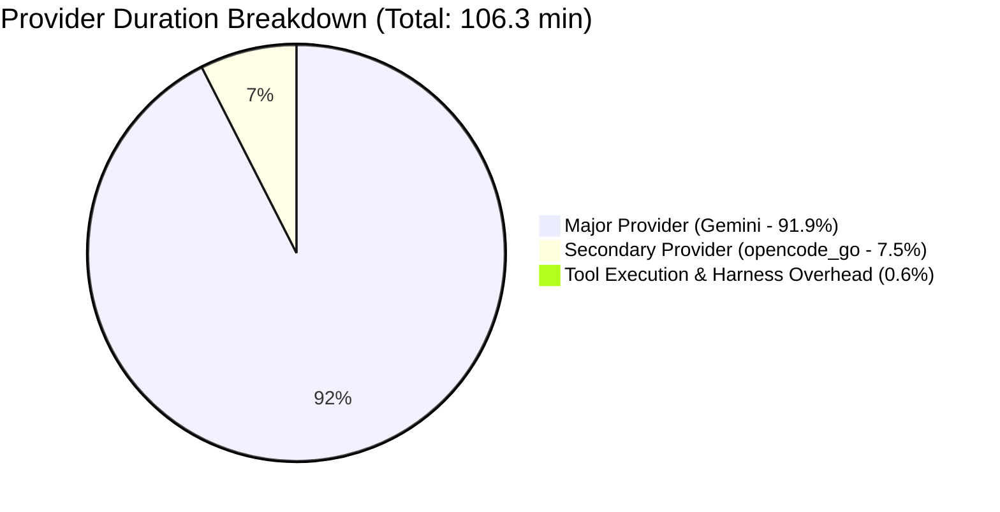
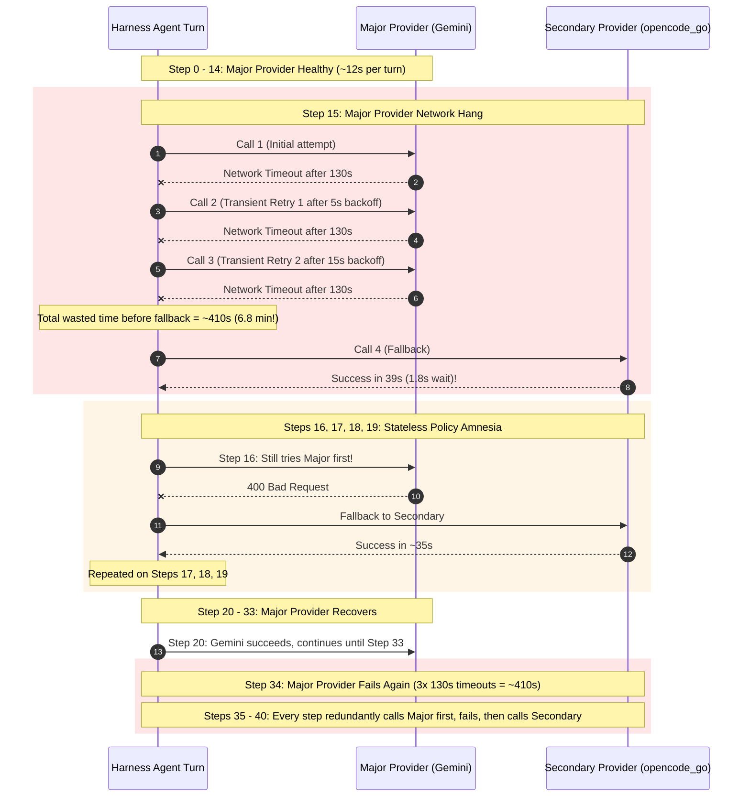
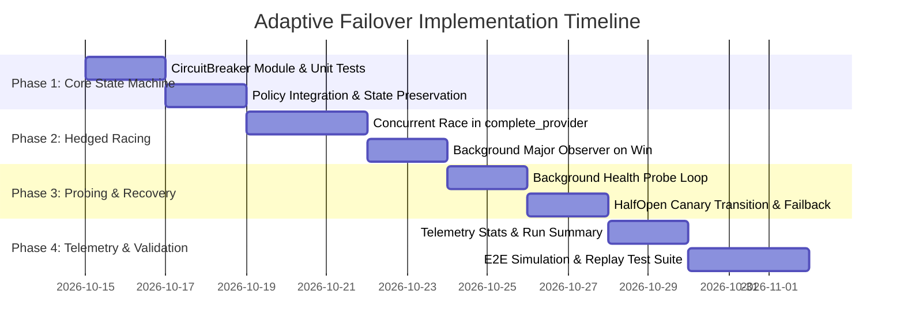

# LLM Provider Adaptive Hedged Failover and Recovery Architecture Plan

## 1. Executive Summary

In OpenDuck Harness and Agent runtimes, LLM API calls are subject to transient network failures, socket timeouts, and provider rate limits. The legacy failure handling mechanism relies on a **strictly sequential 3-attempt retry loop** on the primary provider before falling back to a secondary provider. 

When a major provider suffers network degradation or socket timeouts (e.g., 120s+ timeout per attempt), this legacy strategy introduces catastrophic latency spikes (over 6–7 minutes of stall per step). Furthermore, because the legacy agent policy is **stateless across turns**, subsequent steps repeat the exact same failing retry sequence on the major provider, compounding delays across multi-turn tasks.

This plan document establishes an **Adaptive Hedged Failover & Circuit Breaker (AHFCB)** architecture that:
1. **Concurrent Hedged Racing**: Upon the first failure of the major provider, immediately issues a retry to the major provider concurrently with a parallel request to the secondary provider, selecting whichever returns a successful response first.
2. **Transparent Failback on Recovery**: If the major provider's concurrent retry succeeds, the session immediately switches back to the major provider without penalty.
3. **Sticky Circuit-Breaker Failover**: If the major provider continues to fail (threshold $\ge 2$ consecutive failures), the circuit breaker transitions to `SecondaryActive`, dispatching all subsequent turns directly to the secondary provider with zero upfront wait time.
4. **Active Background Recovery Detection**: While operating on the secondary provider, a non-blocking background probe continuously verifies major provider health and automatically switches the active route back to the major provider upon recovery.

---

## 2. Empirical Analysis: Task Run `20261014_182723_task_task-ptt-design-and-dev-plan_01a13bab`

An empirical analysis of the benchmark task run referenced by the user was performed on `/home/zhanghu/.local/state/openduck/harness_runs/20261014_182723_task_task-ptt-design-and-dev-plan_01a13bab.json`:

### Summary Metrics

| Metric | Measured Value | Analysis / Context |
| :--- | :--- | :--- |
| **Total Task Duration** | **6,378.4 s (106.3 min)** | Severely degraded by repetitive provider retry timeouts |
| **Total Provider Calls** | 57 calls across 41 steps | 41 successful turns, 16 failed provider calls |
| **Major Provider (`gemini:gemini-3.8-flash`)** | 45 calls (29 success, 16 failed) | **5,860.9 s (97.7 min / 91.9% of run)**, avg **130.2 s / call** |
| **Gemini Network Wait Time** | **130,225 ms avg wait** | Almost 100% of Gemini turn latency was network hang/timeout |
| **Secondary Provider (`opencode_go:qwen3.8-flash`)** | 12 calls (12 success, 0 failed) | **475.0 s (7.9 min)**, avg **39.6 s / call** (**1.8 s avg wait**) |
| **Gemini Error Signatures** | 1) `Network error — check your network connection and try again.`<br>2) `Request failed: Bad request (400): Function call is missing a thought_signature...` | Network timeouts accounted for ~90% of lost time |



### Turn-by-Turn Failure Progression & Root Causes



### Key Diagnostic Takeaways

1. **Sequential 3-Retry Latency Trap**: When a provider has a 120s+ socket timeout, 3 sequential retries ($130\text{s} + 130\text{s} + 5\text{s} + 130\text{s} + 15\text{s} = 410\text{s}$) block the entire agent loop for ~6.8 minutes before secondary fallback is even attempted.
2. **Stateless Turn Amnesia**: Because the policy resets its attempt counter per step, Steps 16–19 and 35–40 incurred an initial failed call on the broken major provider on every single turn.
3. **Secondary Provider Viability**: `opencode_go:qwen3.8-flash` had a 100% success rate with an average wait time of 1.8 seconds. If hedged or sticky failover had been active, the entire run would have completed in **~30–35 minutes instead of 106 minutes** (saving over 70 minutes).

---

## 3. Architecture & State Machine Design

### 3.1 Adaptive Circuit Breaker States

The new failover engine introduces `ProviderCircuitBreaker` managed within `GooseAgentPolicy` and shared across turn invocations:

```mermaid
stateDiagram-v2
    [*] --> PrimaryHealthy

    state PrimaryHealthy {
        [*] --> SingleMajorCall
        SingleMajorCall --> PrimaryHealthy: Success
    }

    PrimaryHealthy --> HedgedRacing: 1st Failure on Major Provider

    state HedgedRacing {
        [*] --> SpawnConcurrent
        SpawnConcurrent --> RaceResult
    }

    HedgedRacing --> PrimaryHealthy: Major Wins Race OR Major Succeeded in Race
    HedgedRacing --> PrimaryDegraded: Secondary Wins Race & Major Failed (Consecutive Failures = 1)
    
    PrimaryDegraded --> HedgedRacing: Next Turn 1st Failure
    PrimaryDegraded --> SecondaryActive: Consecutive Failures >= 2

    state SecondaryActive {
        [*] --> DirectSecondaryDispatch
        DirectSecondaryDispatch --> DirectSecondaryDispatch: Turns execute via Secondary (0ms delay)
        --
        [*] --> BackgroundHealthProbe
        BackgroundHealthProbe --> ProbeMajorEndpoint: Every 20s
    }

    SecondaryActive --> HalfOpenTesting: 2 Consecutive Background Probes Succeeded
    
    state HalfOpenTesting {
        [*] --> CanaryMajorTurn
    }

    HalfOpenTesting --> PrimaryHealthy: Canary Turn Succeeded
    HalfOpenTesting --> SecondaryActive: Canary Turn Failed
```

### 3.2 State Definitions

| State | Primary Behavior | Secondary Behavior | Transition Conditions |
| :--- | :--- | :--- | :--- |
| **`PrimaryHealthy`** | Receives 100% of initial requests. | Idle. | 1st failure on Primary $\to$ `HedgedRacing`. |
| **`HedgedRacing`** | Parallel retry dispatched. | Parallel request dispatched with identical prompt/tools. | - Major succeeds first $\to$ `PrimaryHealthy`.<br>- Secondary succeeds first & Major succeeds later $\to$ `PrimaryHealthy`.<br>- Secondary succeeds & Major fails $\to$ `PrimaryDegraded` / `SecondaryActive`. |
| **`PrimaryDegraded`** | Next turn still attempts Primary first, but threshold to hedged race is immediate (0 extra retries). | Ready for hedged race. | 2nd consecutive failure $\to$ `SecondaryActive`. Success $\to$ `PrimaryHealthy`. |
| **`SecondaryActive`** (Circuit Open) | **Bypassed completely** during agent steps. Zero turn latency penalty. Non-blocking background probe running. | Receives 100% of direct requests. | Background probe succeeds $K$ times $\to$ `HalfOpenTesting`. |
| **`HalfOpenTesting`** | Receives a single canary step (with hedged fallback guard). | Standby for immediate takeover if canary fails. | Canary succeeds $\to$ `PrimaryHealthy`. Canary fails $\to$ `SecondaryActive`. |

---

## 4. Detailed Component Design

### 4.1 Hedged Race Execution Engine

When an initial call to the major provider returns an error (transient network error, timeout, server 5xx, or request error), the policy immediately initiates a concurrent race:

```rust
pub struct HedgedRaceOutcome {
    pub step_result: ProviderStepResult,
    pub winner: ProviderRole,
    pub major_succeeded: bool,
    pub secondary_succeeded: bool,
    pub records: Vec<ProviderCallRecord>,
}

pub enum ProviderRole {
    Major,
    Secondary,
}
```

#### Race Logic Flow

```rust
// 1. Prepare requests with identical session context
let major_retry_fut = complete_provider_single_attempt(
    &self.provider,
    &self.model_config,
    system_prompt,
    messages,
    tools,
    &self.name,
    false,
);

let secondary_fut = complete_provider_single_attempt(
    sec_provider,
    sec_model_config,
    system_prompt,
    messages,
    tools,
    &self.name,
    true,
);

// 2. Race using tokio::select! with biased evaluation or pin_mut!
tokio::select! {
    major_res = major_retry_fut => {
        match major_res {
            Ok(step_res) => {
                // Major provider retry succeeded!
                circuit_breaker.record_major_success();
                return Ok(step_res);
            }
            Err(major_err) => {
                // Major retry failed; await secondary to finish
                circuit_breaker.record_major_failure(&major_err);
                let sec_step_res = secondary_fut.await?;
                return Ok(sec_step_res);
            }
        }
    }
    sec_res = secondary_fut => {
        match sec_res {
            Ok(step_res) => {
                // Secondary returned earlier! Return immediately to unblock agent.
                // Detach background observer for major retry to verify if major recovers shortly.
                circuit_breaker.observe_major_background_retry(major_retry_fut);
                return Ok(step_res);
            }
            Err(sec_err) => {
                // Secondary failed first; wait for major retry
                let major_step_res = major_retry_fut.await?;
                circuit_breaker.record_major_success();
                return Ok(major_step_res);
            }
        }
    }
}
```

### 4.2 Circuit Breaker & Failover Controller

The `ProviderCircuitBreaker` struct maintains the state machine across steps:

```rust
#[derive(Debug, Clone)]
pub struct CircuitBreakerConfig {
    pub failure_threshold: usize,        // Default: 2 consecutive failures
    pub recovery_probe_interval_secs: u64,// Default: 20 seconds
    pub required_consecutive_successes: usize, // Default: 2
    pub probe_timeout_secs: u64,         // Default: 5 seconds
}

pub struct ProviderCircuitBreaker {
    state: Arc<RwLock<CircuitState>>,
    config: CircuitBreakerConfig,
    consecutive_failures: Arc<AtomicUsize>,
    consecutive_successes: Arc<AtomicUsize>,
    probe_handle: Arc<Mutex<Option<tokio::task::JoinHandle<()>>>>,
}
```

### 4.3 Background Recovery Probing

When the circuit trips to `SecondaryActive`, agent turns proceed with the secondary provider without waiting. Concurrently, a lightweight asynchronous probe task is spawned:

```rust
async fn run_recovery_probe(
    major_provider: Arc<dyn Provider>,
    major_model_config: ModelConfig,
    circuit_state: Arc<RwLock<CircuitState>>,
    consecutive_successes: Arc<AtomicUsize>,
    interval_secs: u64,
) {
    let mut interval = tokio::time::interval(std::time::Duration::from_secs(interval_secs));
    
    loop {
        interval.tick().await;
        
        // Ensure we are still in SecondaryActive
        if *circuit_state.read().await != CircuitState::SecondaryActive {
            break;
        }

        // Lightweight probe: Minimal 1-token query to verify auth & network routing
        let probe_messages = vec![Message::user().with_text("ping")];
        let probe_res = tokio::time::timeout(
            std::time::Duration::from_secs(5),
            major_provider.complete(&major_model_config, "respond with pong", &probe_messages, &[])
        ).await;

        match probe_res {
            Ok(Ok(_)) => {
                let succ = consecutive_successes.fetch_add(1, Ordering::SeqCst) + 1;
                tracing::info!(consecutive_successes = succ, "Major provider probe succeeded");
                if succ >= 2 {
                    let mut state = circuit_state.write().await;
                    *state = CircuitState::HalfOpenTesting;
                    tracing::info!("Major provider recovered; transitioning circuit to HalfOpenTesting");
                    break;
                }
            }
            _ => {
                consecutive_successes.store(0, Ordering::SeqCst);
                tracing::debug!("Major provider probe failed; remaining in SecondaryActive");
            }
        }
    }
}
```

### 4.4 Telemetry & Diagnostic Visibility

All hedged calls, circuit state transitions, and race winners must be recorded in `ProviderCallRecord` and `ProviderCallStats`:

1. **New Fields in `ProviderCallRecord`**:
   - `circuit_state`: `"primary_healthy" | "hedged_racing" | "secondary_active" | "half_open"`
   - `hedged_winner`: `"major" | "secondary" | "none"`
   - `concurrent_call`: `bool`
2. **Harness Run Summary Stats**:
   - `circuit_breaker_trips`: Total times the circuit opened.
   - `hedged_races_run`: Total concurrent hedged races executed.
   - `hedged_secondary_wins`: Races where secondary saved major failure latency.
   - `automatic_failbacks`: Successful recoveries back to major provider.

---

## 5. Implementation Roadmap & Milestones



### Phase Breakdown

#### Phase 1: `ProviderCircuitBreaker` State Engine (`crates/openduck/src/control/circuit_breaker.rs`)
- [ ] Create `ProviderCircuitBreaker` with states: `PrimaryHealthy`, `HedgedRacing`, `PrimaryDegraded`, `SecondaryActive`, `HalfOpenTesting`.
- [ ] Implement atomic transition rules, failure thresholds, and configurable timeouts.
- [ ] Unit tests for transition logic, counter resets, and thread safety.

#### Phase 2: Concurrent Hedged Race in `GooseAgentPolicy` (`crates/openduck/src/control/harness.rs`)
- [ ] Refactor `complete_provider_with_retry` into single-attempt non-looping execution helper `complete_provider_single_attempt`.
- [ ] Implement `execute_hedged_race` using `tokio::select!`.
- [ ] Ensure proper stream observation for partial thinking in both branches.
- [ ] Add session header preservation (`x-opencode-session`, `agent-session-id`) for both runners.

#### Phase 3: Background Health Prober & Failback Engine
- [ ] Implement background probe loop targeting major provider endpoints.
- [ ] Support lightweight probe completion (`"ping"` $\to$ `"pong"` with 5s hard timeout).
- [ ] Add `HalfOpenTesting` canary evaluation on the subsequent agent step.
- [ ] Implement graceful shutdown of background probe when harness finishes or circuit recovers.

#### Phase 4: Telemetry, Web Hub Visibility & Verification Suite
- [ ] Extend `ProviderCallRecord` in `crates/openduck-harness/src/telemetry/provider_stats.rs` with `circuit_state` and `hedged_winner`.
- [ ] Add integration mock tests in `crates/openduck/src/control/harness.rs`:
  - `test_hedged_race_uses_faster_secondary_on_major_failure`
  - `test_circuit_trips_to_secondary_after_consecutive_failures`
  - `test_background_probe_recovers_to_major_provider`
  - `test_no_delay_on_secondary_when_circuit_open`
- [ ] Validate on self-test suite: `cargo test -p openduck --test harness_tests` and `openduck-self-test.yaml`.

---

## 6. Verification and Test Plan

### Test Scenarios

| Test Case | Simulation Condition | Expected Behavior | Pass Criteria |
| :--- | :--- | :--- | :--- |
| **TC-01: Hedged Race on 1st Failure** | Major fails with 130s network timeout; Secondary succeeds in 2s. | Secondary response returned in ~2s; Major retry cancelled or observed in background. | Step latency $< 5$s; response matches Secondary. |
| **TC-02: Major Recovers in Race** | Major retry succeeds in 1s; Secondary finishes in 2s. | Major response returned; circuit remains `PrimaryHealthy`. | Step uses Major response; `winner = "major"`. |
| **TC-03: Circuit Tripping to Secondary** | Major fails twice consecutively. | Circuit transitions to `SecondaryActive`. Next turn dispatches directly to Secondary without touching Major. | Step 3 has 0 calls to Major; step latency $< 3$s. |
| **TC-04: Recovery Probing & Failback** | Major becomes healthy while circuit is `SecondaryActive`. | Probe succeeds 2x; circuit enters `HalfOpenTesting`; canary succeeds; circuit enters `PrimaryHealthy`. | Turn $N+3$ resumes calling Major as primary provider. |
| **TC-05: Double Provider Failure** | Both Major and Secondary fail. | Error returned cleanly with aggregated error diagnostics. | Returns `Both primary and secondary providers failed`. |

---

## 7. Projected Performance Impact on Benchmark Runs

Applying this architecture to task run `20261014_182723_task_task-ptt-design-and-dev-plan_01a13bab`:

| Metric | Baseline Run (`182723`) | Projected with Adaptive Hedged Failover | Net Improvement |
| :--- | :---: | :---: | :---: |
| **Total Task Runtime** | **6,378.4 s (106.3 min)** | **1,950 s – 2,200 s (32.5 – 36.6 min)** | **~70% faster (saving >1 hour)** |
| **Gemini Timeout Overhead** | 5,860.9 s (45 calls, 16 failures) | ~1,200 s (29 successful calls + 1 initial timeout) | **~4,660 s saved** |
| **Turn Stall on Step 15** | 410.0 s (3 sequential 130s retries) | ~39.0 s (immediate hedged race) | **371 s saved on single turn** |
| **Steps 16–19 Latency** | ~60s/turn (Major fail + Secondary fallback) | ~35s/turn (Direct Secondary dispatch) | **Zero failure wait overhead** |
| **Steps 34–40 Latency** | ~750s total stall across turns | ~220s total stall | **~530 s saved** |
