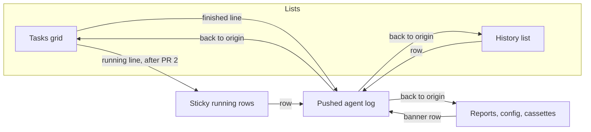

# Hub Project Page UX Plan

| Field | Value |
|---|---|
| **Title** | Project tasks, running work, and task history |
| **Status** | Proposed |
| **Author** | (placeholder) |
| **Date** | 2026-10-07 |
| **Surface** | Web Hub project harness page |
| **Primary files** | `ui/hub/src/components/ProjectHarnessTab.tsx` (3,595 lines), `ui/hub/src/components/HarnessHistoryTable.tsx`, `ui/hub/src/projectTasks.ts`, `ui/hub/src/styles.css` |
| **Related, not redesigned** | `ui/hub/src/components/TaskTrajectoryViewer.tsx` (entry, back, run-id copy only), `design-docs/agent-log-ux-plan.md` |

## 1. Overview

The project harness page splits one job across three places. A running banner sits above every subtab and shows a job id, a clock time, and Inspect / Stop. The task card tells you what the task is (name, id, badges, path, a dense action row) and does not tell you whether the last run worked. History is then rendered twice: five rows under the grid, and the same table again on the History subtab, with no search.

This plan makes the card answer "what happened," makes the banner the only live control, and makes History the only list of runs. A run opens the existing agent log as a pushed view with a back link to the list the user came from. It does not add a sixth peer tab, and it does not change the transcript. Presentation is derived from `HarnessHistorySummary` and `HarnessActiveJob`. The only backend field is a later, optional prompt preview.

## 2. Current view

`ProjectDetail` (`ui/hub/src/components/ProjectDetail.tsx`) already shows the workspace title, slug, path, and status, then the project tabs (Harness, Chat, Git, Files, Rules, Terminal, Insights, Settings). The only caller of `ProjectHarnessTab` passes `api`, `selectedProjectSlug`, and `onNavigateToFiles`. `projects` defaults to `[]`, so `selectedProject` is undefined and the project `<select>` never renders (`projects.length > 1 && onSelectProject`). The row that does render is the label `PROJECT HARNESS` and the slug. The path and the status tag render only inside `{selectedProject && …}` / `selectedProject?.path`, so they are absent at this call site. Refresh is the other control on that row. `ProjectDetail` already shows title, slug, path, and status.

Under that, `project-subnav-tabs` is a flat list:

- Tasks (`tasks.length`, always)
- History (count only after `loadedSections.history`; omitted while loading, not shown as 0)
- Eval Reports, Harness Config, Cassettes (same loaded-count pattern)
- Agent Log, only when `activeTrajectoryView || loadingTrajectory`, labeled with the task id

Daily navigation and rare navigation are the same row. Emoji are the icons (📋 📜 📊 ⚙️ 📼 🧠, and 🔄 on Refresh).

### Running banner

When `activeJobs.length > 0`, `.active-jobs-banner` renders above every subtab, including config and the log. Each `.active-job-item` shows:

- a job-type pill (`job.jobType`)
- the raw `taskId`
- `new Date(job.startedAt).toLocaleTimeString()`
- Inspect (`handleInspectRunningJob`) and Stop (`handleStopRunningJob`)
- `job.description` on a second line

`provider` and `model` are on `HarnessActiveJob` and are not rendered. `currentStatus` is not a live step. `launch_project_task` in `crates/openduck/src/control/project_harness.rs` sets `current_status: "running"` and sets `description` to `notify_task_name`: `task_def.name` when that name is non-empty, otherwise `task_spec.problem_statement` (the prompt). An eval job is different: `task_id` is `project-{slug}`, `job_type` is `"eval"`, and `description` is `Project evaluation on {slug} ({n} tasks)`. Replay jobs exist on the global harness path (`job_type: "replay"`) and are not given a project slug there. The banner must tolerate a job that does not match a task card.

The same Inspect and Stop are repeated on the card when `activeJobs` contains that `taskId` (`handleInspectRunningJob`, `handleStopRunningJob` / `handleStopTask`).

`HarnessActiveJob` / `HarnessActiveJobDto` has no step index and no current action. Those exist only after the client inspects. `handleInspectRunningJob` calls `inspectProjectHarnessJob`, stores `detail.snapshot` (`HarnessRunResponse`, which includes `trajectory.steps`, `stepCount`, and `partialThinking`) on `activeTrajectoryView`, and `subscribeJobLiveStream` updates that snapshot while `inspectingJobId` is set. `step_update` clears `partialThinking`. Nothing in the jobs list (`listProjectActiveJobs` → `active_jobs_for_project`) carries the step. A `task_status_changed` event whose status is running and that has a `jobId` calls `startLiveInspect` and `setSubTab('trajectory')`. That is what steals the page, including a scheduled start and an eval (`register_active_job` emits the same running event; eval's `taskId` is `project-{slug}`). `handleRunTask` does not. It awaits `api.runProjectTask` (the HTTP call blocks until `launch_project_task`'s oneshot completes), then `setActiveTrajectoryView(res)`, `stopLiveInspect()`, and `onInspectTrajectory` only when the parent passed it. `ProjectDetail` does not pass `onInspectTrajectory`. The trajectory pane renders only when `subTab === 'trajectory'`, so setting the view alone does not navigate.

### Task cards

`filteredTasks` comes from `filterAndSortProjectTasks` (`ui/hub/src/projectTasks.ts`). The query matches id, name, and category. It does not match tags. The tag chip is a separate exact match. Sort is `createdAt` descending, then `id` ascending via `localeCompare`. There is no last-activity sort.

`ProjectTaskSummary` (`ui/hub-core/src/types.ts` and `crates/openduck-harness/src/project/task_store.rs`) is `id`, `name`, `category`, `tags`, `filePath`, `hasVerifier`, `createdAt`, `cron`, `schedulePaused`, `nextRunAt`, `currentlyRunning`, `dynamicPrompt`. There is no `prompt`. `ProjectTaskStore::list_tasks` already deserializes `ProjectTaskDefinition` (which has `prompt`) and drops it. `getProjectTask` returns the definition. The editor loads it in `handleOpenEditTask`. A dynamic run loads it in `openDynamicRun`.

Each card shows the name, the id, a category badge, `✓ Verifier` or `No Verifier`, an auto-run badge, a dynamic-prompt badge, tags, the schedule line, and `📄 {filePath}`. History is read on the card only to decide Continue:

```ts
const latest = history.find(h => h.taskId === t.id)
```

`list_history_for_project` / `internal_list_history` (`crates/openduck/src/control/harness.rs`) sort `started_at` descending, so `find` is the newest row only while that order holds. Both the directory listing and `merge_history_lists` use the same comparator. `started_at` is RFC3339, so the string order matches time order. The card does not show that row's status, time, duration, steps, or error.

`loadTasksAndJobs` paints tasks and jobs, then starts `loadHistory` in the background. Continue appears after the cards. A skipped scheduled tick is a real history row: `run_scheduled_project_task` persists `job_type: "task"` with `skipped_run_dto` and the error `Skipped: previous run still in progress`. That row can be the one `find` returns. `continuable` is `openduck_harness::is_continuable_status`: Failure, Cancelled, or Timeout. `isContinuableStatus` in `ui/hub/src/taskContinuation.ts` is the same three strings after `toLowerCase()`. `RunStatus` has no serde rename, so the wire value is `Success` / `Failure` / `Timeout` / `Cancelled` / `Running` / `Skipped`. The UI already lowercases it. There is no Rust `Error` variant. The TypeScript union's extra `'error'` is defensive only.

The action row, inside `.tasks-grid` at `minmax(360px, 1fr)`, can show Run, Continue (+25) plus a turns slider, Record, Inspect, Stop, Trace, Auto-runs, Edit, and Delete. Continue (+25) calls `handleRunTask(..., latest.id, 25)` directly. The slider opens `continueModalTask`. Trace (`setSubTab('trajectory')`) is shown when this card's task is `activeTrajectoryView` and it is not the running job. "View Agent Log" is the history row's button. Both land in `TaskTrajectoryViewer`. `handleDeleteTask` confirms with the task id: `Are you sure you want to delete task "${taskId}"?`.

Empty copy is always `No tasks found in this project.` plus `Create your first Task`, including when `filterQuery` or `filterTag` excluded every task.

The create/edit form is an inline `.task-editor-card` above the grid (prompt, attachments, verifier, schedule, phase turns), so opening it pushes the list down. Continue and the dynamic-prompt run are already `.modal-backdrop` / `.glass-modal` dialogs. `.glass-modal` is `max-width: 620px` and `overflow: hidden`.

### History, twice

The tasks view embeds `HarnessHistoryTable` with `history.slice(0, 5)` under `Recent Task History`, and the toolbar has `Task History ({history.length})`. That toolbar count is the one that reads 0: `history` starts as `[]`, and the button does not wait for `loadedSections.history`. The subnav button does wait. The History subtab renders the same table with the full list and no filters.

`HarnessHistoryTable` puts all of this on every row: title, task id, cassette tag, full run id, copy button, the full `error` string, a type pill, an uppercased status, step count, a provider-calls pill (`⚡ {n}`), tool count, `(durationMs / 1000).toFixed(2)` seconds, `toLocaleString()` for `startedAt`, View Agent Log, and Continue. Continue is shown when `continuable || isContinuableStatus(status)` and it opens the continue modal (not the card's +25 shortcut). `finalAnswer` is on `HarnessHistorySummary` and on `history_summary_from_payload` (`run.final_answer`) and is not rendered.

`.history-table-container` is only `overflow-x: auto`. The `@media (max-width: 720px)` block does not mention history or task cards. There is no stacked history fallback. `.tasks-grid` already wraps to one column when the container is under 360px plus the gap.

### Log entry

`onBackToTasks` is `() => setSubTab('tasks')` even when the run was opened from History. The log header already shows `Run ID: {selectedHistoryId}` when not live, and `Job ID` when live. There is no copy control on that pill. `selectedHistoryId` is `HarnessHistorySummary.id`, the run-file stem. This plan does not restyle the transcript. `design-docs/agent-log-ux-plan.md` stays the owner of the reading view, the thinking shimmer, and the follow-up composer.

### Corrections to the brief

These were checked against the code and are what this plan implements:

- The History **subnav** hides its count until `loadedSections.history`. The **toolbar** button is what shows `(0)`.
- The project switcher in the harness header is dead on the only call site. That row shows the label and the slug. Path and status are not rendered, because `projects` is not passed.
- `job.description` is the display name only when the task has a non-empty name. Otherwise it is the prompt. Eval jobs do not match a task id.
- The live step is not on the active job. It is on an already-fetched inspect snapshot. Prefer no new job field.
- A running SSE event already force-opens the log. That fights "the banner is the live control" and should stop.
- Card Continue is two controls (+25 and a slider). History Continue is already one control and already opens the modal.
- `history.find` is newest-first only by server contract. The selector should compare `startedAt` itself.

## 3. Goals and non-goals

### Goals

- A card shows the last run in one status line, and that line opens the log.
- Running work has one sticky row: name, ticking elapsed time, model, Stop. The row opens the log.
- One history list. A row is a run. Filters are status, task, and job type.
- The card's primary action is Run, or Continue when the last run is continuable. Record, Edit, schedule pause, and Delete sit in one menu.
- Tasks and History are the primary nav. Reports, config, and cassettes are secondary. The log is a pushed view.
- The editor does not shove the grid. The card can show a two-line prompt preview without a per-card fetch.
- Batch eval runs the tasks the filter is showing.
- Narrow view stacks the same history fields. It does not add a second component.

### Non-goals

- The agent-log transcript, thinking shimmer, split inspector, stream timeline, and provider stats (`design-docs/agent-log-ux-plan.md`).
- Project Chat, Git, Files, Rules, Terminal, Insights, Settings.
- Turn budgets, the judge, continue seeding, or any harness execution change.
- A new run-storage schema, history pagination, or a new jobs field in the first slices.
- Rewriting `TaskTrajectoryViewer` beyond the back link and a run-id copy button.
- Desktop (`ui/desktop`) and mobile (`ui/mobile`). An optional hub-core field must stay source-compatible so those apps need no UI change.
- Fixing the existing `pnpm run typecheck` errors in `TaskTrajectoryViewer.tsx` on `TaskProviderStats` and `ProviderCallRecord.callId`. Do not edit those lines. Do not add a new type error. `ui/hub/tsconfig.json` has `noUnusedLocals` and `noUnusedParameters`, so a PR that drops a button must drop the unused import in the same change.

## 4. Target

### Tasks page

```
Tasks    History                          More ▾
                                         Reports, Config, Cassettes

[ search…………………… ]  Tag: All  api          Last activity ▾
                                         New task     ↻

● Ship GPS alerts          grok-3        2m 14s      [ Stop ]
  Thinking…                                          the row opens the log

┌ Ship GPS alerts                          api ┐
│ ship-gps-alerts                  ✓ Verifier │
│ #alerts                                    │
│ Running · 2m 14s                           │  links to the row above
│ Every weekday at 09:00                     │
│ [ Running…………………… ]              [ ··· ]   │
└────────────────────────────────────────────┘

┌ Fetch markets                            api ┐
│ fetch-markets                    ✓ Verifier │
│ #web3                                      │
│ Failed · 3m ago · 12 steps                 │  the line opens that run
│ Policy step 4 failed for task 'fetch-markets': … │
│ [ Continue ]  [ Run ]            [ ··· ]   │
└────────────────────────────────────────────┘

┌ Nightly notes                                  ┐
│ nightly-notes                                  │
│ No runs yet                                    │
│ [ Run ]                              [ ··· ]   │
└────────────────────────────────────────────────┘
```

File path and `No Verifier` are gone. A verifier badge renders only when `hasVerifier` is true. The prompt preview (two clamped lines) is added only in the later preview slice, and only when the summary carries it.

The failure line under the status is `runDetailLine`: `firstLine(error)` when `error` is non-empty, otherwise `firstLine(finalAnswer)`, omitted when both are empty. The sketch sentence is the usual policy-step failure. `launch_project_task` persists an `Ok` run with `error: None`, and `runtime.rs` sets `final_answer` to `Policy step {n} failed for task '…'` while returning `Ok` with `RunStatus::Failure`. A single-task Run does not call `verifier.verify` (that is `EvalRunner` in `crates/openduck-harness/src/eval/runner.rs`). `Command verification failed: exit_code=…` is not on `HarnessHistorySummary`. A user stop is the case where both fields are set: `stop_active_job` persists `Some(reason_str)` (default `Task stopped by user`) and `cancelled_run_dto` copies that same string onto `final_answer`. A skipped tick writes the same `Skipped: previous run still in progress` string as the persist error and as `skipped_run_dto`'s `final_answer`. The card and the history row use this one helper. They do not show a verifier sentence.

While history is loading, the status slot is a skeleton of the same height (`min-height: 2.5rem`). After load, a task with no rows says `No runs yet` in that slot. The slot does not appear and disappear. `Couldn't load the last run` plus the existing Retry replaces the skeleton when `historyError` is set and there is no row. That keeps `handleRetryHistory`. The recent table and the toolbar `Task History (n)` button go away.

### Running row

One row per active job, not one row for the page. Sticky under `.app-header` (`position: sticky; top: 0; z-index: 100`). Start at `top: 4.25rem` and `z-index: 30`, and check the wrapped header at `max-width: 1024px`, where `.app-header` becomes a column and grows. Do not cover the header.

```
● Ship GPS alerts     2m 14s     grok-3     Thinking…          [ Stop ]
● Project evaluation on openduck (12 tasks)     45s            [ Stop ]
```

The title is the task's `name` when `tasks` has that id, else `description`, else `taskId`. Elapsed is `Date.now() - Date.parse(startedAt)`, formatted by the same duration helper as history, ticked from one interval for the whole banner. Model is `job.model`; omit it when null or blank. Do not render `provider`, the job-type pill, the raw id, or `toLocaleTimeString()`.

The current action is rendered only when this job's live snapshot is already in memory: `liveInspect && inspectingJobId === job.jobId` and `activeTrajectoryView` is that snapshot. The string is the existing `liveLineText(buildAgentLog(snapshot), true, String(snapshot.status))`. Do not add a second algorithm and do not key off `partialThinking` first. `liveLineText` (`ui/hub/src/components/AgentLogTranscript.tsx`) walks `buildAgentLog` turns from the end, returns `describeToolCall` of the newest tool on the latest assistant turn, and otherwise returns `Thinking…` (that turn has no tool, or there is no assistant turn). `buildAgentLog` already puts step thinking on the turn and appends `partialThinking` as a later turn. `step_update` in `ProjectHarnessTab` clears `partialThinking`; after a step is recorded, the thought the log shows lives on the step. A helper that prefers `partialThinking`, or that returns null for a final-answer turn, will disagree with the line the log is already painting. When this job has no loaded snapshot, the banner omits the action. That null is the call site, not a return value of `liveLineText`. Do not call `inspectProjectHarnessJob` or `subscribeJobLiveStream` just to label the banner. Opening the row uses the existing inspect path, which is what fills the snapshot. The step number (`stepCount`, else `trajectory.steps.length`) is shown on the card's running line only from that same snapshot (`Running · 2m 14s · step 4`). The banner uses `liveLineText` instead of a second step phrase.

The row is a `div` with `role="button"` and `tabIndex={0}`. Enter and Space open the log. Stop is a real `<button type="button">` on that row, `stopPropagation`, calling `handleStopRunningJob` by `jobId`. Do not put a `<button>` inside a `<button>`. The row does not toggle closed. Eval and any other non-task job get the same row and no card.

While that task's job is running, the card does not show Inspect, Stop, or Trace. That removal lands in PR 2, in the same change that adds `id="active-job-{jobId}"`. Until that id exists, PR 1 renders `Running · {elapsed}` as text, not as a control: there is no history id for `handleSelectHistory`, and there is no row to focus. From PR 2 on, the running line scrolls that id into view and moves focus to it. It does not open the log.

The banner stays mounted on Tasks, History, and the More screens (reports, config, cassettes). While a log is open, omit the row for `inspectingJobId` only. The log header already stops that job: `TaskTrajectoryViewer` looks up `activeJobs` by `inspectingJobId` and calls `onStopJob` (`handleStopRunningJob`) by `jobId`. Keep that path. Do not stop an eval by its `taskId` (`project-{slug}`). Keep one sticky row, with Stop, for every other active job. `try_register_active_job` blocks a second `job_type == "task"` for the same task id, but `eval_project_tasks` uses `register_active_job` with `job_type: "eval"`, so a task run and an eval can both be active. Hiding the whole banner would remove the only Stop for the eval until Back. If the open job is the only active job, the banner is absent. When the user goes back, rows for whatever is still running are visible again, including the job they were watching if it has not finished.

### History row

```
×  Fetch markets          3m ago     2m 14s     12 steps          [ Continue ]
   Policy step 4 failed for task 'fetch-markets': …

✓  Ship GPS alerts        1h ago     45s         6 steps
   Posted 4 alerts.

○  Nightly notes          2d ago      —          0 steps
   Skipped: previous run still in progress
```

The detail line is `runDetailLine`, the same helper as the card. On the failure row above, `error` is null and the text is `finalAnswer`. On the skip row, both fields are the skip sentence, so `firstLine(error)` wins and the words match. A user stop looks like the failure row with detail `Task stopped by user`, and both fields are that string.

The row is a `div` with `role="button"` and `tabIndex={0}`. Enter and Space call `onInspect`. Continue is a real `<button>` on the row, `stopPropagation`, and only when `continuable || isContinuableStatus(status)`. It opens the existing continue modal. No +25 on the row, no emoji. Do not use a `<button>` as the row.

Under 720px the same fields stack. They do not sit in a horizontally scrolling table.

```
×  Fetch markets                         [ Continue ]
   3m ago · 2m 14s · 12 steps
   Policy step 4 failed for task 'fetch-markets': …
```

### Log chrome this plan touches

```
← Back to history

Agent Log: fetch-markets          FAILURE
Run ID  20261007_153012_task_fetch-markets_ab12   [ copy ]
```

Back names the screen the log was opened from: `Back to tasks`, `Back to history`, `Back to reports`, `Back to config`, or `Back to cassettes`. The copy control sits on the run-id pill that is already rendered when `selectedHistoryId && !liveInspect`. Live inspect keeps the Job ID pill and does not gain a copy button. The transcript, metrics strip, and composer are untouched. Drop the 🧠 on this title when the header is edited. Do not edit the `TaskProviderStats` / `callId` sites.

## 5. Proposed design



```mermaid
sequenceDiagram
  participant User
  participant Card
  participant Banner
  participant Jobs as listProjectActiveJobs
  participant Inspect as inspect + live SSE
  participant Log as TaskTrajectoryViewer

  Jobs-->>Banner: startedAt, model, description
  Note over Banner: elapsed is local; no step yet
  User->>Banner: open row
  Banner->>Inspect: existing inspect path
  Inspect-->>Banner: snapshot already in memory
  Note over Banner: liveLineText of that snapshot only
  Banner->>Log: push, origin = the screen that was showing
  User->>Log: Back
  Log->>Card: restore that screen and scroll
```

### 5.1 Pure helpers

Put presentation in `ui/hub/src/projectTasks.ts`. `ProjectHarnessTab.tsx` should call these, not grow another block of inline history logic. `ui/hub` tests are `node --experimental-strip-types --test src/*.test.ts`. New tests go in `ui/hub/src/projectTasks.test.ts`. The banner action is not a new helper; tests for the moved `liveLineText` go in `ui/hub/src/taskTrajectory.test.ts`. There is no component test runner.

`filterAndSortProjectTasks` gains options. The product default becomes last activity. Existing tests that assert created-at order must pass `sort: 'created'`.

```ts
export type ProjectTaskSort = 'activity' | 'created'

export function filterAndSortProjectTasks(
  tasks: ProjectTaskSummary[],
  options: {
    query?: string
    tag?: string
    sort?: ProjectTaskSort // default 'activity'
    latestByTaskId?: ReadonlyMap<string, HarnessHistorySummary>
    runningJobStartedAt?: ReadonlyMap<string, string>
  } = {},
): ProjectTaskSummary[]
```

- Query matches id, name, category, and any tag (case-insensitive substring). The tag chip stays an exact `tags.includes`.
- Do not match `prompt`. Do not call `getProjectTask` to search. After the preview field exists, the query may also match `promptPreview` when it is already on the object. Absent means no match on that field.
- Running task ids pin first in both sort modes, most recently started job first. `activeJobs` arrive with the cards, so a running pin changes order before history loads. Today's `filterAndSortProjectTasks` does not pin. The first paint matches today only for idle tasks.
- `activity`: pin, then last activity descending, then `id` ascending. Last activity is `startedAt + durationMs` of `latestRunForTask`, or `createdAt` when the task has no run.
- `created`: pin, then the current `createdAt` desc / `id` asc order.
- Until history has loaded, `latestByTaskId` is empty, so an idle task's activity falls back to `createdAt`. Idle cards reorder once when history arrives. The status slot does not also change height. Existing tests that expect `mmm`, `zzz`, `aaa` pass `sort: 'created'` and do not pass `runningJobStartedAt`.

```ts
export function latestRunForTask(
  history: readonly HarnessHistorySummary[],
  taskId: string,
): HarnessHistorySummary | undefined
```

Pick the greatest `startedAt` for that `taskId`. On a tie, the greater `id` wins. Do not trust array order. Eval suite rows do not use the task's id (`project-{slug}`), so they do not become the card's last run. A skipped scheduled run does, when it is the newest row.

```ts
export function formatDurationMs(ms: number): string
export function formatRelativeTime(iso: string, now: number): string
export function firstLine(text: string | null | undefined, max?: number): string | undefined
```

`formatDurationMs`: under 1s → `<1s`; else round to the nearest second; `45s`, `2m`, `2m 14s`, `1h`, `1h 3m`. Omit a zero component. This replaces `(durationMs / 1000).toFixed(2)` on history rows and is the elapsed text on the banner.

`formatRelativeTime`: invalid → empty; under 45s → `just now`; under 60 minutes → `3m ago`; under 24 hours → `5h ago`; under 7 days → `2d ago`; otherwise a short date without a clock (`Oct 2`), not `toLocaleString()`.

`firstLine`: trim, take the text before the first newline, cap at 140 characters plus `…`.

```ts
export function runDetailLine(item: {
  error?: string | null
  finalAnswer?: string | null
}): string | undefined
```

`runDetailLine` is the only detail rule for the card and the history row. Return `firstLine(error)` when that is non-empty, otherwise `firstLine(finalAnswer)`, otherwise `undefined`. A normal `Failure` from `run_task` has a null `error`: the `Ok` arm of `launch_project_task` calls `persist_harness_run` with `None`, and the policy-step arm in `runtime.rs` puts `Policy step {n} failed for task '…'` on `final_answer`. A worker `Err` is the other shape: `failed_run_dto` sets `final_answer` to the error string and `persist_harness_run` also receives `Some(&err_str)`, so `error` wins and the words match. A user stop and a skipped tick also set both, to the same sentence (`Task stopped by user`, or `Skipped: previous run still in progress`). Do not read a verifier result off this payload.

```ts
export type LastRunPresentation =
  | { kind: 'loading' }
  | { kind: 'unavailable' }
  | { kind: 'none' }
  | { kind: 'running'; text: string; jobId: string }
  | { kind: 'success'; text: string; detail?: string; runId: string }
  | { kind: 'terminal'; text: string; detail?: string; runId: string }

export function presentLastRun(input: {
  historyLoaded: boolean
  historyError: boolean
  latest: HarnessHistorySummary | undefined
  running: { jobId: string; startedAt: string; stepCount?: number } | undefined
  now: number
}): LastRunPresentation
```

A running job wins over history.

| Case | Line |
|---|---|
| Running, no snapshot step | `Running · 2m 14s` |
| Running, snapshot step known | `Running · 2m 14s · step 4` |
| `success` | `Success · 2m 14s`, plus `runDetailLine` when it returns text |
| `failure` | `Failed · 3m ago · 12 steps`, plus `runDetailLine` |
| `timeout` | `Timed out · …`, same shape, plus `runDetailLine` |
| `cancelled` | `Cancelled · …`, same shape, plus `runDetailLine` |
| `skipped` | `Skipped · 2d ago`, plus `runDetailLine` |
| Loaded, no row | `none` → copy `No runs yet` |
| Not loaded | `loading` |
| Error and no row | `unavailable` |

`runDetailLine` is omitted when it returns `undefined`. For a policy-step `Failure` that is `firstLine(finalAnswer)`. For a user stop it is `firstLine(error)`, which is the same sentence as `finalAnswer`. Timeout, Cancelled, and Skipped stay their own words. Folding them into Failed would hide why Continue is offered (`failure`, `timeout`, `cancelled` — the strings `isContinuableStatus` matches) and would disagree with the status words the log header already prints. Success does not get a relative time; duration is the fact that it worked. The failure line carries the time because that is the row you scan for. `RunStatus::Timeout` is never constructed. Turn exhaustion sets `RunStatus::Cancelled` when `step_idx == max_steps - 1` in `runtime.rs`. The timeout row is accepted if a history file has that status. Do not require a fixture that produces one. A max-turn stop is a `cancelled` line.

```ts
export function projectTaskListEmpty(input: {
  taskCount: number
  matchCount: number
}): 'no-tasks' | 'no-match' | 'list'
```

`no-tasks` keeps today's empty state and the create button. `no-match` (the project has tasks, the filter matched none) says nothing matches and offers Clear filter. It does not offer "Create your first Task".

```ts
export function filterHistoryItems(
  items: readonly HarnessHistorySummary[],
  filter: { status?: string; taskId?: string; jobType?: string },
): HarnessHistorySummary[]
```

`filter.status` is the lowercased wire value, not the visible label. `RunStatus` has no serde rename, so the wire strings are `Success`, `Failure`, `Timeout`, `Cancelled`, `Skipped`, and `Running`. Compare `String(item.status).toLowerCase()` to `success`, `failure`, `timeout`, `cancelled`, or `skipped`. `all` or empty keeps the row. A value of `failed` or `timed out` matches nothing. `isContinuableStatus` already matches `failure` and `timeout`, not `failed`. Task and job type are exact. This is a client filter over the list `listProjectHistory` already returned. No new request. In-progress work is an active job, not a history row, so there is no `running` chip. `timeout` stays in the value list because a stored row might have it. Today's runner does not emit it. Max-turn stops are `cancelled`.

```ts
export function presentHistoryRow(
  item: HarnessHistorySummary,
  taskNames: Record<string, string> | undefined,
  now: number,
): {
  title: string
  status: 'success' | 'failure' | 'timeout' | 'cancelled' | 'skipped' | 'running' | 'other'
  relative: string
  duration: string
  steps: number
  detail?: string
}
```

`title` is `historyTaskTitle`. `detail` is `runDetailLine(item)`, not a second rule. Duration uses `formatDurationMs`. A missing or zero duration on a skipped row renders `—` only when `durationMs` is 0 and status is skipped; every other row uses the formatter (0 → `<1s` is wrong for a skip that never started, and the scheduler writes a skip with whatever `skipped_run_dto` stored — if that duration is 0, show `—`).

Do not add `describeLiveAction`. Move the existing `liveLineText` from `AgentLogTranscript.tsx` into `ui/hub/src/taskTrajectory.ts` and export it. Leave the function body as it is. `AgentLogTranscript` imports it and keeps the same call (`liveLineText(turns, live, status)`). The banner calls `liveLineText(buildAgentLog(snapshot), true, String(snapshot.status))` only when the snapshot for that `jobId` is already the live inspect. Do not inspect just to label the banner. Tests in `taskTrajectory.test.ts` lock that function against `buildAgentLog` fixtures: the newest tool on the latest assistant turn returns `describeToolCall`; a latest assistant turn with no tool returns `Thinking…`. Do not assert that `partialThinking` beats a newer tool, and do not assert that a final-answer-only snapshot returns null. Those disagree with `liveLineText`. The banner renders no action only when this job has no loaded snapshot.

### 5.2 Card and sort

The card body order is: title and id, badges (category, verifier only when true, schedule, dynamic prompt), tags, the status line, the schedule sentence when `cron` is set, then the action row. Drop `.task-card-path` from the default card. The id remains. The path stays in the editor because save still writes `.goose/tasks/{id}.yaml`. Drop `.no-verifier-badge` usage. Delete the class if nothing else references it.

A finished or other terminal line is a `<button>` and calls `handleSelectHistory` for that summary (the parent looks up the row by `runId`). A running line is not a button in PR 1. It is text (`Running · {elapsed}`, step count only once a snapshot for that job is already loaded). PR 2 makes it focus `#active-job-{jobId}` in the same change that adds the id and removes the card's Inspect and Stop. Do not call `handleSelectHistory` for a running line. There is no history file yet. The line is also not a button while loading, empty, or unavailable.

Sort control sits with the search: `Last activity` (default) and `Created`. Component state only. Do not persist it.

A card overflow item `All runs` sets the history task filter to this id and switches to History. That is the "open History already filtered" path. The status line still opens the single run.

### 5.3 Banner

Replace `.active-job-item`'s two-line layout with the row in [Running row](#running-row). Keep `.active-jobs-banner` as the container so the live tint stays. `InspectRunningJobButton` leaves the banner and the card; delete it if unused (`noUnusedLocals`).

`handleInspectRunningJob` loses the early return that treats a second click as Hide and `setSubTab('tasks')`. The row always opens. Back leaves. Stop stays on the row.

Elapsed uses one `setInterval(1000)` owned by the banner, cleared on unmount. Cards that are running read the same `now` from a parent state tick so they do not each start a timer. `prefers-reduced-motion` does not need to stop the text tick. Do not add a new pulse. The existing `.live-dot` can stay on the row.

### 5.4 History list

Delete the tasks-tab block from the `Recent Task History` card through the embedded `HarnessHistoryTable`, and delete the toolbar history button. Keep the history-tab error and retry UI.

`HarnessHistoryTable` becomes a list, not a `<table>`, so 720px can stack without fighting columns. Each row is a `div` with `role="button"` and `tabIndex={0}`. Enter and Space call `onInspect`. Continue, when rendered, is a real `<button>` with `stopPropagation` and calls `onContinue`. Replace the ⏩ label with the `FastForward` icon the card already uses, plus the word Continue. Do not wrap the row in a `<button>`. That would nest Continue's button.

Drop from the row: task id line, run id, copy button, type pill, tools column, provider-calls pill, cassette tag, `View Agent Log` as a separate button, and the full error dump. The run id moves to the log header in the navigation slice. Until that slice lands, the row may keep the id in a `title` attribute so it is not lost for one PR. Job type remains a filter value, not a column. Provider stats stay on the log's Providers view, which this plan does not change.

Filters above the list. Status options use a human label and a wire value: All (`''`), Success (`success`), Failed (`failure`), Timed out (`timeout`), Cancelled (`cancelled`), Skipped (`skipped`). The select value is the wire string. Task options come from `tasks` plus any history `taskId` that is not in the list, labeled with `historyTaskTitle`. Job type options are the distinct `jobType` values in the loaded list; `task` is the common one. A filter with no rows says that nothing matches and offers clear, instead of the "no runs yet" empty state. Pass `taskId` in from the card via state on `ProjectHarnessTab` (`historyTaskFilter`). Clearing it is local. A Timed out chip matches only a stored `Timeout` row. Max-turn stops show up under Cancelled.

`showProject` has no caller (`ProjectHarnessTab` does not pass it). Keep the prop. If it is true, add one muted project line. Do not add a project column back.

### 5.5 Card actions

Primary slot:

- Not continuable: filled Run. Dynamic prompt still opens `openDynamicRun(task, false)`.
- Latest run is continuable and the task is not running: filled Continue. It calls `handleOpenContinueModal(task.id, latest.stepCount || 25, task.name, latest.id, latest.progressSummary)`. The modal already defaults to +25 additional turns (`setContinueTurnsInput(25)`). Run stays as the next outline button so a fresh start is still one click. There is no second filled button and no slider.
- Running: the primary slot is a disabled Running label. No Inspect, Stop, or Trace.

Delete the `continue-btn-group` pair (`Continue (+25)` and `SlidersHorizontal`). Extra turns stay in `continueModalTask`.

Overflow (`MoreHorizontal`, `aria-haspopup="menu"`, Escape and outside click close it, following the dynamic-run Escape listener):

- Record (`openDynamicRun(task, true)` or `handleRunTask(task.id, true)`)
- Edit (`handleOpenEditTask`)
- Auto-runs / Auto-run off, only when `task.cron` is set (`handleToggleSchedulePause`)
- All runs (sets the history task filter)
- Delete

Delete confirms with the display name: `Delete "${task.name || task.id}"?`. Use that name in the success toast as well. The id remains the API argument.

### 5.6 Navigation

Remove the harness identity row. At the only call site that row is the `PROJECT HARNESS` label, the slug, and Refresh. Path and status are not rendered there, because `projects` is not passed. The unused `<select>` goes away with the row. `ProjectDetail` already shows title, slug, path, and status. Refresh moves to an icon button (`RefreshCw`) on the tasks and history toolbars, calling the same `loadSubTabData(..., true)`.

Primary subnav: Tasks, History. Counts: Tasks uses `tasks.length`. History uses `(${history.length})` only when `loadedSections.history` is set, matching today's subnav, never a premature 0.

Secondary: one More menu with Eval Reports, Harness Config, and Cassettes. Lucide icons (`BarChart3`, `Settings`, and the cassette-style icon already available, or `Disc`). Counts stay behind the existing `loadedSections.*` checks. No emoji on these tabs or on the buttons this plan redraws (Run, Continue, Stop, New task, Refresh, history rows, log back). Do not sweep emoji inside the config form or the estimate panel; those screens are not part of this layout.

The trajectory peer tab goes away. `ProjectSubTab` can keep `'trajectory'` internally during the transition, but the rendered nav must not have that button.

Log open state:

```ts
type LogOrigin = 'tasks' | 'history' | 'reports' | 'config' | 'cassettes'
```

The banner stays on the More screens. Opening a log records the screen that is showing, not "whichever list." A card status line records `tasks`. A history row records `history`. A banner row records `tasks`, `history`, `reports`, `config`, or `cassettes`, whichever is visible. Back restores that screen. The button text is `Back to tasks`, `Back to history`, `Back to reports`, `Back to config`, or `Back to cassettes`. `TaskTrajectoryViewer` takes the label and the handler from the parent (`onBackToTasks` can stay as the prop name if the parent passes the origin handler). Run's completion does not open the log and does not record an origin.

On open, store `window.scrollY` and the origin id (`data-task-id` on the card, `data-run-id` on the row). On back, restore the scroll position. Do not unmount-and-forget without restoring. Keeping the list mounted and hidden is acceptable if it is simpler than scroll bookkeeping. Do not mount Reports, Config, or Cassettes in the background just to preserve them; restoring `subTab` is enough for those three.

The page is stolen by the running branch of `task_status_changed`, not by `handleRunTask`. `try_register_active_job` and `register_active_job` both emit that event with `current_status: "running"` and a job id, including eval. The edit in that branch: do not call `startLiveInspect` and do not call `setSubTab('trajectory')`. Still update `currentlyRunning` when the event's `taskId` matches a task, and still reload jobs. That covers a scheduled run and an eval. The non-running branch that drops the job from `activeJobs` stays.

`handleRunTask` keeps awaiting `api.runProjectTask`. This plan does not change that request. After it returns:

- Refresh tasks and history, as it does now.
- Replace `historyList.find(item => item.taskId === taskId)` with `latestRunForTask(historyList, taskId)`.
- If this job's log is already open, do not call `stopLiveInspect()`. The existing `finished` / snapshot path on `subscribeJobLiveStream` updates `activeTrajectoryView`. Set `selectedHistoryId` from `latestRunForTask` so the open log's run-id pill follows the persisted file. Do not replace the live snapshot with a navigation.
- If the log is not open, do not set `subTab`, and do not treat `setActiveTrajectoryView(res)` as a navigation. Leave `activeTrajectoryView` unchanged so a later visit does not open a stale run. Leave `selectedHistoryId` unchanged.

The banner is how a long run stays visible while the blocking request is in flight. The user opens the log from the row.

### 5.7 Editor and prompt preview

The inline `.task-editor-card` becomes a drawer: the existing `.modal-backdrop`, `role="dialog"`, `aria-modal="true"`, Escape closes when `savingTask` is false. Do not reuse the 620px `.glass-modal` cap. A side panel `width: min(720px, 100%)`, `height: 100%`, `overflow: auto` fits the prompt, attachments, verifier, and schedule. The grid does not move. Title uses the display name when editing (`taskForm.name || editingTaskId`), not only the id.

The card preview is not in the first slice. `ProjectTaskSummary` has no prompt, and fetching `getProjectTask` per card is an N+1 on top of `list_tasks`, which already parsed the YAML.

Later slice, smallest API change: add an optional preview on the summary that `list_tasks` already builds.

```rust
// crates/openduck-harness/src/project/task_store.rs  ProjectTaskSummary
#[serde(default, skip_serializing_if = "Option::is_none")]
pub prompt_preview: Option<String>,
```

Build it from `task_def.prompt` before the prompt is dropped: first two non-empty trimmed lines, joined with `\n`, capped at 240 characters on a char boundary, with `…` if truncated. Empty prompt → `None`. Do not put the full prompt on the list payload.

```ts
// ui/hub-core/src/types.ts  ProjectTaskSummary
promptPreview?: string
```

The card renders it with a 2-line clamp only when the string is non-empty. Older servers omit the field; the card omits the preview. No desktop or mobile UI change. The field is optional, so those packages keep compiling if they construct or read the summary.

Search may include `promptPreview` in that same slice. It must not fetch definitions to search the rest of the prompt.

Extend `crates/openduck-harness/tests/project_harness_tests.rs` (`test_project_task_store_crud` already writes `Fetch top 5 markets`) with a preview assertion, plus one multi-line prompt that keeps two lines and one that truncates past 240 characters.

### 5.8 Batch eval and narrow layout

`handleRunProjectEval` posts `api.runProjectHarnessEval(slug, {})`. The server (`eval_project_tasks`) ANDs `task_ids`, `category`, and `tags`, and the tag check is any-match. A tag chip on the client is exact, and the text query exists only on the client. Sending `tags` or `category` would not match the grid.

Move the button off the New task cluster and put it by the filter as `Run these (N)`, where N is `filteredTasks.length`. The request is `{ taskIds: filteredTasks.map(t => t.id) }`. Unfiltered, N is every task, which matches today's `{}`. Disabled when N is 0 or `runningEval` is set. No extra confirm dialog: the count is the scope, and today's button is the one that always runs everything. The server error `No tasks matched the filter criteria` still surfaces in the existing error banner.

The eval job appears as its own banner row (suite id, sentence description). It does not pin a task card. Stop still goes through `handleStopRunningJob` by `jobId`.

At `max-width: 720px`:

- History rows use the stacked layout in the sketch. Remove the dependence on `.history-table-container { overflow-x: auto }` for this list.
- The running row wraps: name and elapsed on the first line, model and action truncated, Stop on the row's end.
- `.tasks-header-bar` already wraps. The search input should be allowed to shrink (`min-width: 0` on the narrow breakpoint; today `.search-input` is `min-width: 260px`).
- `.tasks-grid` needs no new breakpoint. `minmax(360px, 1fr)` already produces one column.

## 6. API / interface changes

No change in slices 1–5 and 7.

Slice 6 only:

| | Before | After |
|---|---|---|
| `ProjectTaskSummary` | no prompt | optional `promptPreview`, omitted when empty |
| List route | `list_project_tasks` returns the same DTO | same route, one extra optional field |
| Eval | client sends `{}` | client sends `{ taskIds }` using the existing `ProjectHarnessEvalRequest.task_ids` |
| Active job | unchanged | still no step index |

Not proposed: `stepCount` or `currentAction` on `HarnessActiveJobDto`. Elapsed is `startedAt`. The action is `liveLineText` of a snapshot the log already loaded. A later field would be filled from the in-memory snapshot inside `active_jobs_for_project` if we ever need the step before the user opens the log. `currentAction` on the server would duplicate `liveLineText` and go stale. Don't add it.

`handleInspectRunningJob`, `handleSelectHistory`, `handleOpenContinueModal`, `handleRunProjectEval`'s endpoint, and `onContinueTask` stay. The log plan's composer signature is not part of this work.

## 7. Data model changes

No run-file or history schema change. `HarnessHistorySummaryDto` already stores `status`, `step_count`, `duration_ms`, `final_answer`, `error`, `started_at`, `continuable`, `job_type`, and `task_id`. The UI currently ignores `final_answer`.

`prompt_preview` is a projection at list time, not a new column and not a migration. Old clients ignore an unknown JSON field. New clients tolerate a missing field (`#[serde(default)]` / optional TypeScript).

Rollback of slice 6 is a frontend revert. The extra JSON field is harmless. Rollback of the other slices is a frontend revert. Nothing is written in a new shape.

## 8. Alternatives considered

**Per-card `getProjectTask` for the preview and for prompt search.** Rejected. `list_tasks` already parsed the prompt and threw it away. N extra definition reads on every tasks paint, and search would wait on all of them. A truncated field on the summary is one projection in a loop that already exists, and it waits for a later PR.

**A `stepCount` / `currentAction` field on `HarnessActiveJobDto` in the first banner slice.** Rejected for the first slice. The banner's elapsed time and model are already on the DTO. The action string is only useful once a snapshot exists, and opening the row is what loads that snapshot today. Polling inspect for every visible job would pull full trajectories (`trajectory.steps`, prompts, provider calls) just to label a row. A later optional `stepCount` is the smallest addition if the missing step before the first open is a real problem.

**Keep the history `<table>` and add a card layout under 720px.** Rejected. Two markups of the same fields will drift, and `.history-table-container` only scrolls sideways today. One list with a stacked grid at 720px is the same component.

**Leave History embedded as five rows and only restyle the subtab.** Rejected. The card status line is the "what just happened" surface. The second table is why the page feels like three tools. The toolbar button also lies with `(0)` while history loads.

**Auto-open the log on Run, as the SSE handler does now.** Rejected. The banner is the live control, including for scheduled runs that start while the user is reading the list. Forcing `trajectory` on every `task_status_changed` is why the log became a peer tab. The row is one click, and it is sticky.

## 9. Security and privacy

The page is already behind the hub's project APIs. This plan adds no route except the optional preview field on a list the caller can already read.

- `promptPreview` is a prefix of the task prompt. Anyone who can list tasks can already `getProjectTask` and read the whole prompt. Cap it at two lines / 240 characters so the list payload is not a new bulk export of every prompt. Do not log the preview.
- Delete confirms with the display name so a raw id is harder to misread. The API still deletes by id.
- `Run these` sends the ids on screen. That is a narrower write than today's unfiltered eval. The eval still executes those tasks with the project's harness policy. The button does not gain a way to run tasks outside the project.
- The run-id copy writes an id the history row already exposed into the clipboard. No new secret. Do not copy the job id from a live row in this plan.
- Sticky rows and filters are client-side. They do not widen `list_history_for_project` or `active_jobs_for_project`.

## 10. Observability

No new metrics and no new info logs. Keep the existing history error banner and `handleRetryHistory` (including the tasks-page status slot when the recent table is gone). Keep the eval and delete error banners. A filter that matches nothing is UI state, not an error report.

The banner must not start a live SSE per job. That subscription is the log's, and it already updates `activeTrajectoryView`. Adding one per row would multiply step events for no list-level metric.

## 11. Rollout

No feature flag. Each PR below is the new behavior for that slice. The data the page reads does not change until the preview field, and that field is optional in both directions.

Rollback is revert the PR. A reverted frontend still talks to the same history and jobs routes. A frontend that has the preview slice still works if the server does not send `promptPreview`.

Ship the helper and card slice first so later PRs share `formatDurationMs`, `latestRunForTask`, and the status line. Do not stack the history rewrite, the nav rewrite, and the editor move in one review. `ProjectHarnessTab.tsx` is 3,595 lines; each PR should say which block it touched and should move logic out instead of adding branches.

## 12. Risks

| Risk | Severity | Mitigation |
|---|---|---|
| History load reorders the grid once under the new default sort | Low | Pins use `activeJobs`, which arrive with the cards. Idle cards move once. The status slot height stays put. `Created` remains a sort. |
| Continue still pops into the action row after PR 1 | Low | PR 4 puts Continue in the primary slot instead of adding a sibling. PR 1 must not add a button. |
| Banner `top` overlaps the wrapped app header | Low | `z-index` under the header (30 vs 100). Check at 1024px. Adjust the offset; don't guess a second sticky bar. |
| `liveLineText` labeled from another job's snapshot | Medium | Call it only when `inspectingJobId === job.jobId && liveInspect` and `activeTrajectoryView` is that snapshot. When inspect stops, the action disappears. Elapsed still comes from `startedAt`. Do not invent a second label function. |
| Stopping SSE auto-open surprises people who watch every run | Low | The sticky row is the watch control and is visible on tasks and history. The log is one click. Scheduled runs no longer steal the list. |
| Full history list is heavier as a stacked row than as a dense table | Low | No per-row fetch. The client already holds the full list. Don't virtualize in this plan. If a project is past a couple hundred runs, that is a follow-up. |
| Copy button edit in `TaskTrajectoryViewer.tsx` lands next to known type errors | Medium | Touch only the back button and the existing run-id pill. Do not touch `TaskProviderStats` or `callId`. `noUnusedLocals` will fail the PR if the new icon import is unused. |
| Drawer hides a half-edited task on backdrop click | Low | Match the continue modal's backdrop dismiss only when not saving. Escape uses the same guard. |
| `Run these` with an explicit id list races a task deleted mid-click | Low | The server already returns `No tasks matched the filter criteria` or runs the ids it still finds. Surface that error as today. |

## 13. Verification

Hub unit tests, from `ui/hub` (there is no root `package.json` script for this):

```bash
cd ui/hub && pnpm test
```

That runs `src/*.test.ts` only. Cover:

- default activity sort, running pin, created-at sort still available
- tag substring search; tag chip still exact; prompt not required
- `latestRunForTask` ignores older rows and does not depend on array order; tie breaks on `id`
- `formatDurationMs` (`500` → `<1s`, `2140` ms rounds, `134000` → `2m 14s`, zero component omitted)
- `formatRelativeTime` with a fixed `now`
- `presentLastRun` for success, a `Failure` whose `error` is null and whose `finalAnswer` is the policy-step sentence, a user stop where both fields are set, cancelled, skipped, running with and without a step, loading, unavailable. A `timeout` case is optional and must not be required to exist in the runner.
- `runDetailLine`: non-empty `error` wins over `finalAnswer`; `finalAnswer` is used when `error` is null; both empty omits the line
- `projectTaskListEmpty` for an empty project versus a filter miss
- `filterHistoryItems`: value `failure` matches wire `Failure`; value `failed` matches nothing; `cancelled` matches a max-turn stop; `timeout` matches only a row whose status lowercases to `timeout`
- `liveLineText` via `buildAgentLog`: newest tool on the latest assistant turn; `Thinking…` when that turn has no tool. No assertion that `partialThinking` beats a tool, and no assertion that a final-answer snapshot returns null

Slice 6 also runs the existing task-store test, extended for the preview:

```bash
cargo test -p openduck-harness --test project_harness_tests
```

Do not claim `pnpm run typecheck` is clean. Known errors in `TaskTrajectoryViewer.tsx` on `TaskProviderStats` and `ProviderCallRecord.callId` predate this work. A slice must add no new type error in the files it edits, and must not touch those two sites unless the copy button cannot be added any other way. It can.

Browser pass, after the slice that introduces the behavior:

- A policy-step failure (`finalAnswer` set, `error` null) shows Failed, a relative time, the step count, and the first line of `finalAnswer`. The line opens that run. A user stop shows the first line of `error` (`Task stopped by user`), which is also on `finalAnswer`. Do not look for a verifier sentence on the history payload.
- A success shows Success and a rounded duration, not `12.34s` style seconds, plus `runDetailLine` when the summary has a `finalAnswer`.
- A running task is pinned as soon as `activeJobs` loads, before history. After PR 2 its line focuses the banner row, and the card has no Inspect or Stop. PR 1's running line is text and the card still has Inspect and Stop.
- The banner elapsed ticks. Model shows when the job has one. With that job's log already open, the row shows the same string as `liveLineText`, not a `partialThinking`-first label. With the log never opened, the row has no action. Opening the row is what starts inspect.
- History is not under the grid. The History tab filters by wire status (`failure`, not `failed`), task, and job type. A max-turn stop is under Cancelled. Timed out matches nothing on today's runner. A card's All runs opens that task's filter. The row opens the log. Continue shows only for failure, timeout, and cancelled.
- Back from a history run returns to History. Back from a card run returns to Tasks. Back from a banner row opened on Reports, Config, or Cassettes returns to that screen.
- With a task log open and an eval still running, the eval row and its Stop stay. The open task's Stop is the log header, by `jobId`.
- A filter that hides every task is not the "first task" empty state.
- Delete asks with the display name.
- `Run these (N)` evals the visible ids. New task is not beside it.
- At about 720px the history row stacks and the page does not depend on sideways scroll to read status, time, and duration.
- Reports, config, and cassettes still open from More. The transcript of an open log is unchanged.

## 14. Open questions

- The sticky offset under a wrapped `.app-header` needs a look in the browser at 1024px. The starting value is `4.25rem`. If that leaves a gap or an overlap, measure the header once. Don't add a second app-header implementation.
- Skipped rows use `—` when `durationMs` is 0. If `skipped_run_dto` stores a non-zero duration, the row shows that duration instead. Confirm during the history slice; don't special-case further.
- Virtualizing history is out of scope. Revisit only if a real project list is large enough that the stacked rows jank. The payload is already the full list.

## 15. References

- `ui/hub/src/components/ProjectHarnessTab.tsx` — subnav, banner, cards, editor, both history mounts, eval, delete, SSE auto-open
- `ui/hub/src/components/HarnessHistoryTable.tsx` — current row
- `ui/hub/src/components/TaskTrajectoryViewer.tsx` — back button and run-id pill (about lines 564–641)
- `ui/hub/src/components/ProjectDetail.tsx` — the identity row this page repeats
- `ui/hub/src/projectTasks.ts`, `ui/hub/src/projectTasks.test.ts`, `ui/hub/src/taskContinuation.ts`
- `ui/hub/src/taskTrajectory.ts` — `describeToolCall`, `buildAgentLog`, `parseAgentAction`; `liveLineText` moves here
- `ui/hub/src/components/AgentLogTranscript.tsx` — `liveLineText` today (private). Move it; do not restyle the transcript
- `ui/hub-core/src/types.ts` — `HarnessHistorySummary`, `HarnessActiveJob`, `ProjectTaskSummary`, `ProjectTaskDefinition`, `ProjectHarnessEvalRequest`
- `ui/hub-core/src/rest.ts` — `listProjectHistory`, `listProjectActiveJobs`, `runProjectHarnessEval`
- `crates/openduck/src/control/harness.rs` — `HarnessActiveJobDto`, `HarnessHistorySummaryDto`, `internal_list_history`, `history_summary_from_payload`
- `crates/openduck/src/control/project_harness.rs` — `launch_project_task`, `eval_project_tasks`, `enrich_task_summaries`
- `crates/openduck-harness/src/project/task_store.rs` — `ProjectTaskSummary`, `list_tasks`
- `crates/openduck-harness/src/eval/continuation.rs` — `is_continuable_status`
- `crates/openduck/src/control/task_scheduler.rs` — skipped run persistence
- `ui/hub/src/styles.css` — `.tasks-grid`, `.task-card*`, `.active-jobs-*`, `.history-table*`, `.app-header`, `.modal-backdrop`
- `design-docs/agent-log-ux-plan.md` — transcript plan; this document only changes how you get there

## 16. Key Decisions

- **The card status line is the last run, not a second history table.** History is newest-first on the server, but `latestRunForTask` compares `startedAt` so the card does not depend on that. One reserved slot stops the load from changing card height.
- **Default sort is last activity, with running tasks pinned in every mode.** Created-at stays an option. The pin applies as soon as `activeJobs` arrives, so a running task is not in today's created-at order on first paint. Idle tasks use `createdAt` until history arrives, then move once.
- **No active-job API change for the banner.** Elapsed is local. Model is already on `HarnessActiveJob`. The action is `liveLineText(buildAgentLog(snapshot), true, status)` and only when that job's snapshot is already loaded. A banner must not poll full trajectories, and it must not grow a second label function.
- **The banner row opens the log. The card's running line only points at the row, and only after the row id exists.** PR 1 renders Running as text. PR 2 adds the id, removes card Inspect and Stop, and focuses the row. The running SSE branch (`startLiveInspect` + `setSubTab('trajectory')`) is what stops taking the page. `handleRunTask` does not navigate; if that job's log is already open it must not call `stopLiveInspect()`.
- **One history list, and the row is the click target.** The row is `role="button"`, not a `<button>`, so Continue can be a real button. Continue stays the only extra action and only for the continuable statuses. Run id copy moves to the log header that already shows the id. Card and history share `runDetailLine` (`error`, else `finalAnswer`). Under 720px the same list stacks. Status filters compare lowercased wire values.
- **Continue replaces the filled button when the last run can continue, and it opens the existing modal.** The +25 shortcut and the slider sibling go away. Run remains an outline button. Record, Edit, pause, and Delete go in one menu. Delete names the task.
- **`Run these` sends the visible task ids.** The server filter cannot see the client text query, and its tag match is any-match. Ids are the grid.
- **The log is a pushed view with an origin, not a subtab.** The origin is the screen that was showing, including reports, config, and cassettes. The banner stays on those screens. While a log is open, other jobs keep a Stop row; the open job's Stop stays on the log header, by `jobId`. The transcript plan is unchanged.
- **Prompt preview is a later optional field on `ProjectTaskSummary`, built in `list_tasks`, not an N+1 `getProjectTask`.** Search does not fetch prompts. It may match the preview only after that field is on the client.
- **Helpers live in `projectTasks.ts` and `taskTrajectory.ts`.** The 3,595-line tab should not gain this logic inline. Tests are the existing `node --test` files. Known trajectory type errors are left alone.

## PR Plan

### PR 1 — Last-run line, activity sort, filter empty state, tag search

- **Files / components:** `ui/hub/src/projectTasks.ts`, `ui/hub/src/projectTasks.test.ts`, `ui/hub/src/components/ProjectHarnessTab.tsx` (card body and empty state only), `ui/hub/src/styles.css` (status slot, drop path and no-verifier from the card)
- **Dependencies:** none
- **Description:** Add `latestRunForTask`, `presentLastRun`, `runDetailLine`, `formatDurationMs`, `formatRelativeTime`, `firstLine`, `projectTaskListEmpty`, and the sort/search options. Default sort becomes last activity with a running pin. A running job changes order before history loads. Idle cards stay in created-at order until history arrives. Existing tests that expect `mmm`, `zzz`, `aaa` pass `sort: 'created'` and do not pass a running map. The query matches tags. A finished status line opens that run through `handleSelectHistory`. A running line is text (`Running · {elapsed}`), not a button, and does not call `handleSelectHistory`. Detail text is `runDetailLine` (`firstLine(error)` when error is non-empty, else `firstLine(finalAnswer)`). A policy-step `Failure` has null `error`. The slot keeps its height while history loads. A filter miss is not the empty-project state. File path and `No Verifier` leave the card. A verifier badge remains when `hasVerifier` is true. Do not remove the recent table or the card's Inspect / Stop in this PR. Do not add a banner row id yet.

### PR 2 — Running banner as the only live control

- **Files / components:** `ui/hub/src/components/ProjectHarnessTab.tsx`, `ui/hub/src/styles.css`, `ui/hub/src/taskTrajectory.ts`, `ui/hub/src/taskTrajectory.test.ts`, `ui/hub/src/components/AgentLogTranscript.tsx` (import only: move `liveLineText`, do not change its body or the transcript markup)
- **Dependencies:** PR 1 (the card already renders a running line as text)
- **Description:** One sticky row per job: task name (else description), ticking elapsed time, model, Stop. The row is `role="button"` with Enter / Space to open the log. Stop is a real button and calls `handleStopRunningJob` by `jobId`. It is not nested inside another button. Move `liveLineText` unchanged into `taskTrajectory.ts` and call `liveLineText(buildAgentLog(snapshot), true, status)` only when that job's snapshot is already the live inspect. Do not inspect just to label the row. In the same change, add `id="active-job-{jobId}"`, remove Inspect and Stop from the card, and make the running line focus that id. Delete `InspectRunningJobButton` if nothing references it. Do not add a jobs API field. Leave the trajectory peer tab and the SSE auto-open for PR 5. While a log is already open, still render rows for the other jobs so an eval can be stopped. Omit the row whose `jobId` is `inspectingJobId`.

### PR 3 — One history list

- **Files / components:** `ui/hub/src/components/HarnessHistoryTable.tsx`, `ui/hub/src/components/ProjectHarnessTab.tsx`, `ui/hub/src/projectTasks.ts`, `ui/hub/src/projectTasks.test.ts`, `ui/hub/src/styles.css`
- **Dependencies:** PR 1 (duration, relative time, `firstLine`)
- **Description:** Remove the embedded recent table and the toolbar `Task History (n)` button. Point a failed history load at the card status slot's retry. History rows become a list: status, `historyTaskTitle`, relative time, rounded duration, step count, and `runDetailLine`. The row is `role="button"` (Enter / Space open the log). Continue is a real button, the only extra action, and only when continuable. Status filter values are `success`, `failure`, `timeout`, `cancelled`, `skipped`. Labels stay Success, Failed, Timed out, Cancelled, Skipped. Tests must show that `failure` matches wire `Failure` and that `failed` matches nothing. Note that a max-turn stop is `cancelled`, and that `timeout` is accepted if present and is not emitted today. Also filter by task and job type, including the task id a card will set in PR 4. Run id may sit in a `title` until PR 5 copies it from the log header. No pagination and no schema change.

### PR 4 — Card overflow and Continue placement

- **Files / components:** `ui/hub/src/components/ProjectHarnessTab.tsx`, `ui/hub/src/styles.css`
- **Dependencies:** PR 1 and PR 2 (the action row should be edited once, after Inspect / Stop are gone)
- **Description:** Filled Run by default. When the latest run is continuable, filled Continue opens `continueModalTask` and Run becomes the outline button beside it. Remove Continue (+25) and the turns slider from the card. Move Record, Edit, schedule pause, All runs, and Delete into one menu. All runs opens History filtered to that task (the filter state from PR 3). Delete confirms with `task.name`. Drop the Trace button; the status line is the log entry.

### PR 5 — Primary nav, pushed log, back to the origin

- **Files / components:** `ui/hub/src/components/ProjectHarnessTab.tsx`, `ui/hub/src/components/TaskTrajectoryViewer.tsx` (back label and run-id copy only), `ui/hub/src/styles.css`
- **Dependencies:** PR 2 and PR 3 (banner row and history row are the entry points)
- **Description:** Remove the identity row that shows `PROJECT HARNESS` and the slug (path and status are already absent there). Tasks and History stay primary. Reports, config, and cassettes move under More. The banner stays on those screens. Remove the trajectory peer tab. `LogOrigin` is `tasks | history | reports | config | cassettes`. Opening a log records the screen that was showing, and Back returns there, including scroll for the lists. The real navigation edit is the running branch of `task_status_changed`: do not call `startLiveInspect` or `setSubTab('trajectory')`; still update `currentlyRunning` and reload jobs. In `handleRunTask`, do not set `subTab`. If this job's log is already open, do not call `stopLiveInspect()`; let the `finished` / snapshot path update `activeTrajectoryView`, and set `selectedHistoryId` from `latestRunForTask`. If the log is not open, leave `activeTrajectoryView` and `selectedHistoryId` unchanged. Replace the post-run `.find` with `latestRunForTask` only for that open-log update. Add the copy button beside the existing run-id pill when not live. Do not restyle the transcript and do not touch the `TaskProviderStats` / `callId` errors. Drop emoji from the nav and buttons this PR renders.

### PR 6 — Editor drawer and prompt preview

- **Files / components:** `crates/openduck-harness/src/project/task_store.rs`, `crates/openduck-harness/tests/project_harness_tests.rs`, `ui/hub-core/src/types.ts`, `ui/hub/src/components/ProjectHarnessTab.tsx`, `ui/hub/src/projectTasks.ts`, `ui/hub/src/projectTasks.test.ts`, `ui/hub/src/styles.css`
- **Dependencies:** PR 4 (card markup is stable). No dependency on the eval or history work beyond avoiding a conflict in the tab.
- **Description:** Move `.task-editor-card` into a drawer that uses the existing modal backdrop and does not use the 620px dialog width. The grid no longer jumps. Add optional `promptPreview` on `ProjectTaskSummary`, filled in `list_tasks` from the prompt it already parsed (two lines, 240 characters, omitted when empty). The card clamps it to two lines. Search matches the preview only when the field is present and does not fetch task definitions. No desktop or mobile UI change.

### PR 7 — Narrow history rows and filter-scoped eval

- **Files / components:** `ui/hub/src/styles.css`, `ui/hub/src/components/HarnessHistoryTable.tsx`, `ui/hub/src/components/ProjectHarnessTab.tsx`
- **Dependencies:** PR 1 (the filtered task set) and PR 3 (the history list markup)
- **Description:** Under 720px, stack the history fields and let the running row wrap. Let the tasks search shrink. Move eval next to the filter as `Run these (N)` and post `{ taskIds }` for `filteredTasks`. New task stays the create action. Disabled when the filter matches nothing.
