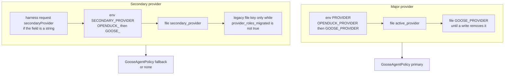
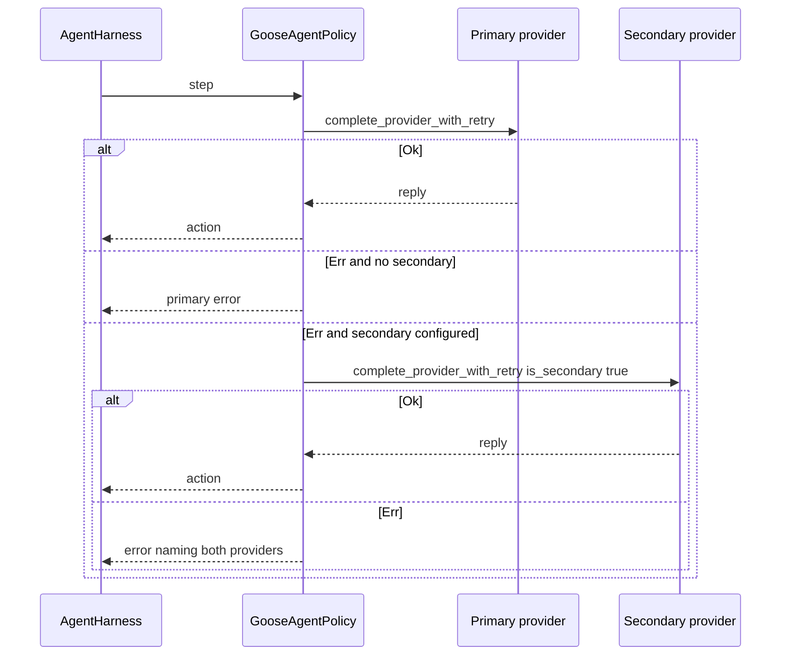

# Provider configuration refactor

| Field | Value |
|---|---|
| **Title** | Provider configuration: per-provider models and a selected secondary provider |
| **Status** | Draft |
| **Author** | (placeholder) |
| **Date** | 2026-10-07 |
| **Audience** | OpenDuck runtime, config, and Web Hub engineers |
| **Primary files** | `crates/openduck/src/config/providers.rs`, `crates/openduck/src/config/migrations.rs`, `crates/openduck/src/model_config.rs`, `crates/openduck/src/control/harness.rs`, `crates/openduck/src/control/app_config.rs`, `ui/hub/src/components/OpenDuckConfigPanel.tsx` |
| **Related, not redesigned** | Provider implementations, model catalogs, prompt caching, compaction, judge, Agent Log transcript, retry counts |

## 1. Overview

OpenDuck already stores providers as a map. `providers` and `active_provider` live in `~/.config/openduck/config.yaml`, and `ProviderEntry` holds `enabled`, `model`, and `configured` (`crates/openduck/src/config/providers.rs`). Fast model, secondary provider, and secondary model do not. They are still flat keys: `GOOSE_FAST_MODEL` (read by `configured_fast_model_name`), and `GOOSE_SECONDARY_PROVIDER` / `OPENDUCK_SECONDARY_PROVIDER` plus `GOOSE_SECONDARY_MODEL` / `OPENDUCK_SECONDARY_MODEL` (read by `Config::get_goose_secondary_provider` and `get_goose_secondary_model` in `crates/openduck/src/config/base.rs`). When the secondary model key is missing, `resolve_harness_policy_with_secondary` substitutes the literal model name `"default"`. When the fast model key is missing, `get_fast_model` substitutes a registry default (`ProviderMetadata.fast_model`, or OpenAI's live fast model).

This design keeps the provider entry as the configuration unit and adds two optional strings on that entry: `fast_model` and `secondary_model`. It adds one new top-level selection, `secondary_provider`, next to `active_provider`. The major provider remains `active_provider`. A fast model that is absent or blank resolves to that same provider's effective main model, never to a registry default. A `secondary_model` that is absent or blank means that provider has no second model. The secondary provider, when selected, is a different provider used only as the existing per-step fallback in `GooseAgentPolicy` after `complete_provider_with_retry` returns `Err`. The fallback provider runs its own `model`, and its own fast-model rule. The Web Hub edits this map through a dedicated config route. API keys stay in the secrets file.

## 2. Background and motivation

### 2.1 What the code does today

`ProviderEntry` is:

```rust
pub struct ProviderEntry {
    #[serde(default)]
    pub enabled: bool,
    #[serde(default)]
    pub model: String,
    #[serde(default)]
    pub configured: bool,
}
```

There is no `deny_unknown_fields`. Serde's default is to ignore unknown fields on deserialize and to emit every field on serialize. `get_active_provider` checks `openduck_env::get_var("PROVIDER")` (that is `OPENDUCK_PROVIDER`, then `GOOSE_PROVIDER`), then the file key `active_provider`, then the file key `GOOSE_PROVIDER`. `get_active_model` checks `MODEL` (`OPENDUCK_MODEL`, then `GOOSE_MODEL`), then the active entry's non-empty `model`, then the file key `GOOSE_MODEL`. `set_active_provider` writes `active_provider` and then replaces the named entry with a fresh `ProviderEntry { enabled: true, model, configured: true }`. `clear_active_provider` deletes `active_provider`, `GOOSE_PROVIDER`, and `GOOSE_MODEL` and leaves the map alone. `Config::get_goose_provider`, `set_goose_provider`, `get_goose_model`, and `set_goose_model` delegate to that module. `set_goose_provider` looks up the target entry's model and calls `set_active_provider`, which still replaces the entry.

`migrate_provider_config` in `crates/openduck/src/config/migrations.rs` is the only provider migration. `Config::load_write_config` runs `run_migrations` before a write. `Config::load` and `load_strict` run only `run_read_migrations`, which deliberately skips provider migration because that migration deletes flat keys. Once a `providers` map exists, a later write backfills `active_provider` from `GOOSE_PROVIDER` if needed and `cleanup_legacy_provider_keys` deletes `GOOSE_PROVIDER`, `GOOSE_MODEL`, and `*_configured`. Readers of the active provider still fall back to the flat `GOOSE_PROVIDER` key until that write happens.

`get_fast_model` (`crates/openduck/src/model_config.rs`) resolves in this order:

1. `Config::get_param("GOOSE_FAST_MODEL")`, which is env `OPENDUCK_FAST_MODEL`, then env `GOOSE_FAST_MODEL`, then the file key.
2. `provider_default_fast_model`: for `openai`, `live_fast_model()` (`gpt-4o-mini` only when the host is the direct OpenAI host); otherwise `ProviderMetadata.fast_model` from the registry.
3. The `model_config` passed by the caller.

Registry defaults that exist today include `claude-haiku-4-5` (`ANTHROPIC_DEFAULT_FAST_MODEL`), `gemini-2.5-flash` (`GOOGLE_DEFAULT_FAST_MODEL`), `databricks-claude-haiku-4-5`, `google/gemini-2.5-flash` (OpenRouter), and `gemini-2.5-flash-lite` (Gemini OAuth). Declarative providers carry `fast_model` on `DeclarativeProviderConfig` (`crates/openduck-providers/src/declarative.rs`). Those stay code and catalog metadata. They stop being runtime substitutes.

`complete_fast` materializes that fast config, disables thinking and prompt-cache writes, and calls `provider.complete`. If `fallback_to_main_model` is true and the fast model name differs from the caller's model, a failure is logged and retried once on the caller's model. Callers:

| Caller | `fallback_to_main_model` | What it does |
|---|---|---|
| `session_naming::generate_session_name` | `true` | Session titles. Used from `session_manager` for both agent paths. CLI providers that `manages_own_context` skip `complete_fast`. |
| `tool_call_labels::complete_label` | `false` | Tool titles and chain summaries. Called from `acp/server/tool_calls/enrichment.rs`. |
| `orchestrator::OrchestratorClient::summarize_conversation` | `true` | Orchestrator extension summary. The extension is available to whichever loop loaded platform extensions. |

`complete_compaction` and `context_mgmt::summarize_tool_call` use the main model, not the fast model. They do not change.

Harness fallback is only in `GooseAgentPolicy` (`crates/openduck/src/control/harness.rs`). `with_secondary_provider` stores a second `Arc<dyn Provider>` and a `ModelConfig`, wrapping the provider in `CompactingProvider` unless it manages its own context. In `step`, the primary call is `complete_provider_with_retry(..., is_secondary: false)`. Any `Err` from that function switches to the secondary for that step (`is_secondary: true`). If both return `Err`, the error names both providers. If no secondary is configured, the primary error is returned. Retry counts stay inside `complete_provider_with_retry` and are not part of this design: `MAX_EMPTY_TURN_RETRIES` is 4, `MAX_TRANSIENT_POLICY_RETRIES` is 2, and a context-length error is pruned and retried once on the same provider before it can become an `Err`.

`resolve_harness_policy_with_secondary` builds that policy. The primary model falls back to `"default"` when `get_goose_model` fails. The secondary name is the request override or `get_goose_secondary_provider()`. The secondary model is the request override, or `get_goose_secondary_model()`, or the string `"default"`. If `model_config_from_user_config` or `providers::create` fails for the secondary, the error is discarded and the policy has no secondary. No log is emitted.

`HarnessEvalRequest` and `HarnessRunRequest` already carry optional `secondary_provider` and `secondary_model` (camelCase on the wire). CLI `openduck harness eval` and `openduck harness run` call `resolve_harness_policy`, which passes `None, None` and therefore picks up the flat config keys. Project task runs (`project_harness.rs`, `resolve_harness_policy`) do the same. `ProjectTaskRunRequest` and `ProjectHarnessEvalRequest` have no secondary fields.

The Hub settings panel (`OpenDuckConfigPanel`) edits scalars through `GET/PUT/DELETE /api/v1/config`, plus `PUT /api/v1/config/harness` and `PUT/DELETE /api/v1/config/judge`. `upsert_entry` writes one key. `validate_key` rejects secret-looking names and the structural keys `extensions`, `providers`, `harness`, `judge`, `advisors`, `notifications`, `secrets`, and `active_provider`. A PUT of `GOOSE_PROVIDER` calls `write_provider`, which calls `set_active_provider` and can replace an entry. `GOOSE_FAST_MODEL` is a generic scalar (`configEditor.ts` labels it "Fast model") and is not structural, so the panel can edit it today. The providers map is not in the document the panel edits. `read_entries` skips non-scalars, secrets, structural keys, and the dedicated provider/model/mode keys.

Credentials are not in `config.yaml`. `Config::get_secret` reads env first, then `~/.config/openduck/secrets.yaml` (or the system keyring when that feature is on). Provider `ConfigKey`s with `secret: true` use that path. `BUILDING_DOCKER.md` passes `GOOSE_PROVIDER`, `GOOSE_MODEL`, and API keys. It does not pass a secondary provider or a fast model. Recipe settings have `goose_provider` and `goose_model` only (`crates/openduck-sdk-types/src/custom_requests/recipe.rs`). No recipe or Docker path passes `SECONDARY_*`.

### 2.2 Pain

- Fast model and fallback are global, so switching `active_provider` silently keeps another provider's fast model and secondary model.
- A missing secondary model becomes the model name `"default"`, which is not a configured model.
- A missing fast model becomes a code default the user did not choose. That default can be wrong for a compatible endpoint (`live_fast_model` already special-cases this for OpenAI, which is why the registry value is not safe to apply implicitly).
- The Hub cannot edit the provider map. The scalar route is specified to reject `providers` and `active_provider`. Extending that PUT to accept a nested map would either violate `ensure_scalar` or risk a client flattening the document.
- `set_active_provider` rebuilds the entry. Any new field would be wiped by CLI configure (`configure.rs` line 999), ACP defaults save (`acp/server/config.rs` `on_defaults_save`), ACP `GOOSE_PROVIDER` / `GOOSE_MODEL` upserts, onboarding, and the signup flows. `on_save_provider_config` in `crates/openduck/src/acp/server/providers.rs` does not call `set_active_provider`. For ACP-setup providers it builds a fresh `config::ProviderEntry { enabled, model, configured }` and `set_provider_entry` replaces the row, which would drop the new fields the same way. `on_delete_provider_config` and `unconfigure_provider` in `provider_secrets.rs` load the entry and mutate it, so they keep unknown fields once the struct has them.

### 2.3 Four roles that must stay distinct

| Role | Stored as | If absent or blank |
|---|---|---|
| Main model | `ProviderEntry.model` | Legal on an entry that is not selected. A configuration error if that entry is the major or the secondary provider. Never the string `"default"`. |
| Fast model | `ProviderEntry.fast_model: Option<String>` | Use that provider's effective main model for this call. No registry substitute. |
| Same-provider second model | `ProviderEntry.secondary_model: Option<String>` | `None`. Not `model`, not a registry default, not `"default"`, not the secondary provider's model. |
| Secondary provider | Top-level `secondary_provider: string` | No provider fallback. The policy's `secondary_provider` stays `None`. |

The major provider is the existing `active_provider` role. It is not a new key.

## 3. Goals and non-goals

### Goals

- Keep `providers` plus `ProviderEntry` as the configuration unit.
- Store `model`, `fast_model`, and `secondary_model` on each entry.
- Select at most one major provider (`active_provider`) and at most one secondary provider (`secondary_provider`), which must be a different name.
- Resolve fast model as: env override, else the entry's `fast_model`, else the main model already chosen for that call.
- Resolve same-provider `secondary_model` only through `get_provider_secondary_model`, which returns `None` when unset.
- Keep harness fallback as the current per-step switch in `GooseAgentPolicy`, using the fallback provider's own `model` unless the request overrides it.
- Reject a selected provider that is missing, disabled, not `configured`, or has an empty `model`. Surface that in the Hub and at resolve time.
- Edit providers in the Web Hub without accepting API keys.
- Migrate the three legacy flat keys inside `migrate_provider_config`. Do not add a second migration runner.
- Preserve new entry fields across `set_active_provider` and across `on_save_provider_config`, which replaces the entry today.

### Non-goals

- Redesigning provider implementations, declarative provider authoring, model catalogs, prompt caching, compaction, the judge, or the Agent Log transcript.
- Changing retry counts, empty-turn nudges, transient backoff, or context-length pruning inside `complete_provider_with_retry`.
- Adding a tertiary provider, or moving harness fallback into the chat agent loop.
- A Desktop settings screen for these fields. Desktop keeps using `get_goose_provider` / `get_goose_model` and ACP defaults. See the compatibility note in section 4.8.
- Auto-selecting `secondary_model` inside the agent loop, the state machine, or `GooseAgentPolicy`.
- Teaching `complete_fast` to switch to the secondary provider. See Open Questions for the one behavior this plan explicitly does not add.
- Changing `OPENDUCK_PLANNER_PROVIDER`. That remains a separate planning-mode setting.
- Project-task request fields for a per-run secondary. Project runs keep using the saved selection through `resolve_harness_policy`. Adding those fields would be a follow-up, not part of the four PRs below.

## 4. Proposed design

### 4.1 Data model

```rust
#[derive(Debug, Deserialize, Serialize, Clone)]
pub struct ProviderEntry {
    #[serde(default)]
    pub enabled: bool,
    #[serde(default)]
    pub model: String,
    #[serde(default)]
    pub configured: bool,
    #[serde(default, skip_serializing_if = "Option::is_none")]
    pub fast_model: Option<String>,
    #[serde(default, skip_serializing_if = "Option::is_none")]
    pub secondary_model: Option<String>,
}
```

`#[serde(default)]` on the new fields is required so a file written by today's binary still loads. `skip_serializing_if` keeps absent fields out of YAML. Do not add `deny_unknown_fields` to `ProviderEntry`. An old binary must ignore the new keys (section 11).

Blank and whitespace-only strings are normalized to absent before write. A fast model that equals that entry's `model` is also stored as absent. The runtime treats "equal to model" and "absent" the same; the file should not carry a redundant copy. `secondary_model` equal to `model` is stored as written only if it is non-blank and the user set it. It is not an alias of `model`. The Hub normalizes a blank secondary model to absent. It does not normalize a secondary model that happens to equal `model`, because that would hide an explicit value the user may want a future caller to see. The UI copy for a blank secondary model is "no secondary model".

Top-level keys:

- `active_provider`: major provider name. Unchanged.
- `secondary_provider`: optional provider name. Absent, empty, or whitespace means no fallback.

`enabled` and `configured` both have to be true, and `model` has to be non-empty, before a provider can be selected as major or secondary.

- `configured` remains the historical marker migrated from `{name}_configured`. CLI configure sets it after a successful provider test. The Hub sets it when the user saves a non-empty `model` for a registry provider. It does not mean "the secret was checked just now".
- `enabled` is the on/off switch. Migration of a discovered provider sets it `true`, matching today's migration. The Hub can turn it off. Selection checks run after the new major and secondary are applied, so one save may move the selection and disable the previous row. Disabling the provider that is still selected after that save is rejected.
- A provider that is in the map with `configured: false` or `enabled: false` can keep its model fields, but it cannot be `active_provider` or `secondary_provider`.

`set_active_provider` keeps the signature it has today, `set_active_provider(config, name: &str, model: &str)`. It rejects an empty or whitespace `model` with `ConfigError` instead of writing it. On success it writes `active_provider` and merges into the existing entry: set `enabled` and `configured` to true, set `model` to the non-empty argument, and leave `fast_model` and `secondary_model` as they were. If the entry does not exist yet, those two options are `None`. There is no `Option` form of this function. `None` versus blank is only the contract of `upsert_provider_models`, below.

Clearing a model is `clear_provider_model(config, name)`. It sets that entry's `model` to `""` and does not change `fast_model`, `secondary_model`, `enabled`, or `configured`. The two callers that pass `""` today both switch to it in PR 1:

- `on_config_remove` for `GOOSE_MODEL` in `crates/openduck/src/acp/server/config.rs`
- `clear_model` in `crates/openduck/src/control/app_config.rs`

No other function is named for this. Do not add `set_provider_model`.

`on_save_provider_config` (`crates/openduck/src/acp/server/providers.rs`, the `metadata.setup.acp` branch) stops building a new `ProviderEntry`. It loads the existing entry the way `unconfigure_provider` already does, and sets only `enabled`, `configured`, and `model` (the current entry model, or `metadata.default_model` when the entry is missing). `fast_model` and `secondary_model` stay. `on_delete_provider_config` already mutates the loaded entry and does not need a new shape. `providers/provider_registry.rs` has a different `ProviderEntry`. That type is the registry row. It does not gain these fields, and PR 1 does not edit it.

Every `config::ProviderEntry { ... }` literal has to name the new fields or use `..Default::default()` once `Default` is derived. PR 1 updates all of them so the workspace builds:

- `crates/openduck/src/config/providers.rs` (the setter and `test_set_and_get_provider_entry`)
- `crates/openduck/src/config/migrations.rs` (the build loop and the assertion literal)
- `crates/openduck/src/acp/server/providers.rs` (the save path above; the delete path is a mutate, not a fresh literal)
- `crates/openduck/src/providers/provider_secrets.rs` (`unconfigure_provider_clears_structured_entry`)
- `crates/openduck-cli/src/session/builder.rs` (four test literals that call `set_provider_entry`)

New helpers in `providers.rs`, all taking `&Config`:

- `get_provider_fast_model_name(provider_name) -> Option<String>` reads the entry only. Blank is `None`. No env, no registry, no main-model substitution.
- `get_provider_secondary_model(provider_name) -> Option<String>` reads the entry only. Blank is `None`.
- `get_secondary_provider() -> Option<String>` is the selection resolver in section 4.3. PR 2 is when harness resolve starts calling it.
- `set_secondary_provider(Option<&str>)` writes or deletes the key. `None` or blank deletes it and does not recreate it from the legacy key when the migration marker is set (section 5).
- `upsert_provider_models(name, ProviderModels { model, fast_model, secondary_model })` merges into the existing entry. On this Rust API, `None` leaves the current value and `Some("")` stores absent. The HTTP PUT does not use that leave-current convention. Its keys are required. JSON `null` and `""` on `fastModel` and `secondaryModel` store absent (section 6.2).
- `validate_selection(major, secondary) -> Result<()>` implements the rules in section 4.5.
- `provider_roles_migrated(config) -> bool` is the file marker from section 5, read from the YAML mapping, not through `get_param`.

`Config::get_goose_secondary_provider` and `get_goose_secondary_model` keep reading the flat keys through PR 1. Harness resolve still calls them and still substitutes `"default"` until PR 2, which switches those wrappers and `resolve_harness_policy_with_secondary` together. `get_goose_provider` and `get_goose_model` stay the major-provider accessors. Desktop and the scheduler keep calling them.

### 4.2 YAML before and after

Before, a file that still has the flat keys and no `providers` map:

```yaml
GOOSE_PROVIDER: openai
GOOSE_MODEL: gpt-4o
GOOSE_FAST_MODEL: gpt-4o-mini
GOOSE_SECONDARY_PROVIDER: anthropic
GOOSE_SECONDARY_MODEL: claude-sonnet-4-5
openai_configured: true
anthropic_configured: true
```

After the existing provider migration plus the extension in section 5, on the first mutating write:

```yaml
active_provider: openai
secondary_provider: anthropic
provider_roles_migrated: true
GOOSE_FAST_MODEL: gpt-4o-mini
GOOSE_SECONDARY_PROVIDER: anthropic
GOOSE_SECONDARY_MODEL: claude-sonnet-4-5
providers:
  openai:
    enabled: true
    model: gpt-4o
    configured: true
    fast_model: gpt-4o-mini
  anthropic:
    enabled: true
    model: claude-sonnet-4-5
    configured: true
```

The flat `GOOSE_PROVIDER`, `GOOSE_MODEL`, and `openai_configured` keys are still removed by the existing cleanup. The fast and secondary legacy keys are copied once and left on disk for one release so the previous binary still reads them (section 11). `provider_roles_migrated: true` means that copy has happened. After the marker is set, a missing `fast_model` or a missing `secondary_provider` stays missing even though the legacy keys are still in the file. The previous binary ignores the marker and keeps using those legacy keys, including values the new binary has cleared.

A file the user then edits in the Hub, with same-provider `secondary_model` set on OpenAI and no fast-model override on Anthropic, and with the legacy keys still present until the next release removes them:

```yaml
active_provider: openai
secondary_provider: anthropic
provider_roles_migrated: true
providers:
  openai:
    enabled: true
    model: gpt-4o
    configured: true
    fast_model: gpt-4o-mini
    secondary_model: gpt-4.1
  anthropic:
    enabled: true
    model: claude-sonnet-4-5
    configured: true
```

`gpt-4.1` is not consulted by harness fallback. Fallback uses Anthropic's `model`. Nothing in this release calls `get_provider_secondary_model` except the resolver itself and tests.

Conflict example. The map already has `anthropic.model: claude-opus-4-1` and the file also has `GOOSE_SECONDARY_MODEL: claude-sonnet-4-5`. Migration keeps `claude-opus-4-1`, does not write `secondary_model`, and emits one `tracing::warn` with both names and the provider name. It does not add a conflict field to the file. The warn is the record. It fires only when the values differ and the entry model is non-empty.

If the secondary provider has no entry yet, migration creates one with `enabled: true`, `configured: true`, `model` set from the legacy secondary model when that string is non-empty, and no `fast_model` or `secondary_model`. If the legacy secondary model is also empty, `model` stays `""` and selection validation fails until the Hub or CLI sets a model. The string `"default"` is not written.

### 4.3 Resolution



Env overrides use `openduck_env::get_var`. That checks `OPENDUCK_<SUFFIX>` then `GOOSE_<SUFFIX>`. It does not consult a raw unprefixed variable. No new variable names.

File keys in the steps below are read from the YAML mapping (`Config::load` or the write mapping inside `load_write_config`). They are not read with `Config::get_param`. `get_param` calls `env_lookup` first. For `GOOSE_FAST_MODEL` that returns the env value before the file, so it cannot implement a file-only fallback. For an unprefixed key such as `secondary_provider`, `env_lookup` checks `OPENDUCK_SECONDARY_PROVIDER`, then `GOOSE_SECONDARY_PROVIDER`, then the raw environment variable `SECONDARY_PROVIDER`, and only then the file. The raw name `SECONDARY_PROVIDER` is not part of this contract. A small `file_string` helper that reads the mapping is the file path. There is no file-only helper on `Config` today.

`provider_roles_migrated` is that same file read. It is true only when the YAML boolean is true. Until the first write of this release sets it, the file has not been through the new migration, and the legacy file keys still apply. After it is true, absence means the user has no value, even if the legacy keys are still on disk. That is what makes a Hub clear stick. See section 5.

**Major name.** Unchanged: `get_active_provider`.

**Major model for a call that did not pass a model.** `get_active_model`. A selected major with an empty result is an error at harness resolve, not `"default"`.

**Fast model** inside `get_fast_model(provider_name, model_config)`:

1. If `openduck_env::get_var("FAST_MODEL")` is set and non-blank, that name. This is the existing env contract (`OPENDUCK_FAST_MODEL`, then `GOOSE_FAST_MODEL`) documented in `documentation/docs/guides/environment-variables.md`. It overrides every provider for this process. The Hub locks fast-model inputs.
2. Else if `get_provider_fast_model_name(provider_name)` is `Some`, that name.
3. Else, only when `provider_roles_migrated` is not true, and this `provider_name` is the active provider, the file key `GOOSE_FAST_MODEL` or `OPENDUCK_FAST_MODEL` when non-blank. This is the not-yet-migrated file, not a cleared field. The next release deletes the keys and this step.
4. Else clone `model_config`. That is the main model the caller already resolved (entry model, `MODEL` env, recipe, session, or harness request). Do not re-read the file, and do not call `provider_default_fast_model` or `live_fast_model`.

Step 4 is what "unset means that provider's model" means at a call site. A harness request that overrides `model` therefore also wins for fast tasks on that run when `fast_model` is unset. A set `fast_model` still wins over the request's main model, except when `FAST_MODEL` is in the environment.

`complete_fast`'s `fallback_to_main_model` flag stays. The existing guard `fast_model_config.model_name != model_config.model_name` makes the flag a no-op when the resolved fast model is the main model, which is the new default. When the user set a different `fast_model`, session naming and the orchestrator still retry once on the main model and log the existing warn. Tool-call labels still do not. Do not remove the flag in this refactor.

**Same-provider secondary model.**

```rust
pub fn get_provider_secondary_model(config: &Config, provider_name: &str) -> Option<String>
```

Returns the trimmed entry value, or `None`. It does not read `GOOSE_SECONDARY_MODEL`, the env, the registry, or `model`. No current caller asks for a second model on the same provider. Searched call sites of `secondary_model`, `GOOSE_SECONDARY_MODEL`, and `OPENDUCK_SECONDARY_MODEL` are the flat config accessors, the harness request DTOs, and `GooseAgentPolicy.secondary_model_config`. All three mean "the model the fallback provider should call", not an alternate model on the primary. This plan does not add a call site. A later caller that wants the field calls `get_provider_secondary_model` and handles `None`. The harness request's `secondaryModel` is not that caller. See the decision in section 13.

**Secondary provider name**, when the harness request did not pass one:

1. `openduck_env::get_var("SECONDARY_PROVIDER")`, which is `OPENDUCK_SECONDARY_PROVIDER` then `GOOSE_SECONDARY_PROVIDER`. This env already works today because `get_param("GOOSE_SECONDARY_PROVIDER")` goes through `env_lookup`. Docker and recipes do not set it. This plan does not add a new name and does not remove the existing one. The raw environment variable `SECONDARY_PROVIDER` is not read.
2. File key `secondary_provider` when the key is present and non-blank. A present empty value is "none", not a fallthrough.
3. Only when `provider_roles_migrated` is not true and the `secondary_provider` key is absent from the file, the file key `GOOSE_SECONDARY_PROVIDER` or `OPENDUCK_SECONDARY_PROVIDER`. After the marker is set, this step does not run, so a cleared selection stays cleared while those keys remain on disk for the previous binary.
4. `None`.

**Model used for the fallback provider:**

1. Harness request `secondaryModel` when the field is a non-empty string. That value is used for this run only. It is not written back, and it is not read from `ProviderEntry.secondary_model`.
2. Else `openduck_env::get_var("SECONDARY_MODEL")` (`OPENDUCK_SECONDARY_MODEL`, then `GOOSE_SECONDARY_MODEL`). Same rationale as the provider env: `get_param` already honors it. It overrides the fallback provider's `model` for the process. It does not override `secondary_model` on any entry. The Hub locks the model field of the selected secondary provider while this env is set. The raw environment variable `SECONDARY_MODEL` is not read.
3. Else that provider entry's `model` when non-empty.
4. Only when `provider_roles_migrated` is not true and that entry's `model` is empty, the file key `GOOSE_SECONDARY_MODEL` or `OPENDUCK_SECONDARY_MODEL`. After the marker is set, clearing the entry model does not resurrect this string.
5. Else a configuration error. Not `"default"`.

Fast tasks that do run on the fallback provider use `get_fast_model(fallback_name, fallback_model_config)`. The policy switch itself calls `complete`, not `complete_fast`, so a failover step uses the fallback main model. If session naming or another `complete_fast` caller is later handed the fallback provider object, the fallback entry's `fast_model` applies. This plan does not retarget those callers.

**Request versus saved selection** in `resolve_harness_policy_with_secondary`:

| Input | Primary | Fallback provider |
|---|---|---|
| Field omitted or JSON `null` | `get_goose_provider` / `get_goose_model`. If that saved major is missing, the existing error `No default provider configured. Use --provider <name> or run 'goose configure'` (`resolve_harness_policy_with_secondary`, the `None` arm) | Saved or env secondary, as above |
| Non-empty string | That provider. If `model` is omitted, that entry's `model`, not the previously active provider's model and not `"default"` | That provider name. Model from the table above |
| Empty or whitespace string | Configuration error, even when a major is saved. Does not call `get_goose_provider`. Does not use the "No default provider configured" text | No fallback for this run, even if a secondary is saved or set in the env |

`HarnessRunRequest.provider` and `HarnessEvalRequest.provider` are `Option<String>`. The eval and run handlers pass `req.provider.as_deref()` (`harness.rs`, the `resolve_harness_policy_with_secondary` call sites). Today `Some("")` takes the `Some(p) => p.to_string()` arm and is used as the provider name. It does not fall through to `get_goose_provider`, and it does not produce the "No default provider configured" error. That string is only the `None` arm, which runs when the field was omitted or JSON `null` and the saved major is missing. PR 2 rejects empty or whitespace before `providers::create` and before `get_goose_provider`. A saved major does not make `""` valid.

Request beats env, matching today's `provider_opt` being checked before `get_goose_provider`. Env beats the file, matching `get_param`. The UI locks a control whose env is set so a person cannot think they saved over the env. An API client can still pass a per-run override. That override does not write the file.

Project task runs and the CLI harness commands do not pass request overrides. They use the saved selection, including "none". `estimate_with_model` (`project_harness.rs`) and `generate_with_model` (`control/git.rs`) currently substitute `"default"` when the major model is missing. They call the shared model resolver and return its error instead. They do not gain a secondary provider. They are one-shot calls, not `GooseAgentPolicy` steps.

### 4.4 Fallback trigger

The trigger does not change. After the primary `complete_provider_with_retry` returns `Err`, and both `secondary_provider` and `secondary_model_config` are `Some`, the policy logs the existing `tracing::warn` ("Primary provider failed or returned empty completion after retries") and calls `complete_provider_with_retry` on the secondary with `is_secondary: true`.

`complete_provider_with_retry` returns `Err` only when:

- `provider.complete` or the stream path returns a non-transient `ProviderError`, or a context-length error whose pruned retry also fails, or
- a transient error (`NetworkError` or `ServerError`) has already used both retries (`MAX_TRANSIENT_POLICY_RETRIES` is 2), or
- the reply is an empty completion or thinking-only (`is_empty_completion_error`) and the empty-turn retries are exhausted (`MAX_EMPTY_TURN_RETRIES` is 4), or
- `action_from_provider_reply` returns some other error.

A successful primary reply never consults the secondary. The secondary is not used for the next step automatically. The next step starts on the primary again, because the switch is local to that `step` call. This plan does not change that.



Construction failure of the secondary stays non-fatal, with one change: the `if let Ok(sec_provider) = providers::create` arm that currently swallows the error logs `tracing::warn` with the provider name and the error, then continues with no secondary. Invalid configuration (equal names, empty model, not configured, disabled, unknown to the map) is rejected before `create`, at resolve time, so the run does not start. A create failure is the remaining case: the entry looks selected but the provider cannot be built, usually because the secret is missing or the registry name is unknown. Failing the whole run there would be a behavior change for a primary that would have succeeded. The warn is the error event that is missing today.

Both providers failing keeps the existing `tracing::error` and the existing `anyhow` message that includes both names. No new log line on that path.

### 4.5 Validation

`validate_selection` checks selection only. The HTTP handler calls it after the new major and secondary are applied, and then applies one extra registry rule that `validate_selection` does not.

`validate_selection` rules:

- Major is required to start a harness run, a scheduler job, or a session. That is already true for `get_goose_provider`. The provider PUT allows an explicit clear: `majorProvider: null` or `""` deletes `active_provider` (section 6.2). Omitting the key is a 400. The panel has a clear control that sends null, and it shows the major as unset afterward. A harness run with no major still fails at resolve. The scalar `remove_entry` of `GOOSE_PROVIDER` keeps clearing until PR 4, which is when the panel stops calling it.
- Secondary is optional. The Hub control includes "none", stored as a deleted `secondary_provider` key. After `provider_roles_migrated` is true, that delete is not filled back in from `GOOSE_SECONDARY_PROVIDER`.
- Secondary name, when set, must differ from the major name. Env resolution is not applied to the file. The file itself must not store `secondary_provider == active_provider`. Migration does not write that pair (section 5). If env `PROVIDER` makes the effective major equal the saved secondary at resolve time, resolve returns an error and does not attach a fallback. The run does not start.
- The selected entry must exist in the map, `enabled` must be true, `configured` must be true, and `model` must be non-empty. Otherwise resolve returns an error that names the provider and which check failed.
- `validate_selection` does not check the registry.

Registry rule, on the route only, and only for names that were not already in the stored map:

- A name in `availableProviders` may be added. That list is the live registry minus names already in the map (section 4.7).
- A name already in the stored map may be sent back even if it is no longer in the live registry.
- Any other new name is 400.

Resolve of a name that was in the map and later disappeared from the registry is not a `validate_selection` error. It fails later at `providers::create` (secondary: warn and no fallback; primary: the existing create error).

- Blank `fast_model` is stored as absent. Blank `secondary_model` is stored as absent. JSON `null` on the PUT is the same absent value (section 6.2).

### 4.6 Where each runtime path gets its provider

Fallback lives only in `GooseAgentPolicy`. The legacy loop (`crates/openduck/src/agents/agent.rs`, around the reply path) and the state machine (`InferenceRunner::infer` in `crates/openduck/src/agents/state_machine/ops_llm.rs`) both stream through `crate::agents::reply_parts::stream_response_from_provider` on the single provider stored on the session. Neither calls `provider.complete` directly, and neither reads `secondary_provider`. `agent.rs` `restore_provider_from_session` has a different fallback: if the session's provider is not in the registry, it switches to `get_goose_provider` and warns. That is not the secondary provider, and this plan does not change it. AGENTS.md parity applies to agent-loop behavior. This change is not an agent-loop behavior change. Both loops pick up the fast-model rule because `complete_fast` is shared. No edit to `ops_llm.rs` or `agent.rs` reply is required.

| Call site | What it builds | Major | Fast model | Secondary provider | Same-provider `secondary_model` |
|---|---|---|---|---|---|
| `resolve_harness_policy_with_secondary` | `GooseAgentPolicy` for REST eval/run | Yes, with request override | Indirect, if a later `complete_fast` uses that provider | Yes. This is the fallback | No |
| `resolve_harness_policy` | CLI harness, project task run | Yes. Project request `provider`/`model` or project policy, else config | Same | Saved selection only. No per-task override field | No |
| `session/builder.rs` `resolve_provider_and_model` | CLI session | Request, then session, then recipe `goose_provider`/`goose_model`, then config. Already reads `get_provider_entry` for the overridden provider's model | Via session naming | No | No |
| `scheduler.rs` scheduled recipe | `Agent` via `get_goose_provider` / `get_goose_model` | Yes | Via session naming if the agent names the session | No | No |
| `agent.rs` `model_config_for_session`, `restore_provider_from_session` | Chat provider | Session, else major | Via session naming and tool-pair compaction. Compaction uses `complete_compaction` (main model) | No. Registry-miss restore uses the major, not `secondary_provider` | No |
| `state_machine/ops_llm.rs` | Next assistant turn | The provider already on the session | No direct call | No | No |
| `acp/server_factory.rs`, `acp/server/new_session.rs` | Desktop/ACP session | `get_goose_provider` | Via session naming | No | No |
| `control/git.rs` `generate_with_model` | Commit message | Major. Stop substituting `"default"` | No. Uses `complete` on the main model | No | No |
| `project_harness.rs` `estimate_with_model` | Turn estimate | Project policy or major. Stop substituting `"default"` | No | No | No |
| `permission/permission_judge.rs`, `doctor.rs`, `agents/mcp_client.rs`, `gateway/handler.rs`, `security/adversary_inspector.rs` | One-shot or display | Major via `get_goose_*` | No | No | No |
| `posthog.rs`, `session/diagnostics.rs` | Telemetry labels | Major name only | No | No | No |

Recipe `goose_provider` / `goose_model` stay session overrides of the major. They do not select `secondary_provider` and do not set `fast_model`.

### 4.7 Hub editor

The provider block in `OpenDuckConfigPanel` replaces the current Provider and Model inputs (`saveDefaults` writing `GOOSE_PROVIDER` and `GOOSE_MODEL`). That replacement ships in PR 4, not before. Until then the free-text provider field stays, and `write_provider` keeps today's behavior, including copying the current model onto a name that is not yet a valid entry. Mode, harness guardrails, judge, and the other scalar entries stay.

The block shows:

- One row per entry in the `providers` map, in map order (`IndexMap` already preserves it). An empty map shows no rows, the major control as unset, and the secondary control as "none".
- An add control. It lists provider names from `availableProviders` on the GET response: the live registry minus names already in the map. The live registry is `crate::providers::providers()` after `refresh_custom_providers()` (`crates/openduck/src/providers/init.rs`). That path calls `load_custom_providers_into_registry`, so declarative providers under `custom_providers` are included. A static built-in list is not used. Picking one appends `{ name, enabled: true, model, fastModel, secondaryModel }` to the PUT array. The user types the model before the new row can be selected as major or secondary. The server sets `configured` from a non-empty model. This is how a file that only has the active provider gains a secondary, and how a fresh install creates the first provider without the scalar box.
- Columns on each row: name, enabled, model, fast model, secondary model.
- A control for the major provider. The choices are entries that are `enabled` and have a non-empty model, plus "clear". A newly added row with a non-empty model is included. The server is what sets `configured`. The control also shows the current value when env locks it.
- A control for the secondary provider with the same list and an explicit "none".
- Under a blank fast model, the text "uses model". The input placeholder may show `suggestedFastModel` from the GET response, labeled as a suggestion. Saving a blank stores the field absent. The suggestion is not written.
- Under a blank secondary model, the text "no secondary model".
- No API key, token, or secret input. No link that posts a secret to `/api/v1/config`.

What the locked controls show, and what the PUT sends, are different bytes.

Provider selectors (`majorProvider`, `secondaryProvider`) use `{ value, fileValue, fromEnv }`:

- `value` is the env string when `fromEnv` is true, and the file string otherwise. The input displays `value`.
- `fileValue` is the YAML bytes. The PUT submits `fileValue`. It does not submit `value` when that is the env string, and it does not omit the key.

Model fields on each row use a pair of the same idea. `model`, `fastModel`, and `secondaryModel` are the file values (`null` when absent, not omitted). The env display strings are separate:

- `modelEnvValue` is the `MODEL` env string on the major row when `modelFromEnv` is true, and `null` on every other row and when the flag is false. The locked major model input displays `modelEnvValue`. The PUT submits that row's `model`.
- `fastModelEnvValue` is the `FAST_MODEL` env string on every row when `fastModelFromEnv` is true, and `null` otherwise. The locked fast-model input displays `fastModelEnvValue`, not `resolvedFastModel`. The PUT submits that row's `fastModel` (`null` or `""` when the file field is absent).
- `secondaryModelEnvValue` is the `SECONDARY_MODEL` env string on the selected secondary row when `secondaryModelFromEnv` is true, and `null` otherwise. The locked input displays `secondaryModelEnvValue`. The PUT submits that row's `model`, because this env overrides the fallback provider's `model`, not `ProviderEntry.secondary_model`.

`resolvedFastModel` is the section 4.3 fast-model name for that row, including step 1. When `FAST_MODEL` is set it equals `fastModelEnvValue`. When it is not set it is the entry fast model or the main model. The "uses model" label reads `fastModelUsesMain`. It is not the lock display and it is not submitted.

The server accepts a locked field only when the submitted value equals the file value. It compares to the file, not to the env, and it does not copy the env string into the file. For `fastModel` and `secondaryModel`, JSON `null`, `""`, and whitespace-only are the same file value as an absent field. Omitting the key is a 400.

Which fields are locked:

- `PROVIDER` set: major control read-only. PUT `majorProvider` must equal the file `active_provider` (both empty counts as equal, including `null` and `""`).
- `MODEL` set: the major provider's model field read-only. Other providers' model fields stay editable. PUT `model` on the major entry must equal that entry's file model. The displayed text is `modelEnvValue`.
- `FAST_MODEL` set: every fast-model field read-only. The displayed text is `fastModelEnvValue`. PUT `fastModel` on every entry must equal that entry's file value. Absent, `null`, and `""` match each other.
- `SECONDARY_PROVIDER` set: secondary control read-only. PUT `secondaryProvider` must equal the file key. Absent, `null`, and `""` match each other.
- `SECONDARY_MODEL` set: the selected secondary provider's model field read-only. The displayed text is `secondaryModelEnvValue`. PUT `model` on that entry must equal the file model.

Validation in the client runs before PUT, and the server repeats it on the document after the new major and secondary are applied. The client helpers live in a new `ui/hub/src/providerConfig.ts`, tested with `node:test` the same way as `configEditor.test.ts`. The React component is not unit-tested. `cd ui/hub && pnpm test` and the hub typecheck are the checks. There is no root `package.json`.

`GOOSE_FAST_MODEL`, `OPENDUCK_FAST_MODEL`, `GOOSE_SECONDARY_PROVIDER`, `OPENDUCK_SECONDARY_PROVIDER`, `GOOSE_SECONDARY_MODEL`, and `OPENDUCK_SECONDARY_MODEL` leave the generic scalar list in PR 4, together with the editor. `read_entries` skips them. `upsert_entry` / `remove_entry` reject them with "edit this on the provider". In PR 3, `secondary_provider` and `provider_roles_migrated` are added to `STRUCTURAL_KEYS` next to `active_provider`, so a scalar PUT cannot write the marker or the selection key before the editor ships.

Scalar `write_provider` and `write_model` stay behavior-compatible through PR 3, except that PR 1's `clear_provider_model` is what `clear_model` calls so an empty model does not rebuild the entry. PR 4, in the same release as this editor, stops the panel from sending `GOOSE_PROVIDER` / `GOOSE_MODEL` and tightens `write_provider`: it selects an existing entry only when that entry is configured, enabled, and has a non-empty model, and it does not copy the previous active model onto a different name. A client that still PUTs `GOOSE_PROVIDER` for a name that fails those checks gets `AppConfigError::Invalid` starting in that release. PR 3 must not ship that tighter rule while the panel still depends on the old one.

### 4.8 Desktop compatibility

Desktop is out of scope for a new screen. `ModelAndProviderContext` reads and writes through ACP (`acpReadDefaults`, `acpSaveDefaults` in `ui/desktop/src/components/ModelAndProviderContext.tsx`). `on_defaults_read` / `on_defaults_save` use `get_goose_provider`, `get_goose_model`, and `set_active_provider`. After the merge fix, saving a desktop default updates `active_provider` and `model` and leaves `fast_model` and `secondary_model` in place. Saving an ACP provider's config goes through `on_save_provider_config`, which must merge the same way. The migration examples use `claude-acp`, and that id is this path (`metadata.setup.acp`).

Risk if either writer still replaces the entry: the next desktop save drops the new fields. Today's `set_active_provider` builds a new `ProviderEntry` with only the three old fields, and `on_save_provider_config` does the same for ACP-setup providers. Both are fixed in PR 1. A test on the extracted merge used by `on_save_provider_config` asserts `fast_model` and `secondary_model` survive.

`on_defaults_save` also refuses a provider the inventory marks unconfigured (`entry.configured` from `default_inventory_configured`, which inspects secret config keys). That check is separate from `ProviderEntry.configured`. This plan does not change the inventory. A provider that the Hub marked `configured: true` can still be rejected by Desktop until the secret exists. That is the current Desktop rule and it should stay.

An old Desktop binary talking to a new server is fine: it never sends the new fields. A new server talking to an old config file is fine: the new fields default.

## 5. Migration

Extend `migrate_provider_config`. Do not add another function to `run_migrations` beyond a helper that `migrate_provider_config` calls. Do not run provider migration from `run_read_migrations`.

`migrate_provider_config` returns immediately when `providers` already exists, after the `active_provider` backfill:

```rust
if config.contains_key(&providers_key) {
    // backfill active_provider from GOOSE_PROVIDER
    return cleanup_legacy_provider_keys(config);
}
```

That is the path for every file this binary has already migrated. The new steps run in both branches. The early `return cleanup_legacy_provider_keys(...)` moves to after the steps below. A file with no `providers` map still builds the map first, then runs the same steps.

`provider_roles_migrated: true` separates "not migrated yet" from "the user cleared this". The copy runs only when that boolean is not already true. Then the migration sets it true. A later write, including the write that clears a field, does not copy again.

On that first write only:

1. If `secondary_provider` is absent, read a non-blank `GOOSE_SECONDARY_PROVIDER` or `OPENDUCK_SECONDARY_PROVIDER` from the mapping. If that name equals the active provider, do not write `secondary_provider`, do not create an entry, and do not run step 3 against the major. Emit one `tracing::warn` with the provider name, the same class of warn as the model conflict in step 3. The legacy keys stay on disk. Still run step 4 and step 5, so the fast-model copy and `provider_roles_migrated` still happen. Today `resolve_harness_policy_with_secondary` has no equality check, so the old binary still starts a run when those legacy names match. Copying the equal name would make PR 2 reject every harness run. Skipping the write leaves the new binary with no secondary, and the run starts. If the legacy name is non-blank and different from the active provider, copy it into `secondary_provider`.
2. Ensure that copied name has an entry. Create one if missing (`enabled: true`, `configured: true`, empty model). Skip this step when step 1 did not write a name.
3. If a secondary was written, and `GOOSE_SECONDARY_MODEL` or `OPENDUCK_SECONDARY_MODEL` is a non-blank file value, and that entry's `model` is empty, set `model` to that value. If `model` is non-empty and different, keep `model`, do not set `secondary_model`, and `tracing::warn` once with the provider name and both model names. If they are equal, do nothing. Do not apply this step to the major when step 1 skipped an equal name. `GOOSE_SECONDARY_MODEL` must not fill or replace the active provider's `model`.
4. If the active provider entry exists and its `fast_model` is absent or blank, copy a non-blank `GOOSE_FAST_MODEL` or `OPENDUCK_FAST_MODEL` onto `fast_model`. If `fast_model` is already set, leave it. If there is no active provider, leave the flat key untouched and do not invent a provider.
5. Set `provider_roles_migrated` to true even when there was nothing to copy, so a legacy key added later cannot fill a field the user left empty.
6. Do not delete `GOOSE_FAST_MODEL`, `OPENDUCK_FAST_MODEL`, `GOOSE_SECONDARY_PROVIDER`, `OPENDUCK_SECONDARY_PROVIDER`, `GOOSE_SECONDARY_MODEL`, or `OPENDUCK_SECONDARY_MODEL` in this release. `cleanup_legacy_provider_keys` still deletes `GOOSE_PROVIDER`, `GOOSE_MODEL`, and `*_configured` only.

`load_write_config` runs this migration before the caller mutates the mapping. A clear therefore happens in this order: the first write copies the legacy values and sets the marker, then the handler stores the cleared field, then `save_values` writes both. The next resolve sees the marker and does not read the legacy file keys. The legacy keys are still in the file. An old binary ignores `provider_roles_migrated` and keeps the pre-clear legacy values until the next release deletes those keys.

The compatibility window matches the reason `run_read_migrations` skips provider migration, and it is stricter than `cleanup_legacy_provider_keys` on purpose. `GOOSE_PROVIDER` can be deleted on write because current readers already understand `active_provider`. The previous binary does not understand `fast_model`, `secondary_model`, `secondary_provider`, or the marker. Deleting the flat fast and secondary keys in the same release would make that binary lose fast model and fallback. The next release adds those six names to `cleanup_legacy_provider_keys` and deletes the reader steps that consult them when the marker is absent.

Migration is idempotent. A second write sees the marker and does not overwrite a non-empty `fast_model`, a non-empty entry `model`, or an existing `secondary_provider`, and it does not recreate a key the user deleted.

No feature flag. Config migrations in this repo are not flagged. The first `set_param` or provider save persists the copy and the marker. A read-only process, with the marker still absent, keeps working through the legacy file-key steps in section 4.3.

## 6. API and interface changes

### 6.1 Why a new route

`PUT /api/v1/config` is `upsert_app_config` (`crates/openduck/src/control/http.rs`). The body is `{ key, value }`. `validate_key` rejects `providers` and `active_provider`. `ensure_scalar` rejects maps. Putting the provider document through that route would either be rejected or would require a special case that still leaves `secondary_provider` and the map as two writes. A dedicated route updates the map and both selection keys in one `load_write_config` / `save_values` cycle so a crash cannot leave a new major pointing at an entry the map does not yet contain. `set_param_values` already holds `config.guard` once and inserts many keys, but it cannot delete a key. Clearing `active_provider` or `secondary_provider` needs a sibling that, under that same lock, loads the write mapping, inserts or removes keys, and calls `save_values` once. Do not call `set_provider_entry` in a loop of separate saves. Validate the body before the first write so a rejected body changes nothing. `load_write_config` runs migration before that mutation, which is what sets `provider_roles_migrated` before a clear is stored (section 5).

### 6.2 Routes

`GET /api/v1/config/providers` and `PUT /api/v1/config/providers`, registered beside the harness and judge routes in `control/http.rs`.

GET response, camelCase:

```json
{
  "majorProvider": { "value": "openai", "fileValue": "openai", "fromEnv": false },
  "secondaryProvider": { "value": null, "fileValue": null, "fromEnv": false },
  "modelFromEnv": false,
  "fastModelFromEnv": true,
  "secondaryModelFromEnv": false,
  "availableProviders": ["anthropic", "google", "ollama"],
  "providers": [
    {
      "name": "openai",
      "enabled": true,
      "configured": true,
      "model": "gpt-4o",
      "modelEnvValue": null,
      "fastModel": null,
      "fastModelEnvValue": "gpt-4o-mini",
      "secondaryModel": null,
      "secondaryModelEnvValue": null,
      "resolvedFastModel": "gpt-4o-mini",
      "fastModelUsesMain": false,
      "suggestedFastModel": "gpt-4o-mini"
    }
  ]
}
```

For `majorProvider` and `secondaryProvider`, `value` is what the control displays. When `fromEnv` is true, `value` is the env string and `fileValue` is what the YAML holds. The PUT sends `fileValue`.

On each provider row, `model`, `fastModel`, and `secondaryModel` are file values. `fastModel` and `secondaryModel` are JSON `null` when absent, not omitted. `modelEnvValue`, `fastModelEnvValue`, and `secondaryModelEnvValue` are the env display strings from section 4.7. They are `null` when that field is not locked. The locked input displays the env string. The PUT submits the file field, not the env string.

`resolvedFastModel` is the section 4.3 fast-model name for that row's stored main model, including step 1 (the `FAST_MODEL` env). A harness request override is ignored. When `fastModelFromEnv` is true, `resolvedFastModel` equals `fastModelEnvValue`. The locked input still displays `fastModelEnvValue`, and the client does not submit `resolvedFastModel`. `fastModelUsesMain` is true when the section 4.3 name equals the effective main model. `suggestedFastModel` comes from a public helper that wraps today's private `provider_default_fast_model` and `live_fast_model`. It may be null. It is not stored, and `get_fast_model` does not call it. `availableProviders` is the live registry minus names already in the map (section 4.7).

PUT body. Every entry field is required. A missing `enabled`, `model`, `fastModel`, or `secondaryModel` is a 400, not a serde default. Do not put `#[serde(default)]` on `fastModel` or `secondaryModel`: with `Option<String>` and no default, a missing key fails and JSON `null` is `None`. `#[serde(default)]` would hide the missing-key 400. `model` is a required string. JSON `null` for `model` is 400. `majorProvider` and `secondaryProvider` are required keys. Their value may be a string, `null`, or `""`. `fastModel` and `secondaryModel` may be a string, `null`, or `""`.

```json
{
  "majorProvider": "openai",
  "secondaryProvider": "anthropic",
  "providers": [
    {
      "name": "openai",
      "enabled": true,
      "model": "gpt-4o",
      "fastModel": "",
      "secondaryModel": ""
    }
  ]
}
```

`majorProvider: null` or `""` is the explicit clear and deletes `active_provider`. Omitting the key is a 400. `secondaryProvider: null` or `""` clears the selection the same way. The `providers` array is the full map the editor intends to store, including a row just added from `availableProviders`. Names omitted from the array are removed from the map. The handler refuses the write if the removed name is the major or the secondary after the new selections are applied. Unknown JSON fields fail the request (`deny_unknown_fields` on the DTOs).

JSON `null`, `""`, and whitespace-only `fastModel` and `secondaryModel` skip `require_token` and are stored as absent. Omitting either key is a 400. A `fastModel` equal to that entry's `model` is stored as absent. A blank `model` is allowed only on an entry that is not the major or the secondary after the PUT is applied. A non-blank `model`, and every provider `name`, use `require_token` (non-empty after trim, at most 128 characters, no control characters). `enabled` is a required boolean.

The DTO has no `apiKey`, `token`, `secret`, or `configured` field from the client. `configured` is server-owned: a non-empty `model` on a name that is in the live registry sets `configured: true` before selection checks; a provider that was already `configured: true` stays true if the model is kept. The client cannot set `configured: false` to bypass the selection check, and cannot set it true without a model. The route checks the registry only for names that were not already in the stored map (section 4.5). A name in `availableProviders` may be added. A name already in the map may be sent back even if it is no longer in the live registry. Any other new name is 400. `validate_selection` does not perform this check. Resolve of a kept name that disappeared from the registry still fails later at `providers::create` for the primary, and warns for the secondary.

Selection checks run on the document after the new major, the new secondary, and the server-owned `configured` bits are applied. One PUT may select `anthropic` and set `openai.enabled` to false. The check looks at `anthropic`, not at the previous major.

### 6.3 Rejection

- Unknown field, including `apiKey` or `api_key`: 400. The serde message names the field and not the value. `config_error` already returns that message to the client. Do not log the body.
- Secret-like field anywhere in the tree: 400 "API keys and tokens are not edited here", the same text `is_secret_key` uses. Check the raw JSON object keys before relying only on serde, so a nested `api_key` cannot be dropped by a struct that forgot `deny_unknown_fields`.
- Missing required entry field, including a missing `fastModel` or `secondaryModel` key, or a non-blank model or a provider name that fails `require_token`: 400. JSON `null` and `""` for `fastModel` and `secondaryModel` are not this error. JSON `null` for `model` is.
- Secondary equal to major, a new name that is not in `availableProviders` and was not already in the stored map, or a selected entry that is disabled, not configured, or has an empty model after the PUT is applied: 400 with the provider name and the failed check. A name already in the map is not this registry error.
- Env lock: the submitted value is compared to the file value, not to the env string. If `PROVIDER` is set, `majorProvider` must equal the file `active_provider`. Same for `SECONDARY_PROVIDER` against the file key, `MODEL` against the major entry's file model, `FAST_MODEL` against each entry's file `fast_model`, and `SECONDARY_MODEL` against the secondary entry's file model. For `fastModel`, `secondaryModel`, `majorProvider`, and `secondaryProvider`, JSON `null`, `""`, and whitespace-only are the same file value as an absent field. A stored `"gpt-4o-mini"` does not match `null` or `""`. A difference is 400. A match leaves the file bytes unchanged. The provider selectors show the env string in `value` with `fromEnv: true`. Locked model inputs show `modelEnvValue`, `fastModelEnvValue`, or `secondaryModelEnvValue`.

`GET/PUT /api/v1/config` stays behavior-compatible for `GOOSE_PROVIDER` and `GOOSE_MODEL` through PR 3. PR 4 adds the scalar rejections in section 4.7 in the same release as the editor. Mode, harness, judge, and ordinary scalars are unchanged aside from that.

### 6.4 Rust resolver signatures

```rust
pub async fn get_fast_model(
    provider_name: &str,
    model_config: &ModelConfig,
) -> Result<ModelConfig>;

pub fn get_provider_secondary_model(config: &Config, provider_name: &str) -> Option<String>;

pub fn get_secondary_provider(config: &Config) -> Option<String>;

pub async fn suggested_fast_model_name(provider_name: &str) -> Option<String>;
```

`get_fast_model` keeps its current signature and still returns `Result<ModelConfig>`. The three `complete_fast` callers do not change. There is no `FastModelChoice` type. The GET handler computes `resolvedFastModel`, `fastModelUsesMain`, and `fastModelFromEnv` by applying the section 4.3 name rules, including the env step, to the stored main model. It also returns `modelEnvValue`, `fastModelEnvValue`, and `secondaryModelEnvValue` as the locked display strings. `suggested_fast_model_name` is the registry and `live_fast_model` helper, public so the GET handler can call it. `get_fast_model` does not.

## 7. Data model changes

File only. No database migration. The provider inventory SQLite tables are not modified.

| Key | Change |
|---|---|
| `providers.<name>.model` | Unchanged meaning. Required when selected. |
| `providers.<name>.enabled` | Unchanged. Selection requires true. |
| `providers.<name>.configured` | Unchanged marker. Selection requires true. |
| `providers.<name>.fast_model` | New optional string. |
| `providers.<name>.secondary_model` | New optional string. Not the fallback provider's model. |
| `secondary_provider` | New optional top-level string. Absent after the marker means no fallback. |
| `provider_roles_migrated` | New boolean. Set true on the first write of this migration. Not a user setting. |
| `active_provider` | Unchanged. |
| `GOOSE_FAST_MODEL` and the `OPENDUCK_` twin | Copied once, before the marker is set. Ignored after the marker, including when `fast_model` was cleared. Kept on disk this release. Removed next release. |
| `GOOSE_SECONDARY_PROVIDER` and the `OPENDUCK_` twin | Copied once into `secondary_provider`, unless that name equals the active provider. In that case it is not written and a warn is emitted. Kept on disk this release. Not copied again after the marker, so a clear stays cleared. |
| `GOOSE_SECONDARY_MODEL` and the `OPENDUCK_` twin | Copied once into the secondary entry's `model` only when that model is empty. Kept on disk this release. Never copied into `secondary_model`. Not applied again after the marker. |

Secrets file layout does not change.

## 8. Alternatives considered

### 8.1 Keep the flat keys and only change the Hub

The panel would edit `GOOSE_FAST_MODEL`, `GOOSE_SECONDARY_PROVIDER`, and `GOOSE_SECONDARY_MODEL` as scalars. No `ProviderEntry` change.

This ships a smaller patch and matches the panel's current shape. It leaves the bug in place: those values are global, so they survive a switch of `active_provider` and get applied to a provider that does not serve that model. The missing-model path still needs a special case to stop emitting `"default"`, and the fast path still needs to stop calling the registry. The Hub would grow a second source of truth next to the map the CLI already writes. Rejected.

### 8.2 Store fast and secondary model only on the active provider

`active_provider`'s entry would hold `fast_model` and `secondary_model`. Other entries would stay as they are. The secondary provider would still be a top-level name, but its model would remain `GOOSE_SECONDARY_MODEL`.

Switching the major provider would drop the fast model on the floor unless the UI copied it, which is the flat-key problem moved into the active row. The requirement is that each provider carries its own model, fast model, and secondary model so a selection change does not retarget those strings. A fallback provider also needs its own fast-model rule when a `complete_fast` call runs against it. Rejected.

### 8.3 Recommended: fields on every entry, selection beside the map

The map is already how CLI configure records more than one provider (`test_multiple_providers_preserved`). Selection stays two names. Resolution is a pure function of the selected entry plus env plus an optional per-run override. The Hub can show every configured provider without inventing a parallel document. The cost is a migration marker and a merge fix in `set_active_provider` and `on_save_provider_config`. That cost is smaller than a flag-day rewrite of provider construction, and it is split across the PRs in section 18.

### 8.4 Put the fallback model in `secondary_model` and do not add a same-provider field

The words "secondary model" in the current runtime mean "model of the other provider". Reusing `ProviderEntry.secondary_model` for that would alias two roles onto one field and would make the fallback provider's `model` disagree with the model it actually runs. The requirements list a per-entry `secondary_model` that is absent when unset, and separately a secondary provider used for fallback. Those stay different fields. The fallback reads `model` on the other entry. `secondary_model` is stored and resolved and not auto-selected. Rejected as a collapse of the two roles, even though it would touch fewer call sites.

## 9. Security and privacy

Secrets stay in `secrets.yaml` or the keyring, or in the environment (`OPENAI_API_KEY` and the other `ConfigKey`s marked `secret`). The providers map must not grow an `api_key` field. `ProviderEntry` does not get one. The HTTP DTO denies unknown fields, and the handler scans object keys for the same patterns as `is_secret_key` (`_KEY`, `_TOKEN`, `_SECRET`, `PASSWORD`, `CREDENTIAL`, `AUTHORIZATION`). A client that sends a key inside a provider entry gets 400 and nothing is written. The response and logs must not include the submitted value. The existing config document still omits secrets and the `extensions` block.

Env overrides remain higher priority than the file. The UI shows them locked so an operator does not believe a file edit beat the process environment. The process environment is the operator's, not a value the Hub can set.

`secondary_provider` equal to the major is rejected so a misconfiguration cannot double-spend the same credential as if it were an independent fallback.

No new network endpoint beyond the localhost control API that already serves `/api/v1/config`. The new route uses the same server and the same error mapping. It does not expand the set of files that are world-readable. `config.yaml` was already user-readable. Model names are not secrets. Do not copy secret values into `fast_model` or `model` if a client tries. `require_token` (non-empty, at most 128 characters, no control characters) applies to provider names and to non-blank model strings. It does not apply to JSON `null`, `""`, or whitespace-only `fastModel` or `secondaryModel`, or to a blank `model` on an entry that is not selected. Those values are how the client stores "absent" and "no model yet".

## 10. Observability

No new metrics. No new info logs.

Existing signals that already show a secondary call:

- `tracing::warn` in `GooseAgentPolicy::step` when the primary `Err` triggers a switch. Fields: `policy`, `primary_error`, `secondary_provider`, `secondary_model`.
- `tracing::error` when both fail.
- `ProviderCallRecord.is_secondary`: `None` on the primary, `Some(true)` on the fallback. Aggregated into trajectory provider stats.
- Hub `TaskTrajectoryViewer` renders `call.isSecondary` as the pill "Secondary Failover" (`ui/hub/src/components/TaskTrajectoryViewer.tsx`).
- Hub `ProviderStatsDashboard` renders it as "Secondary".

Those stay. A secondary call is already visible without a new log line.

Three warns are added because they are error events that are silent today:

- Secondary `providers::create` or `model_config_from_user_config` failure during resolve. Name and error only.
- Migration conflict when `GOOSE_SECONDARY_MODEL` disagrees with a non-empty entry `model`. Provider name and both model names. Not on the request path.
- Migration skip when the legacy secondary name equals the active provider. Provider name only. `secondary_provider` is not written. Not on the request path.

Do not log config bodies, env values that might be secrets, or API keys. `FAST_MODEL` and model names are not secrets. Still do not log the raw PUT body.

## 11. Rollout and rollback

Rollout is the migration on the next config write. There is no feature flag in the config loader, and this design does not add one. The PR order in section 18 is the rollout order. PR 1, PR 2, and PR 3 are each safe to release alone. PR 4 is safe only together with the scalar-route tightening described in that PR. Do not release that tightening in PR 3.

- PR 1 writes the new fields, the marker, and the one-time copy. `get_fast_model` and `get_goose_secondary_*` are unchanged, so harness resolve still substitutes `"default"` and still reads the flat secondary keys. A config write may set `provider_roles_migrated` before PR 2 ships. That is harmless: nothing in PR 1 reads the marker. Old readers ignore the new fields.
- PR 2 changes runtime resolution, including the secondary wrappers and the removal of `"default"`. Users who never set `GOOSE_FAST_MODEL` stop getting the registry fast model and start using the main model for session names, tool labels, and orchestrator summaries. That is a deliberate behavior change. Auxiliary calls can get slower and more expensive. They do not change which provider is the major. The Hub suggestion in PR 4 is how a user opts back into the old code default, explicitly. After the marker is set, a cleared `fast_model` or `secondary_provider` stays cleared.
- PR 3 adds the route and does not change `write_provider`. The shipped Hub still saves the free-text provider box. `resolvedFastModel` and `suggestedFastModel` use the PR 2 helpers, so PR 3 does not merge before PR 2.
- PR 4 points the panel at the route, removes the free-text provider field, and in the same release edits `app_config.rs` to skip and reject the legacy scalar keys and tighten `write_provider`. That Rust change is not in PR 3.

Rollback to the previous binary:

- `ProviderEntry` has no `deny_unknown_fields`. Verified on the struct in `providers.rs`. An old binary deserializes a new entry and drops `fast_model` and `secondary_model`. It does not fail the load.
- The config file is a YAML `Mapping`, not a struct with `deny_unknown_fields`. An old binary ignores the top-level `secondary_provider` key and leaves it in the file on the next save only if that save rewrites the whole mapping. `set_param` loads the write mapping, inserts one key, and saves the whole mapping, so unknown keys are preserved by a single-key write. `set_active_provider` on the old binary replaces one entry with a three-field struct, which drops `fast_model` and `secondary_model` on that entry at the next CLI configure, Desktop default save, or scalar model edit.
- Because this release does not delete `GOOSE_FAST_MODEL` or `GOOSE_SECONDARY_*`, the old binary's `configured_fast_model_name` and `get_goose_secondary_*` still see them. That includes values the new binary has cleared from the structured fields. The old binary keeps the pre-clear legacy values until the next release deletes the keys. Rollback of the binary without a file restore keeps the old behavior, as long as the operator does not then save from the old binary in a way that rebuilds `ProviderEntry`. The old binary also ignores `provider_roles_migrated`.
- `save_values` already copies the file to `config.yaml.<timestamp>.bak` via `create_config_backup` before the rename. A bad migration can be restored from that backup.
- The new binary reading an old file works because of `#[serde(default)]` on the new fields.

Do not overwrite a running binary in place. The repo rule is to unlink or atomic-rename executables.

## 12. Failure modes

| Case | Result |
|---|---|
| `fast_model` absent or blank, marker set | Caller's main `model_config`, even if `GOOSE_FAST_MODEL` is still in the file. `fallback_to_main_model` does not fire, because the names match. |
| `fast_model` absent, marker not set, active provider, legacy file key set | That file key. This is only the not-yet-migrated file. |
| `fast_model` set and different, call fails, flag true | Existing warn, one retry on the main model. No secondary provider. |
| `fast_model` set and equal to `model` | Stored as absent. Runtime same as unset. |
| `secondary_model` absent or blank | `get_provider_secondary_model` returns `None`. Fallback provider is unaffected. |
| `secondary_provider` unset after the marker is set | Policy has no secondary, even if `GOOSE_SECONDARY_PROVIDER` is still in the file. Primary `Err` is returned. Existing error log. |
| `secondary_provider` key absent and marker not set | Legacy file key, if non-blank. Otherwise no secondary. |
| Primary `Err` after retries, secondary configured and built | Switch for that step. Existing warn. `is_secondary: Some(true)` on the secondary records. |
| Both fail | Existing error naming both. |
| Secondary `create` fails | Warn. Policy has no secondary. Primary can still run. |
| Secondary name equals major, in the file or after env | Save rejected. Resolve rejected. The run does not start. |
| Selected provider missing from the map | Resolve error. Not `"default"`. |
| Selected provider `configured: false` or `enabled: false` | Save rejected. Resolve error. |
| Selected provider `model` empty | Save rejected. Resolve error. Not `"default"`. |
| Request `secondaryModel` set | Used as the fallback provider's model for that run only. |
| Request `secondaryProvider` empty | No fallback for that run. |
| Request primary provider empty or whitespace | Configuration error, even when a major is saved. Does not call `get_goose_provider`. The "No default provider configured" text is only the omitted-field path when the saved major is missing. |
| Legacy secondary name equals the active provider on the one-time copy | `secondary_provider` is not written. One migration warn. Marker is still set. The new binary starts the run with no secondary. The old binary still reads the legacy keys. |
| Legacy secondary model conflicts with a non-empty entry model | Entry model kept. One migration warn. |
| Client sends `api_key` on an entry | 400, no write, value not logged. |
| Old binary loads new fields | Fields ignored. Load succeeds. |
| Old binary `set_active_provider` after new fields exist | Those fields on that entry are dropped. Avoid mixed-version saves. Backup is the undo. |

## 13. Open questions

Should a failed `complete_fast` call switch to the secondary provider?

Today it does not. `complete_fast` either returns the error or, when `fallback_to_main_model` is true and the names differ, retries the same provider's main model. Session naming, tool labels, and the orchestrator are not `GooseAgentPolicy` steps. They do not have a secondary provider handle.

Options:

1. Leave fast calls on the same provider. Recommended. Matches the current function, avoids building a second provider inside session naming, and keeps failover in one place. A failed title is already non-fatal at the session-naming call site (`generate_session_name` returns the error to its caller, which today logs and continues).
2. On fast-model failure, call the secondary provider's fast model, then its main model. This invents a second failover policy and needs a provider build on a path that currently only receives `&dyn Provider`. It also answers a product question the requirements do not ask.

This plan takes option 1. The flag stays for the same-provider retry. No code in `complete_fast` reads `secondary_provider`.

No other question is open. `secondary_model` is the optional same-provider field and is not auto-selected. The fallback trigger is the existing `Err` from `complete_provider_with_retry`.

## 14. Risks

| Risk | Severity | Mitigation |
|---|---|---|
| `set_active_provider` or `on_save_provider_config` drops new fields | High | Both merge in PR 1, before any UI writes the fields. `set_active_provider` rejects `""`. Clears go through `clear_provider_model`. |
| Users who relied on the registry fast model see slower auxiliary calls | Medium | Required by the product rule. Do not silently copy the registry value into `fast_model` during migration. Hub shows it as a suggestion only. |
| Read path does not persist migration, so a long-running process has no marker yet | Low | Until the marker exists, readers still use the legacy file keys. The first save copies once and sets the marker. A later clear is not copied back. |
| `"default"` removal breaks a harness run that never had a model | Medium | Intended. The error is at resolve, before the first step, and names the provider. `estimate_with_model` and commit-message generation lose the same crutch. |
| Mixed-version save from an old binary drops new entry fields | Medium | Documented rollback limit. Config backup already runs inside `save_values`. This release does not delete the legacy keys the old binary needs. |
| Hub full-map PUT deletes a provider omitted by a stale client | Medium | Server rejects removal of the selected major or secondary. The editor sends the list it loaded. |
| Env `FAST_MODEL` hides per-provider values | Low | Same precedence as `MODEL`. UI locks the fields and shows `fromEnv`. |
| Secondary create failure still lets a run proceed with no fallback | Low | Same as today, plus a warn. Invalid config fails closed before create. |

## 15. Tests

Prefer extending the modules that already own the behavior. Hub tests are `node:test` modules, not browser tests.

`crates/openduck/src/config/providers.rs`:

- `test_fast_model_unset_resolves_to_none_at_entry`
- `test_fast_model_blank_is_stored_absent`
- `test_secondary_model_unset_is_none`
- `test_secondary_model_blank_is_none`
- `test_secondary_model_does_not_alias_model`
- `test_set_active_provider_preserves_fast_and_secondary_model`
- `test_set_active_provider_rejects_empty_model`
- `test_clear_provider_model_does_not_drop_fast_model`
- `test_acp_provider_config_save_preserves_fast_and_secondary_model` (the merge helper used by `on_save_provider_config`, not a full ACP server)
- `test_secondary_provider_unset_is_none_after_marker`
- `test_clear_fast_model_sticks_while_goose_fast_model_remains`
- `test_clear_secondary_provider_sticks_while_legacy_key_remains`
- `test_unmigrated_file_still_reads_legacy_fast_model_from_the_mapping`
- `test_secondary_equal_to_major_is_rejected`
- `test_unconfigured_provider_cannot_be_selected`
- `test_disabled_provider_cannot_be_selected`
- `test_selected_provider_missing_from_map_is_error`
- `test_selected_provider_empty_model_is_error`
- `test_secondary_provider_env_overrides_file`
- `test_fast_model_env_overrides_entry`

`crates/openduck/src/model_config.rs` already has `one_shot_tests` and `azure_foundry_tests`. Add `fast_model_resolution_tests` beside them. Do not claim the file has no tests.

- `test_get_fast_model_unset_uses_caller_model_not_registry`
- `test_get_fast_model_uses_entry_fast_model`
- `test_get_fast_model_env_wins_over_entry`
- `test_get_fast_model_ignores_file_key_when_marker_set`

The registry assertion constructs a config with no `GOOSE_FAST_MODEL` and a provider whose metadata has a fast model (anthropic or google) and asserts the returned `model_name` equals the caller model. That is the behavior change.

`crates/openduck/src/config/migrations.rs`:

- `test_migrate_fast_model_onto_active_provider_when_empty`
- `test_migrate_fast_model_does_not_overwrite_existing`
- `test_migrate_secondary_provider_key`
- `test_migrate_secondary_equal_to_active_is_not_copied`
- `test_migrate_secondary_model_fills_empty_entry_model`
- `test_migrate_secondary_model_keeps_entry_model_on_conflict`
- `test_migrate_does_not_copy_secondary_model_key_into_entry_secondary_model`
- `test_migrate_legacy_fast_and_secondary_keys_remain`
- `test_migrate_provider_model_roles_idempotent`
- `test_migrate_runs_when_providers_map_already_exists`
- `test_second_migrate_does_not_restore_cleared_fast_model`
- `test_second_migrate_does_not_restore_cleared_secondary_provider`
- `test_second_migrate_does_not_restore_cleared_secondary_entry_model`

`crates/openduck/src/control/harness.rs`, next to `test_goose_agent_policy_secondary_failover`:

- `test_resolve_without_secondary_leaves_policy_without_secondary`
- `test_primary_error_still_calls_secondary` (the existing failover test stays; this one drives `resolve_harness_policy_with_secondary` with a config, or a thin wrapper if create-from-registry is too heavy, and asserts the policy was given a secondary model taken from the entry rather than `"default"`)
- `test_missing_secondary_entry_model_is_config_error_not_default`
- `test_request_secondary_model_overrides_entry_model`
- `test_request_empty_secondary_provider_disables_fallback`
- `test_request_empty_primary_provider_does_not_fall_through` (empty or whitespace primary is an error even when a major is saved; `get_goose_provider` is not called; the "No default provider configured" text is not used)
- `test_secondary_equal_primary_rejected_at_resolve`

If building a real provider in unit tests is impractical, put the name-resolution checks in `providers.rs` and keep the policy switch covered by the existing `FailingPrimary` / `WorkingSecondary` test. Do not duplicate that test. The new resolve tests can call a pure function extracted from `resolve_harness_policy_with_secondary` that returns the secondary name and model or an error, without `providers::create`. Name that function `resolve_secondary_target` and test it directly.

`crates/openduck/src/control/app_config.rs` tests module:

- `test_provider_put_rejects_api_key_field`
- `test_provider_put_rejects_secondary_equal_major`
- `test_provider_put_blank_fast_model_stores_absent`
- `test_provider_put_null_fast_model_stores_absent`
- `test_provider_put_does_not_touch_unrelated_scalar`
- `test_provider_put_null_major_clears_active_provider`
- `test_provider_put_env_lock_compares_to_file_not_env` (includes a locked fast model whose file value is absent: submitted `null` and `""` both match, and a different non-blank string is 400)
- `test_provider_put_missing_fast_model_is_400`
- `test_get_providers_hides_secrets`
- `test_get_providers_lists_live_registry_names_not_in_the_map`
- `test_scalar_provider_put_unchanged_until_editor` (PR 3: a name that is not yet a valid entry still saves the way `write_provider` does today)
- `test_scalar_put_rejects_goose_fast_model` (PR 4, with the editor)
- `test_scalar_provider_put_rejects_unconfigured_name` (PR 4, with the editor)

`ui/hub/src/providerConfig.test.ts`:

- blank fast model normalizes to absent
- fast model equal to the entry model normalizes to absent
- blank secondary model normalizes to absent
- resolved label is "uses model" when fast model is absent
- label is "no secondary model" when secondary model is absent
- secondary equal to major is rejected
- `majorProvider: null` is the explicit clear; omitting the key is rejected
- disabled or not-yet-configured entry cannot be selected after the PUT is applied
- empty model on a selected provider is rejected
- env-locked provider selectors are submitted as `fileValue`; locked model fields submit the row's file `model`, `fastModel`, or `secondaryModel`, not `modelEnvValue`, `fastModelEnvValue`, or `secondaryModelEnvValue`
- a locked fast model whose file value is absent submits `null` or `""`, not the env string
- adding a provider appends a name from `availableProviders` that is not already in the map
- an empty provider list still renders the add control from `availableProviders`

## 16. Documentation that will go stale

The documentation edits land in PR 2, with the runtime change. The `configEditor.ts` label change lands in PR 4 with the editor.

- `documentation/docs/getting-started/providers.md`. Where it states that Google's fast model is the runtime default (`gemini-2.5-flash`), state that the code default is a Hub suggestion and that an unset fast model uses the provider's `model`.
- `documentation/docs/guides/environment-variables.md`. `OPENDUCK_FAST_MODEL` is a process override of every provider's fast model. The purpose column today says "tool-selection, classification, session titles". The callers are session naming, tool-call labels, and the orchestrator summary. Change the purpose text to those three. The default column must not say "Provider-specific default".
- `documentation/docs/guides/google-gemini-provider.md`. The override sentence is not the only stale line. The table row "Default fast model (titles, classification, and similar auxiliary calls)" still states `gemini-2.5-flash` as the runtime default. Change that row to a suggestion, and name the real auxiliary callers (session titles, tool-call labels, orchestrator summary). Keep the env var. Do not imply the registry default is active when the env and the entry field are unset.
- `documentation/docs/guides/config-files.md`. The sample is still flat `OPENDUCK_PROVIDER` / `OPENDUCK_MODEL` / `OPENDUCK_FAST_MODEL`, and the prose calls fast model "the fast routing model". Show `active_provider`, `secondary_provider`, and per-entry `model` / `fast_model`.
- `CONTRIBUTING.md` env section. It already documents `OPENDUCK_PROVIDER` / `GOOSE_PROVIDER` correctly. Add one sentence that `OPENDUCK_SECONDARY_PROVIDER` (legacy `GOOSE_SECONDARY_PROVIDER`) selects the fallback provider and that the fallback model is that provider's configured model unless `OPENDUCK_SECONDARY_MODEL` is set. Do not document `secondary_model` as the fallback model.
- `ui/hub/src/configEditor.ts` label `GOOSE_FAST_MODEL: 'Fast model'`. The generic editor stops showing that key. The label can stay until the key is gone, or move to the provider editor's own copy.

## 17. Key Decisions

- The provider entry stays the unit of configuration. `fast_model` and `secondary_model` are optional fields on every entry, not global keys and not fields of only the active provider. Switching the major provider must not retarget another provider's models.
- An unset or blank `fast_model` means that provider's main model for the call. Registry `ProviderMetadata.fast_model` and OpenAI `live_fast_model` become Hub suggestions. They are not runtime fallbacks and they are not copied in during migration.
- `secondary_model` is an optional second model on the same provider. Unset means `None`. No current caller selects it. `get_provider_secondary_model` is the only reader. It is not the fallback provider's model, and the harness request's `secondaryModel` does not read or write it.
- The secondary provider is a different provider, stored as `secondary_provider` beside `active_provider`. Fallback stays the existing per-step switch in `GooseAgentPolicy` when `complete_provider_with_retry` returns `Err`. The fallback provider uses its own `model`. A missing model is a configuration error, never the string `"default"`.
- Request `secondaryProvider` / `secondaryModel` remain one-run overrides and beat env and file. Empty `secondaryProvider` means no fallback for that run. An empty or whitespace primary provider on a harness request is an error even when a major is saved. It does not fall through to `get_goose_provider`. The existing "No default provider configured" text stays on the omitted-field path when the saved major is missing. Env `OPENDUCK_SECONDARY_PROVIDER` and `OPENDUCK_SECONDARY_MODEL` already exist through `get_param` and stay. No new env names. Docker and recipes do not gain any.
- `set_active_provider(&Config, &str, &str)` merges and rejects an empty model. `clear_provider_model` is the only clearer, and PR 1 switches both `""` call sites (`acp/server/config.rs` and `app_config.rs`). `on_save_provider_config` loads the entry and sets `enabled`, `configured`, and `model` only. `None` versus blank belongs to `upsert_provider_models`, not to `set_active_provider`. The registry's `ProviderEntry` is a different type and is not edited.
- Migration extends `migrate_provider_config` on both the already-migrated branch and the first-build branch. The early `return cleanup_legacy_provider_keys` moves to after the new steps. The first write copies the legacy fast and secondary keys once, sets `provider_roles_migrated`, and leaves the keys on disk. If the legacy secondary name equals the active provider, that copy is skipped, a warn is emitted, and the marker is still set. After the marker, absence is absence, so a clear sticks. The previous binary ignores the marker and keeps the pre-clear legacy values. `ProviderEntry` does not deny unknown fields, and the new fields use `#[serde(default)]`.
- File-only legacy reads use the YAML mapping, not `get_param`. Env overrides use `openduck_env::get_var`. The raw names `SECONDARY_PROVIDER` and `SECONDARY_MODEL` are not consulted.
- The Hub gets `GET` and `PUT /api/v1/config/providers` because `PUT /api/v1/config` is a scalar upsert that already rejects the `providers` map. The route refuses credential fields. Secrets stay in the secrets file.
- Chat agent loops do not gain fallback. They stream through `stream_response_from_provider` on the session provider. Only `GooseAgentPolicy` switches providers, and this design does not spread that. Both loops pick up the fast-model rule through `complete_fast`.
- `complete_fast` does not fail over to the secondary provider. The same-provider `fallback_to_main_model` flag stays and is a no-op when the fast model name equals the main model.

## 18. PR Plan

### PR 1. Provider entry fields, migration, and resolvers

- **Title:** Store fast and secondary model on provider entries
- **Files:** `crates/openduck/src/config/providers.rs`, `crates/openduck/src/config/mod.rs` (re-exports), `crates/openduck/src/config/base.rs` (`set_goose_model` / `set_goose_provider` call the merging setter; do not retarget `get_goose_secondary_*`), `crates/openduck/src/config/migrations.rs`, `crates/openduck/src/acp/server/config.rs` (`on_config_remove` for `GOOSE_MODEL` calls `clear_provider_model`), `crates/openduck/src/control/app_config.rs` (`clear_model` only; `write_provider` stays as it is), `crates/openduck/src/acp/server/providers.rs` (`on_save_provider_config` merges), `crates/openduck/src/providers/provider_secrets.rs` (the test literal only), `crates/openduck-cli/src/session/builder.rs` (four test literals). Not `crates/openduck/src/providers/provider_registry.rs`.
- **Depends on:** none
- **Changes:** Add the two optional fields with `serde(default)` and `Default` if tests use `..Default::default()`. `set_active_provider` merges and rejects `""`. Add `clear_provider_model` and switch both empty-string sites. Merge the ACP save. Add the resolvers, but leave `get_goose_secondary_provider` and `get_goose_secondary_model` on the flat keys so harness resolve does not start returning `None` and then substituting `"default"`. Extend `migrate_provider_config` in both branches, set `provider_roles_migrated`, and do not delete the six legacy keys. Do not change `get_fast_model`. Unit tests listed in section 15 for `providers.rs` and `migrations.rs`, including the clear-sticks tests and `test_acp_provider_config_save_preserves_fast_and_secondary_model`.

### PR 2. Fast-model resolution and harness fallback wiring

- **Title:** Resolve fast model from the provider entry and stop using "default" as the fallback model
- **Files:** `crates/openduck/src/model_config.rs`, `crates/openduck/src/control/harness.rs`, `crates/openduck/src/control/project_harness.rs` (`estimate_with_model` only), `crates/openduck/src/control/git.rs` (`generate_with_model` only), docs in section 16
- **Depends on:** PR 1
- **Changes:** Replace the body of `get_fast_model`. It must not call `provider_default_fast_model`. Publish `suggested_fast_model_name` for the GET handler in PR 3. Point `get_goose_secondary_*` at section 4.3 in this PR, together with `resolve_harness_policy_with_secondary`, and delete the `"default"` substitute. Honor `provider_roles_migrated`: legacy file keys are read from the YAML mapping only while the marker is absent. Reject an empty or whitespace harness primary before `get_goose_provider` and before `providers::create`. Warn on secondary create failure. Extract `resolve_secondary_target` so tests do not need a live provider. Do not edit `agent.rs` or `state_machine/ops_llm.rs`. Do not change retry constants. Tests listed for `model_config.rs` (`fast_model_resolution_tests`, next to `one_shot_tests` and `azure_foundry_tests`) and `harness.rs`, including `test_request_empty_primary_provider_does_not_fall_through`. Doc updates from section 16 land here, because this is the release that changes runtime behavior.

### PR 3. Provider config HTTP API

- **Title:** Add GET and PUT /api/v1/config/providers
- **Files:** `crates/openduck/src/control/app_config.rs`, `crates/openduck/src/control/http.rs`, `ui/hub-core/src/rest.ts`, `ui/hub-core/src/types.ts`, `ui/hub-core/src/rest.test.ts`
- **Depends on:** PR 2. `resolvedFastModel` and `suggestedFastModel` use the PR 2 resolver and `suggested_fast_model_name`. Do not merge this PR before PR 2.
- **Changes:** DTOs with `deny_unknown_fields` and the required entry fields from section 6.2. `fastModel` and `secondaryModel` accept `""` and `null` as absent and reject a missing key. One locked read-modify-write that can insert and delete `active_provider` and `secondary_provider`. `majorProvider: null` clears. Blank fast and secondary models store absent and skip `require_token`. Env locks compare the body to the file value. Provider selectors return `fileValue` separately from the displayed env `value`. Each row returns `modelEnvValue`, `fastModelEnvValue`, and `secondaryModelEnvValue` for the locked display, and `resolvedFastModel` follows section 4.3 including the env step. `null` and `""` compare equal to an absent fast or secondary model. `availableProviders` comes from the live registry after `refresh_custom_providers`. The registry check applies only to names that were not already in the map. Reject credential keys and bad selections. Add `secondary_provider` and `provider_roles_migrated` to `STRUCTURAL_KEYS`. Do not change `write_provider` or `write_model` behavior. Do not reject `GOOSE_FAST_MODEL` on the scalar route. Do not add `test_scalar_put_rejects_goose_fast_model` or `test_scalar_provider_put_rejects_unconfigured_name`. Those two tests and the tighter `write_provider` are PR 4. The shipped Hub still posts the old scalars. Update the hub-core client and its route test the same way the existing config routes are listed in `rest.test.ts`.

### PR 4. Hub provider editor

- **Title:** Edit providers, fast model, and secondary provider in the Hub
- **Files:** `ui/hub/src/providerConfig.ts`, `ui/hub/src/providerConfig.test.ts`, `ui/hub/src/components/OpenDuckConfigPanel.tsx`, `ui/hub/src/configEditor.ts` (stop treating `GOOSE_FAST_MODEL` as the editor for that setting), `ui/hub/src/styles.css` only if the existing panel classes are not enough, `crates/openduck/src/control/app_config.rs` (scalar tightening only: `read_entries`, `upsert_entry` / `remove_entry`, and `write_provider`)
- **Depends on:** PR 3
- **Changes:** Replace the Provider and Model block with the list, the add control fed by `availableProviders` (including when the map is empty), the major control with an explicit clear, the secondary control including "none", and the per-entry fields. Show "uses model" and "no secondary model". Show registry suggestions as placeholders, not stored values. Locked provider selectors display `value` and submit `fileValue`. Locked model inputs display `modelEnvValue`, `fastModelEnvValue`, or `secondaryModelEnvValue` and submit the row's file field (`null` or `""` when absent). Do not render secret inputs. In this same PR, in `app_config.rs`, skip the legacy fast and secondary keys in `read_entries`, reject them on the scalar upsert, and tighten `write_provider` as section 4.7 describes. Add `test_scalar_put_rejects_goose_fast_model` and `test_scalar_provider_put_rejects_unconfigured_name` here. PR 3 must not contain those two tests or the tighter `write_provider`. Do not ship that tightening without this editor. Client validation helpers covered by `providerConfig.test.ts`. Run `pnpm test` and the hub typecheck. Desktop is not modified.
