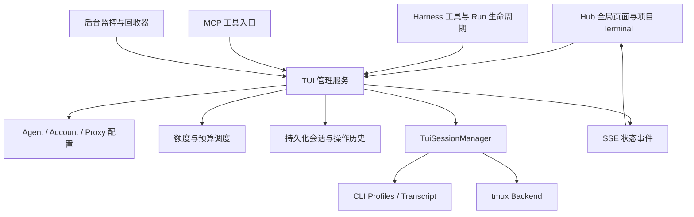

# TUI Agent 统一管理、配额与生命周期方案

- 日期：2026-11-02
- 状态：已实现
- 范围：Agent 配置、网络代理、账号配额、Task Run 归属、运行会话、自动回收与操作历史
- 关联设计：[交互式 Agent CLI 与 tmux 架构](agent-cli-tui-tmux-session-plan.md)

## 1. 目标与边界

在 Web Hub 增加全局「TUI Agents」管理入口，让用户能够回答：

1. 有哪些 Agent，使用哪个账号、模型和网络代理？
2. 哪些 sessions 正在运行，分别由哪个 task run 开启、当前归谁管理？
3. 最后一次操作是什么、何时发生，Agent 是否仍在实际工作？
4. 账号周/月额度与本地预算还剩多少，哪些任务正在等待额度？
5. task run 停止或会话长期不用后，何时停止执行、何时释放资源？
6. 已回收的会话及历史操作如何查询和追溯？

项目 Terminal 保留快捷入口，与全局页面复用会话组件和服务。这里的“代理”同时包括 CLI Agent 和 HTTP/HTTPS 网络代理。

第一版面向单个 OpenDuck 管理服务及其管理的本机 sessions；不扩展为跨机器进程编排系统。服务商额度能力按实际 CLI 支持情况接入，不假定所有 CLI 都提供结构化配额接口。

## 2. 当前实现与缺口

| 位置 | 已有能力 | 需要补齐 |
|---|---|---|
| `crates/openduck-mcp/src/tui_session/session.rs` | `TuiSessionManager` 启动、列举、查找、停止、过期清理 | 持久化、重启接管、后台监控、归属与操作历史 |
| `crates/openduck-mcp/src/tui_session/profiles/mod.rs` | CLI profile、pane 状态、model/effort/proxy/超时配置 | 账号绑定、配额适配及管理层元数据 |
| `crates/openduck/src/control/terminal.rs` | control 层共享 manager、项目会话操作 | 全局管理 API 和统一策略入口 |
| `crates/openduck/src/control/tui_agent_extension.rs` | Harness TUI 工具适配 | 注入可信 task/run/subtask 上下文 |
| `crates/openduck/src/control/project_harness.rs`、`harness.rs` | run 启动、取消与历史 | run 生命周期事件与会话回收联动 |
| `crates/openduck/src/control/app_config.rs` | 命名网络代理配置 | Agent 引用、直连/继承语义及检查 |
| `ui/hub/src/components/ProjectTerminal.tsx` | 项目级 session 列表与操作 | 全局页面、归属信息、历史和回收倒计时 |

当前 session 注册表保存在内存中；tmux 进程存活不代表服务重启后能自动接管。列表状态主要依赖缓存，回收在部分会话操作中触发。`last_activity_unix_secs` 主要由输入更新，不能独立表达用户操作、执行进展和后台检查。停止 session 后会从注册表移除，尚无独立的统一历史账本。

## 3. 统一架构



control 层负责归属、持久化、配额、调度和回收策略；现有 `tui_session` 负责 CLI、终端与 transcript。REST、Harness、独立 MCP 的受管操作必须经过同一管理服务，避免不同进程各自持有注册表或绕过预算。

独立 MCP 通过管理客户端连接服务。若保留独立运行模式，应明确标为不受集中管理，不得在 UI 中宣称其受统一预算约束。历史工具名保持兼容。

## 4. 管理对象与持久化模型

建议使用 SQLite 事务保存管理数据；实际落地先复用仓库合适的存储设施，避免引入重复数据库。配置、事件与大体积终端输出分开存放。

| 对象 | 关键内容 |
|---|---|
| AgentProfile | CLI 类型、默认 model/effort、account_id、proxy 策略、最大并发、生命周期策略 |
| Account | 账号标识、CLI 认证配置引用、登录状态、配额池关联 |
| Proxy | 复用已有代理 ID、URL、说明；检查结果单独记录 |
| Session | 不可复用的内部 ID、终端定位、创建来源、当前归属、实际启动配置、状态与时间 |
| SessionRunBinding | session 与 run 的创建、使用、归属转移和解除关系 |
| SessionOperation | 操作、操作者、task/run 上下文、时间、结果及输出引用 |
| QuotaPool / QuotaSnapshot | 实际账号额度池、窗口、适用模型、观测值与来源 |
| UsageLedger / Reservation | 本地用量、预算预留、结算与释放 |

session 的内部 ID 永不复用；用户指定名称作为展示别名。历史引用内部 ID，避免重启同名 session 后串联历史。

### 4.1 网络代理与账号

网络代理优先级为：会话显式设置 > Agent 默认设置 > 全局默认设置。配置必须区分 `inherit`、`direct`、`proxy_id`，不能用空值同时表达继承和直连。

session 保存实际解析出的代理引用和配置版本。修改默认代理只影响新进程；运行中的 session 显示“重启后应用”。按 CLI 能力设置相关代理环境变量，并确保选择直连时不会意外继承旧代理。

账号通过 CLI 支持的认证目录或凭据引用绑定。启动后核验可获取的实际账号身份；身份不明时标记未知，不能归入已确认账号额度池。认证引用和代理认证信息不写入操作摘要、普通 API 或日志。

### 4.2 Task Run 归属

session 至少保存：

| 字段 | 语义 |
|---|---|
| `created_by_project_id`、`created_by_task_id`、`created_by_run_id` | 不可变的创建来源 |
| `created_by_subtask_id` | 创建时的子任务，可不适用 |
| `creation_source` | Harness、人工、MCP、历史认领等 |
| `owner_run_id` | 当前生命周期归属；人工会话可没有 run |
| `ownership_mode` | run 专属、人工、显式共享 |
| `generation` | 归属与控制变更版本，用于并发检查 |

task ID 不能替代 run ID。同一任务的重试、续跑和定时执行必须可区分。run 标识应在启动执行前稳定生成，并与最终历史记录关联；若现有运行中 job ID 与历史 run ID 不同，需要持久化两者映射，不能事后靠文件名推断。

上下文由 Harness 注入，不接受模型提供的归属作为事实。可在每次 run 创建扩展时绑定上下文；共享执行入口需要传递调用上下文时再扩展 trait。session 启动前登记归属及启动意图，保证启动期间取消也能清理。

创建来源永久保留；复用时增加 binding 事件，并显式转移当前归属。默认不允许多个 run 同时向同一 session 输入。共享模式记录有效使用租约，只能在所有租约释放后按共享策略回收。人工接管必须显式改变控制权及生命周期责任，不能因打开终端就自动脱离原 run。

### 4.3 时间字段

| 字段 | 更新条件 |
|---|---|
| `created_at` | 创建记录 |
| `last_operation_at` | 显式操作请求，关联最后操作 ID、类型、操作者和结果 |
| `last_input_at` | 消息或按键成功提交 |
| `last_progress_at` | transcript 或可靠执行事件出现有效进展 |
| `last_observed_at` | 后台检查完成 |
| `idle_since` | 经确认进入空闲状态 |
| `owner_terminal_at` | 当前 owner run 进入终态 |
| `reclaim_after` | 当前策略计算的预计回收时间 |
| `stopped_at`、`reclaimed_at` | 执行终止、资源释放确认 |

时间持久化为 UTC，UI 按用户时区展示。后台轮询、自动刷新、spinner 动画不算有效活动。人工 read/list 可记为操作，但不更新空闲续期；失败输入也不能延长存活时间。需要保留时提供独立的“延长保留时间”操作。

## 5. 状态与生命周期

进程存活、TUI 状态和管理生命周期分别记录：

- 进程状态：存活、退出、未知。探测失败不直接等同进程退出。
- TUI 状态：沿用 initializing、idle_prompt、working、waiting_approval、exited。
- 管理状态：starting、active、retained、reclaim_pending、stopping、reclaimed、cleanup_failed。
- 调度阻塞原因：额度不足、owner 已结束、人工控制中等，独立于 pane 状态。

保留状态不意味着允许继续执行。例如用户停止任务后应立即停止其专属 session 的工作，历史数据仍然保留。

### 5.1 默认回收策略

以下为建议初始值，支持全局与 Agent 级配置，并允许有记录的单次延期。

| 场景 | 策略 |
|---|---|
| run stop/cancel | 立即封禁该 run 后续输入并打断专属会话；最多等待 30 秒后终止受管进程与 pane |
| run 正常完成 | 空闲会话保留 10 分钟；若仍工作则先打断，不能因父 run 结束继续无主执行 |
| run 失败 | 打断并保存现场，最多等待 30 秒后终止；静态现场保留供排查，空闲进程最多保留 10 分钟 |
| 无活动 owner 的人工/空闲会话 | 默认 30 分钟无有效使用后回收 |
| 等待审批 | 提醒用户，默认 30 分钟未处理后回收，可延期 |
| working 长时间无进展 | 15 分钟标记疑似卡住并提醒；结合回合最大执行时间确认后打断，不能仅因没有输入终止 |
| 已退出会话 | 保存终态，释放残余资源并转入历史 |
| owner 无法确认 | 标记 orphaned，重试对账；默认 10 分钟宽限后按孤立会话策略回收 |

工作中的回合必须有可配置的最大执行时间；疑似卡住阈值和硬超时是不同设置。人工延期延长保留期限，不覆盖已停止 run 的执行禁令。要继续工作，需要显式接管或绑定新 run。

旧 run 的终态事件只能影响它仍拥有或仍持有租约的 sessions。检查当前 generation 后再执行回收，避免终止已经转交新 run 的会话。

### 5.2 回收执行与竞态

1. run 生命周期事件触发候选回收；后台回收器每 30 秒兜底扫描。
2. 在事务中重新验证归属、租约、状态、保留期限和 generation，设置停止栅栏。
3. 串行协调同一 session 的输入、接管与停止操作，停止后拒绝旧 owner 的排队输入。
4. 保存最终可获取的终端快照、transcript 引用、原因及停止意图。
5. 发送温和打断；到期后终止受管 CLI 及其可追踪进程组并销毁 pane。
6. 核验退出与资源释放，持久化结果，结算或标记待核对的预算预留。

停止失败时保持 `cleanup_failed`，记录原因并有限退避重试，不能直接删除注册记录。跨进程恢复通过持久化停止意图继续清理。对于无法追踪的已脱离进程，需要报告清理未完成，不能宣称所有子进程已退出。

取消期间创建新 pane 的操作必须在创建后再次检查停止栅栏，并立即清理，防止晚到进程泄漏。事件处理和停止接口具有幂等性。

### 5.3 重启接管

服务启动后先加载持久化记录，再扫描专用 tmux socket 的 panes，核对内部 ID、pane 标识及进程身份：

- 记录与进程一致：重建 handle，恢复归属、状态监控、transcript 游标和回收期限。
- 有记录但进程确认消失：标记退出，补齐历史与预留核对。
- 存在未登记 pane：标为待认领，不根据 cwd 猜测 task run；认领前禁止自动派发。
- 发现待执行停止意图：继续清理，不重新放行输入。

不在持有全局 registry 锁时逐个执行慢速 tmux 检查。采样失败显示状态未知，并保留错误信息供详情查询。

## 6. Weekly / Monthly Quota 与本地预算

### 6.1 配额归属与窗口

服务商额度与 OpenDuck 本地预算分别展示和执行。

| 类型 | 来源 | 约束能力 |
|---|---|---|
| 服务商额度 | 可用结构化接口、CLI 状态、日志或屏幕解析 | 展示额度与恢复时间，识别受限状态，停止继续派发 |
| 本地预算 | 用户配置与用量账本 | 对受管调用执行账号/项目周月预算、并发及预留检查 |

按实际账号和服务商配额池汇总。同账号多个 sessions 共享对应额度；模型是否共享配额由适配器描述。额度池可覆盖短窗口、周、月及特定模型范围，不假定所有服务商均有月额度。

窗口支持自然周/月、滚动窗口、服务商指定起止时间，并记录适用时区。weekly 不必在周一重置，monthly 不必等于自然月。

QuotaSnapshot 保存：池 ID、适用模型、计量单位、已用量/上限或剩余百分比、窗口起止、reset_at、来源、采集时间和有效期。未知绝对值不能通过百分比虚构；状态包括有效、过期、未知、不支持。未知不显示为无限额度。

### 6.2 采集与调度

优先结构化数据，其次可靠日志，最后屏幕解析。需要向 TUI 输入状态命令时，仅在空闲且取得输入控制权后执行，并记录该操作。不得在正在执行任务时注入探测命令。

建议初始策略：

- 达到 80%：提醒。
- 达到 95%：限制新增并发，提示调整任务。
- 本地硬限制或服务商明确限额：停止派发新回合，任务进入额度等待队列。
- 到达预计重置时间：重新核验后放行；不只靠本地时间清除明确的服务商限额。
- 自动切换模型或账号：仅按预配置回退策略执行，并记录原因。

每次 prompt 提交前检查所有适用预算，在事务中原子预留，避免并发越限。完成后按实际用量结算，失败或取消时核对已消耗用量；不能将未知消耗直接当作零释放。预留具有过期核对机制，服务崩溃后不能永久占用或盲目释放。

同一次服务商用量观测与本地调用结算不能重复计费。记录用量来源及去重标识。估算与确认用量分别标识，不承诺 token 不可见时能够精确限制实际费用。

已开始的回合默认允许完成；严格模式可尝试打断，但不能保证外部 CLI 立即停止计费。人工直接 attach 的操作可观测、可对账，不能承诺完全受本地预算控制。

## 7. 历史会话与操作列表

### 7.1 两类历史

**历史会话**保留创建来源、所有 run bindings、启动配置快照、账号/代理引用、起止时间、最后操作、终态、停止及回收原因。释放进程或内存 handle 不删除这条记录。

**操作历史**跨运行中和已结束会话查询，至少包含：

| 字段 | 内容 |
|---|---|
| 标识 | operation_id、session_id、请求/工具调用关联 ID |
| 上下文 | project、task、run、subtask |
| 操作者 | 人工、Harness、MCP、系统回收器 |
| 类型 | start、prompt、keys、approval、read、list、interrupt、takeover、transfer、extend、stop、reclaim、exit |
| 时间与结果 | 开始/结束时间、请求状态、结果、错误、耗时 |
| 内容 | 脱敏摘要、输出引用、停止/回收原因 |

先记录操作意图，再记录完成或失败；服务崩溃导致结果不明时标为待核对，不伪装成功。对长 prompt 和输出使用独立内容引用，默认列表只展示摘要。按键操作保存可理解的类型，敏感输入不保存原文。

显式 read/list 可记录请求；一次全局 list 记录一个查询事件，不为每个 session 制造重复操作。高频自动监控不逐条进入操作历史，只记录有意义的状态变化。人工直接 tmux 输入如无法可靠捕获，显示观测来源及能力边界，不伪造完整操作审计。

### 7.2 保存期限

- 会话元数据、归属和操作索引：默认 90 天，可配置。
- 完整输出和终端快照：默认 30 天，可配置；到期后索引显示内容已过期。
- 配额账本与预留：保留到相关预算窗口关闭且完成核对，再按配置归档。
- 清理受管输出文件时不顺带删除外部 CLI 自有历史。

“回收 session”仅停止执行并释放资源；“清除历史”是独立操作。

## 8. Web Hub 与接口

### 8.1 页面

全局「TUI Agents」包含：

| 视图 | 内容 |
|---|---|
| 概览 | working、idle、waiting approval、额度阻塞、即将回收及待认领数量 |
| Agents | CLI、账号、模型、代理、并发与回收策略 |
| Sessions / 运行中 | 跨项目 sessions、owner、最后操作、有效进展、预计回收及原因 |
| Sessions / 历史会话 | 已退出/回收 sessions 与 run 关联 |
| 操作历史 | 按时间、session、task/run、操作者、操作类型、结果筛选 |
| Accounts & Quotas | 周/月额度、本地预算、采集来源、更新时间、重置时间及历史用量 |

运行中列表主要列：Agent、Account、Project、创建 Task/Run、当前 Owner Run、Model、State、最后操作及时间、无活动时长、Proxy、预计回收时间。

session 详情展示终端、transcript、操作时间线、归属变更、配额和生命周期策略；提供发送、审批、打断、停止、接管、延期和明确的归属转移入口。已回收 session 的“恢复”创建新内部 session ID，保留与旧会话的恢复关系。

Task Run 详情增加「关联 TUI Sessions」，分别显示创建和使用的会话，并可跳转历史。项目 Terminal 默认按项目过滤，复用详情组件。

### 8.2 接口方向

沿用现有 `/api/v1/projects/{slug}/tui-sessions` 兼容接口，新增全局资源；最终命名按现有路由风格确定：

```text
GET/POST    /api/v1/tui-agents
GET/PATCH   /api/v1/tui-agents/{id}
GET         /api/v1/tui-sessions                  # 状态/项目/task/run/时间过滤及分页
GET         /api/v1/tui-sessions/{id}
GET         /api/v1/tui-sessions/{id}/operations
GET         /api/v1/tui-operations                # 全局操作历史，支持游标分页
POST        /api/v1/tui-sessions/{id}/interrupt
POST        /api/v1/tui-sessions/{id}/stop
POST        /api/v1/tui-sessions/{id}/takeover
POST        /api/v1/tui-sessions/{id}/transfer
POST        /api/v1/tui-sessions/{id}/extend
GET         /api/v1/tui-accounts/{id}/quotas
POST        /api/v1/tui-accounts/{id}/quotas/refresh
GET         /api/v1/tui-events                    # SSE，带版本/事件 ID
```

所有操作经同一服务校验。项目接口先验证 session 项目归属；全局视图沿用现有访问控制。SSE 支持断线后补查快照，不默认推送所有终端内容；仅订阅打开的详情输出。

## 9. 兼容与迁移

1. 读取已有 `harness.tui_sessions`，作为默认 Agent 配置的兼容来源；明确新旧配置优先级，避免两处互相覆盖。
2. 现有 `https_proxy` 兼容为显式代理配置，逐步迁移为命名引用。
3. 现有 MCP 工具名、项目 REST 路径保持可用，内部转发管理服务。
4. 无法确认来源的旧会话标记 legacy/unknown，不凭 cwd 填充 run ID。
5. 先完成身份登记和重启对账，再启用自动回收；迁移时对无法确认 owner 的会话应用宽限策略。
6. 若实现修改 agent-loop 行为，按仓库要求同时覆盖 legacy agent loop 和 state machine 路径；共同管理层策略优先集中实现。

## 10. 实施阶段

### 阶段一：归属、生命周期与历史

- 建立持久化 session、run binding、操作账本和停止意图。
- 注入运行中稳定 run 身份，关联最终历史 run。
- 接入取消、完成、失败事件，处理启动取消与归属转移竞态。
- 增加后台监控、回收、重启接管和失败重试。
- 实现全局运行/历史列表、最后操作、回收倒计时及 Task Run 关联视图。

这一阶段优先解决“谁开启、谁负责、何时回收、回收后如何追溯”。

### 阶段二：Agent、账号与网络代理配置

- 复用命名代理，完善 inherit/direct/指定代理语义。
- Agent 默认配置、账号认证引用、实际身份核验、并发限制。
- 配置修改与运行时快照分离，提供代理检查。

### 阶段三：本地预算与额度调度

- 周/月预算、用量账本、事务预留与崩溃核对。
- prompt 前检查、等待队列、恢复与幂等提交。
- 账号/项目预算展示和额度事件。

### 阶段四：服务商配额适配

- 按实际使用的 CLI 逐个验证数据来源与账号归属。
- 接入结构化采集或可靠解析、限额识别、重置核验。
- 明确显示未知、过期与不支持状态，补齐预配置回退策略。

若后续用于上游 PR，实施前应按仓库贡献流程拆分 issue 并确认 Ready；本文件本身不代表实现已获上游设计批准。

## 11. 验收与验证计划

| 场景 | 验收结果 |
|---|---|
| task 多次运行与子任务启动 session | 创建 run、当前 owner、subtask 准确可追溯 |
| 启动中取消、重复 stop、异常退出 | 无晚到会话泄漏；操作与停止结果可追溯 |
| run 完成、失败、取消 | 按策略停止执行或保留空闲资源，不继续无主工作 |
| session 转交新 run 后旧 run 停止 | 新 owner 的 session 不被误回收 |
| 并发输入与回收 | 通过停止栅栏/版本校验串行处理，无停止后晚到提交 |
| 长时间空闲、等待审批 | 到期自动回收，人工延期有记录 |
| working 无输入但有进展 | 不因缺少用户输入而误回收 |
| 自动轮询与人工查看 | 不意外刷新空闲续期时间 |
| 服务重启、清理中崩溃 | 接管存活 session，恢复归属及未完成清理 |
| tmux 检查错误、kill 失败 | 状态未知或 cleanup_failed，不伪报释放成功 |
| 已回收或同名重建 session | 历史和内部 ID 保留，操作记录不串线 |
| 同账号多 session、并发预算预留 | 共享适用额度池，本地预算不因竞争重复放行 |
| 用量未知、采样过期、窗口重置 | 不虚构额度或消费，按来源与核验结果处理 |
| 队列取消与额度恢复 | 已取消 run 不复活，未取消请求不重复提交 |

后续实现优先在仓库推荐的 `tests/` 目录覆盖归属、竞态、恢复、预算及历史查询，使用可控时钟和 mock backend 避免真实等待。CLI 配额解析采用脱敏固定样本，另安排实际 CLI 冒烟验证。

功能实施时更新 `openduck-self-test.yaml`；按用户授权执行相应构建、测试与 recipe 验证。Rust 修改执行 `cargo fmt`，合并前按仓库要求执行 clippy。本次仅编写方案，不运行构建或测试。
