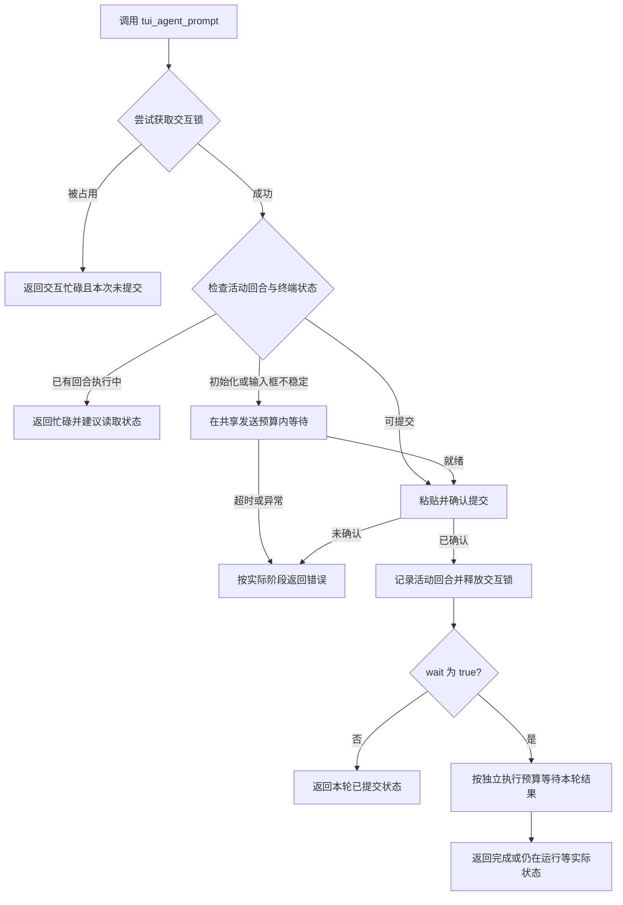

# TUI Session Prompt 阻塞超时排查与系统性修复方案

## 1. 事件背景 (Incident Overview)

在调度执行任务 `task_01a1d2d0-b9b5-7573-99de-55890ac99d59`（子任务 `implement-mqtt-broker-ptt-business`）时，系统启动并调用了 TUI Agent 会话 `agy_1794539108810`。在此期间，该任务在发送 Prompt 操作处出现了长达 **整整 20 分钟（1200 秒）** 的静默挂起，最终以输入框未就绪报错超时结束。

### 关键元数据
- **Task Run ID**: `task_01a1d2d0-b9b5-7573-99de-55890ac99d59`
- **Session Name**: `agy_1794539108810`
- **Session ID**: `sess_330549cc-176f-494c-acf2-bae1b79d0274`
- **Agent Kind**: `agy` (Gemini 3.8 Flash, High Effort)
- **Workspace CWD**: `/mnt/e/mqtt-broker-ptt`
- **关联工程**: `ASR1606` / `mqtt-broker-ptt`

---

## 2. 现场取证与时间线还原 (Timeline & Evidence)

通过对 `~/.local/share/openduck/control.db` 中的 `tui_session_operations` 记录以及 tmux pane 缓冲区历史分析，还原完整时间线如下（时间均为 UTC）：

| 时间 (UTC) | 操作 ID | 类型 | 耗时 (ms) | 状态 | 操作摘要与现场细节 |
| :--- | :--- | :--- | :--- | :--- | :--- |
| **03:05:08.811** | `op_e3538c86` | `start` | 576 | `succeeded` | 启动 TUI 会话 `agy_1794539108810`。 |
| **03:05:09.423** | `op_ad1e1d62` | `prompt` | 3,767 | `succeeded` | 下发第一条指令（PTT 信令服务总体设计与子任务 1 规划实现）。以异步方式写入并触发 agy 运行。 |
| **03:05:15.164** | `op_4986f41b` | `prompt` | **1,200,077** | **`failed`** | 调度器在 6 秒后抢发第二条指令：`"Implement now per task instructions, update notes, test."`。**由此引发长达 20 分钟死等**。 |
| **03:25:15.241** | `op_4986f41b` | `prompt` | - | `failed` | 达到 1200 秒超时上限抛错：<br>`Session 'agy_1794539108810': input composer did not become ready (Working { status_line: Some("⢿ Running command...") }); prompt was not submitted` |
| **03:25:28.636** | `op_661fe3ad` | `keys` | 0 | `succeeded` | 人工手动向 tmux pane 注入 `Escape` 键打断。 |
| **03:25:31.876** | `op_2f714a4d` | `prompt` | 158,505 | `succeeded` | 下发收尾指令（要求暂停修改代码、完成测试并汇报状态），agy 恢复响应并输出结果。 |

### 终端底层真实工作状态取证
在 `op_4986f41b` 被阻塞挂起的 20 分钟内，后台 tmux 中的 agy 并非假死，而是由于前序任务量巨大而持续忙碌：
1. **长推理思考**：单次模型推理耗时 **6 分 30 秒** (`Thought for 6m 30s`)；
2. **重度工具调用**：累计执行 **175+ 项动作**（30 次读文件、33 次代码编辑、51 次终端命令，包含 WSL/9p 跨磁盘多次 `cargo test --workspace` 与编译构建）；
3. **输入框被占用**：终端从始至终显示 `Working { status_line: Some("⢿ Running command...") }`，输入框处于锁定状态。

---

## 3. 根因深度剖析 (Root Cause Analysis)

### 3.1 调度层行为脱节 (Orchestrator Misalignment)
按正确设计，如果使用异步模式（`wait: false`）向 TUI 会话发送 prompt，调度层在收到发送成功的反馈后，**必须通过 `tui_agent_read` 开启周期性状态检查**，直到确认本轮已经完成并且状态变为 `idle_prompt`，或会话退出。即使使用 `wait: true`，调用也可能因等待预算耗尽而返回 `Working`，此时仍必须继续观察状态。
然而，本次调度 Agent 在第一条 prompt 发送完毕后，没有启动轮询，反而在短短 6 秒后连续发出了第二条 prompt，造成指令争抢。

### 3.2 底层代码混淆了“输入框就绪超时”与“回合总超时” (Timeout Conflation)
在 [`crates/openduck-mcp/src/tui_session/session.rs:210`](file:///mnt/e/openduck-harness/crates/openduck-mcp/src/tui_session/session.rs#L210)：
```rust
pub async fn send_prompt(
    &self,
    prompt: &str,
    wait: bool,
    timeout: Duration,
) -> Result<TuiTurnResult> {
    ...
    let start_time = Instant::now();

    // BUG 根源：将整次回合运行超时 (timeout = 1200s) 直接传给了 settle_startup
    let state = self.settle_startup(timeout).await?;
```
- 参数 `timeout` 的本意是：**“给大模型生成和命令执行预留的最大回合运行时间”**（此处为 1200 秒）。
- 函数 `settle_startup` 的本意是：**“在把 Prompt 粘贴到输入框前，短暂等待 TUI 界面稳定”**（正常应为 3~10 秒）。
- **缺陷表现**：当 agy 正在全速执行上一条任务时，`settle_startup` 发现状态为 `Working`，它并没有快速退出，而是陷入了每隔 200ms 的死等轮询，**硬生生等满了整整 1200 秒**！

### 3.3 缺乏 Fail-Fast 与明确的引导报错
当 `settle_startup` 轮询耗尽后，抛出的错误是通用的：
`"Session '{}': input composer did not become ready ({state:?}); prompt was not submitted"`
它没有识别 `TuiPaneState::Working` 这一典型忙碌状态，既没有在 5~10 秒内快速报错（Fail-Fast），也没有在错误信息中明确告知调用方“前置任务正在运行，请使用 `tui_agent_read` 观察”。

### 3.4 工具定义描述缺乏并发使用约束
在 `tui_agent_prompt` 的 Tool Description 中，未明确提示大模型：
> “禁止向处于 Working 状态的 Session 重复发送 Prompt；若前置 Prompt 采用 wait=false，必须先用 tui_agent_read 轮询至 idle_prompt。”

这可能使协调大模型误以为可以随意向同一个 session 追加 prompt；仅凭工具描述不能证明本次调度决策的原因。

---

## 4. 修订后的解决方案

现有归因能够解释本次 `wait=false` 后第二次 prompt 等满 1200 秒的现象，但仅限制 `settle_startup` 不足以覆盖并发调用。修复需要同时处理交互锁、发送前预算和回合等待。

### 4.1 交互锁与回合等待分离

当前 `send_prompt` 在 `start_time` 创建前等待 `interaction.lock()`，并一直持锁到回合等待结束；`send_keys` 也使用这把锁。因此，前一次 `wait=true` 调用可能让后续 prompt 和通过工具发送的 Escape 排队数分钟。composer 超时不能限制这段锁等待。

调整为：

1. prompt 使用 `interaction.try_lock()`；锁正在被占用时立即返回明确的交互忙碌错误，说明本次 prompt 尚未提交，并建议用 `tui_agent_read` 观察。
2. 锁只覆盖状态检查、composer 就绪检查、粘贴和提交确认。确认提交后释放锁，再进入回合完成等待。
3. `send_keys` 继续与粘贴、提交阶段互斥，避免按键破坏提交过程；回合执行期间允许发送 Escape 等人工控制按键。按键获取锁也应有明确的短等待预算，耗尽后返回交互忙碌，不能无限排队。
4. 对已经在执行的回合返回忙碌，不将新 prompt 隐式排队。不要仅依赖调用方此前读到的 Idle 快照；在持锁后重新检查状态。

缩短锁范围还需要维护回合归属：`wait=false` 刚返回时，屏幕可能仍显示上一帧 Idle。提交确认后应记录活动回合，不能因为一次 Idle 快照就允许下一次提交。同步等待者也必须关联本轮回合，避免读到后续回合的输出。

实现时需核查 `transcript_offset`、`last_state` 和 `last_screen` 的并发更新：当前同步等待结束时读取 transcript，不能让新回合提交与旧回合结果提取交错而混入输出。应在完成状态和结果边界确定后再开放下一次提交，或使用等价的回合标识与输出边界机制。

### 4.2 发送前采用共享的 10 秒预算

不能分别给 `settle_startup` 和 `wait_for_agy_composer` 各 10 秒，再让 `submit_agy_prompt` 额外等待 10 秒。它们应共享一个发送阶段 deadline，包括状态检查、composer 检查、粘贴和提交确认。

概念流程如下，具体接口随实现调整：

```rust
let submission_deadline = Instant::now() + MAX_SUBMISSION_TIMEOUT;
let interaction = self.interaction.try_lock()
    .map_err(|_| anyhow!("Session interaction is busy; prompt was not submitted"))?;

// 各发送阶段使用同一个 deadline 的剩余预算。
```

- 已有回合正在 Working：尽快返回忙碌，并引导调用方使用 `tui_agent_read`；初始化或 composer 短暂不稳定才使用剩余预算等待。
- `settle_startup` 也用于会话启动，不应直接全局改变其 Working 行为。可提取发送专用的就绪检查，保留启动路径的既有语义。
- agy 的空 prompt 在等待和粘贴前校验。
- 审批、配额和退出状态分别返回可操作的结果。现有 `settle_startup` 支持 `auto_approve`，发送路径必须明确是否保留该策略，避免无意改变审批行为。
- 若要承诺发送阶段耗时上限，deadline 还必须覆盖 backend 的异步调用，而不仅是轮询循环条件。

超时取消不等于底层操作没有发生。粘贴或 Enter 调用超时后，终端可能已经接受操作，必须返回提交状态不确定，要求先检查会话，不能声称安全重试。

### 4.3 区分未提交与提交结果不确定

至少区分以下情况，供调用方决定下一步：

| 情况 | 返回语义 | 调用方动作 |
| :--- | :--- | :--- |
| 交互锁被占用、已有回合运行、粘贴前就绪检查超时 | 本次 prompt 未提交 | 读取状态，满足条件后再尝试 |
| 已粘贴，尚未确认提交 | composer 可能残留文本 | 检查输入框，避免重复粘贴 |
| 已尝试 Enter，但未确认结果 | 提交结果不确定 | 读取状态和输出，避免重复执行 |
| 已确认提交，执行等待预算耗尽 | 回合仍可能运行 | 继续读取状态，不重发 prompt |

忙碌错误应包含 session、当前状态及 `tui_agent_read` 建议。若工具接口支持，优先使用结构化错误类型，避免调用方依赖字符串解析。不要因超时自动发送 Escape 或清空输入框。

### 4.4 明确执行超时语义

采用两个独立预算：

- **发送预算**：固定最多 10 秒，限制发送前检查与提交确认；交互锁竞争直接返回忙碌。
- **执行等待预算**：仅 `wait=true` 生效，在确认提交后开始计算，使用调用方传入的 `timeout_secs`。`wait=false` 在提交确认后返回，后续由调用方读取状态。

现有代码在发送前创建 `start_time`，执行循环也使用该计时；只修改 composer 超时并不能实现上述语义。实现时应另建执行 deadline，总耗时统计仍从调用入口开始记录。同步更新两处工具定义及参数说明，说明执行等待超时不会终止后台回合。



### 4.5 工具描述与调度约束

同时更新以下入口，保持接口说明一致：

- `crates/openduck/src/control/tui_agent_extension.rs`
- `crates/openduck-mcp/src/tui_session/mod.rs`

工具描述应明确：同一 session 同时只允许一个活动回合；提交成功不代表任务完成。`wait=false` 返回后，以及 `wait=true` 返回 Working 等未完成状态后，都必须使用 `tui_agent_read` 继续观察。审批、配额和退出分别处理，不能统一等待 Idle。

`wait=true` 可作为默认方式，但调度器仍必须检查返回状态。工具说明和错误提示只能引导 LLM，服务端必须执行并发约束，不能将说明文字视为互斥保障。

轮询需要合理间隔和总观察预算；预算耗尽时报告回合仍在运行，由调用方决定继续等待或显式中断，不自动重复发送任务。

## 5. 验证计划与验收标准

采用可控的 backend / 屏幕状态序列验证时间预算和副作用，避免仅靠真实模型运行 20 分钟复现。测试优先放在对应 crate 的 `tests/` 下。

| 场景 | 验收标准 |
| :--- | :--- |
| `wait=false` 提交后持续 Working，再次发送 prompt | 快速返回忙碌；第二条 prompt 没有 paste 和 Enter 副作用 |
| `wait=true` 等待长回合时并发发送 prompt | 不等待前一回合的执行预算；明确返回忙碌 |
| 长回合期间发送 Escape | 回合等待不持有交互锁；按键能够送达 |
| 粘贴提交阶段并发发送按键 | 不与提交操作交错；锁等待受限 |
| 初始化接近预算末尾才转 Idle，随后 agy composer 不稳定 | 全部发送阶段共享预算，不叠加多个 10 秒 |
| backend 捕获、粘贴或 Enter 调用超时 | 调用受 deadline 限制，错误准确描述是否已提交或结果不确定 |
| agy 已粘贴但提交确认失败 | 提示检查 composer，不建议直接重发 |
| 提交后短暂仍显示 Idle | 不提前认定回合完成，不允许第二条 prompt 抢入 |
| `wait=true` 执行预算耗尽，状态仍为 Working | 返回仍在运行状态；后台任务继续；新 prompt 被拒绝 |
| 发送阶段消耗时间，随后执行长回合 | 执行预算从提交确认后计算，不扣减发送耗时 |
| 审批、自动审批、配额、退出 | 状态和既有策略得到明确覆盖，无无限轮询 |
| 前一回合完成与下一回合提交交错 | 输出提取属于正确回合，transcript 边界和缓存状态不串扰 |
| 两套工具入口 | 描述、默认值、错误语义及超时说明一致 |

本次文档审阅未独立核验数据库记录和终端历史；事件时间线保留为原始调查结论。后续实现应保存脱敏后的操作记录、调用参数及终端证据，以区分已核实事实和推断。

预期效果是消除本次发送前误用 1200 秒回合预算造成的长等待，并避免并发 prompt 在交互锁上长期排队。这里是异步工具调用等待，不应描述为“主线程挂起”。完整验收还必须覆盖锁竞争、提交不确定性、长回合中断和输出归属，不能只验证错误文案或 composer 上限。


## 6. 本地实现记录

已在 `tui_session/session.rs` 实施以下修改：

- 使用独立的 prompt 操作锁，在同步回合等待和结果提取结束前拒绝另一条 prompt；交互锁只覆盖发送阶段。模型切换也受 prompt 操作锁约束。
- 发送阶段使用统一的 Tokio 10 秒超时，覆盖 backend 调用、就绪检查、粘贴和提交确认。Working 直接返回忙碌；启动路径的 `settle_startup` 行为保留。
- 确认提交后开始独立的执行等待计时。发送失败根据是否已尝试粘贴区分未提交与结果不确定。
- 按键获取交互锁最多等待 10 秒，回合等待期间可以发送 Escape。
- 对已有提交记录的会话，在再次发送前要求距提交至少 1 秒，且 Idle 屏幕稳定 800 毫秒，降低上一帧 Idle 导致重复提交的风险。此机制仍依赖终端状态识别，并非底层 CLI 提供的回合确认协议；如果 CLI 长时间保留旧 Idle 画面，仍有误判可能。
- 两处工具描述同步说明忙碌拒绝、发送预算和回合超时后继续轮询的要求。

已添加或更新忙碌拒绝、锁竞争、等待期间 Escape、执行超时后拒绝追加 prompt、发送预算回归用例。已执行 `cargo fmt --all` 和差异空白检查；遵循仓库要求，尚未执行构建、测试或 clippy。第 5 节是完整验收计划，不代表所有场景已经通过验证。
