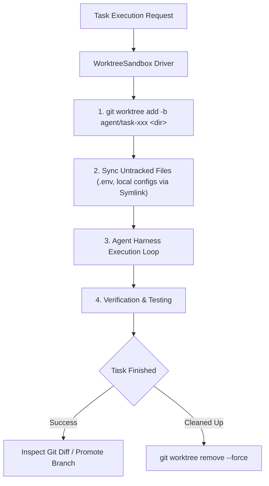

# Git Worktree Task Runner

The **Git Worktree Task Runner** enables OpenDuck agents and harness benchmark tasks to execute inside an isolated Git worktree on a dedicated branch, without interfering with your current workspace, uncommitted changes, or active editor state.

---

## 1. Why Use Git Worktrees for Agent Tasks?

When AI agents perform multi-step modifications, run builds, or execute automated test suites on a repository:
* **Zero Disruption to Working Tree:** Your current working branch and unstaged edits remain completely untouched.
* **Instant Spin-up:** Unlike Docker containers or full repository clones, `git worktree` takes milliseconds to initialize because it shares the existing `.git` object database.
* **Native Branching:** The agent works on a real branch (e.g. `agent/task-xyz`), making it trivial to review diffs, test changes, and submit pull requests.
* **Automatic Rollback & Snapshots:** Snapshotting is powered by `git stash create` and `git reset --hard`, enabling fast checkpointing and step recovery.

---

## 2. Core Features & Architecture



### Untracked File Propagation (Symlink by Default)
Because `git worktree` only checks out files tracked in Git, local settings and secrets like `.env` or `openduck.local.json` are missing by default.

OpenDuck's `WorktreeSandbox` automatically detects untracked configurations and links them into the worktree:
- **`Symlink` (Default):** Symbolic links point to your repository root's `.env` files. Both workspaces share the same live credentials, and deleting the worktree never deletes your original secrets.
- **`Copy`:** Creates independent duplicates if you want complete mutation isolation.
- **`None`:** Leaves the worktree pristine with tracked files only.

### Build Cache Sharing (`CARGO_TARGET_DIR`)
To avoid recompiling the entire Rust dependency graph in each worktree, the driver automatically injects `CARGO_TARGET_DIR=<repo_root>/target` into command environments, sharing compiled artifacts and significantly speeding up test runs.

---

## 3. CLI Usage

### Running a Prompt in an Isolated Worktree

To execute a prompt in a temporary worktree:

```bash
openduck harness run --prompt "Refactor error handling in git module" --worktree
```

Output:
```text
Initialized Git worktree at: "/tmp/openduck-worktree-a1b2c3d4"
Task running on isolated branch: 'agent/task-cli-task'
Running task 'cli-task' with Goose Agent...
Task finished with status: Success
Cassette saved to ...
```

### Specifying a Custom Branch Name

By default, OpenDuck generates a branch named `agent/task-<id>`. You can specify a custom branch name using `--worktree-branch`:

```bash
openduck harness run \
  --prompt "Implement network latency telemetry" \
  --worktree \
  --worktree-branch "feature/network-telemetry"
```

### Keeping the Worktree for Inspection

By default, OpenDuck removes the temporary worktree directory upon task completion while keeping the git branch intact. If you want to keep the worktree directory on disk to inspect files manually:

```bash
openduck harness run \
  --prompt "Add unit tests for serializer" \
  --worktree \
  --keep-worktree
```

---

## 4. Programmatic API (Rust)

You can use [`WorktreeSandbox`](file:///mnt/e/openduck-harness/crates/openduck-harness/src/sandbox/worktree.rs) directly in Rust when building custom agent loops or eval runners:

```rust
use openduck_harness::sandbox::worktree::{WorktreeConfig, WorktreeSandbox, UntrackedFileMode};
use openduck_harness::sandbox::SandboxDriver;
use openduck_harness::runtime::AgentHarness;
use std::path::PathBuf;

#[tokio::main]
async fn main() -> anyhow::Result<()> {
    let repo_root = PathBuf::from("/path/to/my-repo");
    
    // Configure the worktree
    let config = WorktreeConfig::new(repo_root)
        .with_branch("agent/experiment-1")
        .with_untracked_mode(UntrackedFileMode::Symlink);

    let mut sandbox = WorktreeSandbox::new(config);
    sandbox.initialize().await?;

    println!("Worktree ready at {:?}", sandbox.workspace_root());

    // Execute commands or attach to AgentHarness
    let output = sandbox
        .exec_command("cargo test", &Default::default())
        .await?;

    // Export the resulting git diff against base branch
    let diff = sandbox.export_diff().await?;
    println!("Changes:\n{}", diff);

    // Clean up worktree directory
    sandbox.cleanup().await?;

    Ok(())
}
```

---

## 5. Managing & Cleaning Up Worktrees Manually

If you need to inspect or prune worktrees manually using standard Git commands:

```bash
# List all active worktrees
git worktree list

# Remove a specific worktree directory
git worktree remove --force /path/to/worktree

# Prune metadata for deleted directories
git worktree prune

# Delete the branch if no longer needed
git branch -D agent/task-xyz
```
